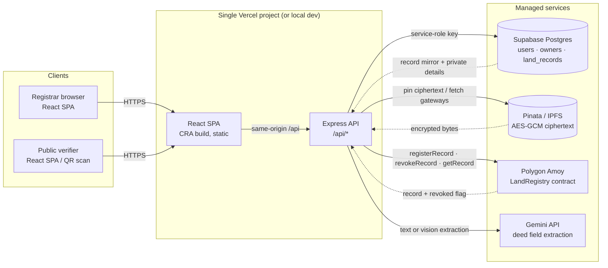
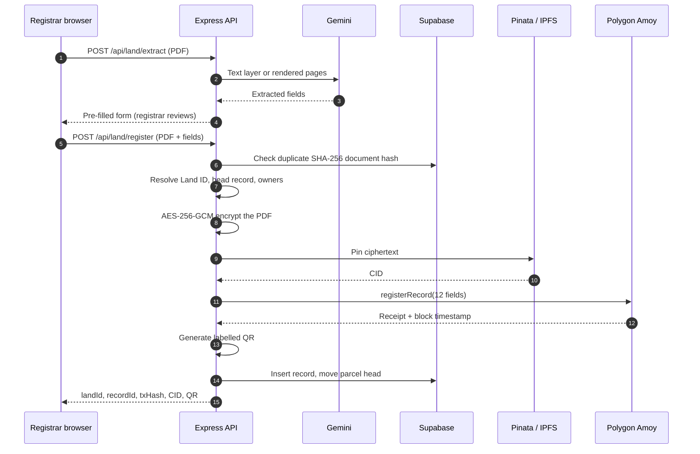

# NOSIH — Land Deed Registry

> Register land deeds as encrypted PDFs on IPFS, anchor their fingerprints on Polygon, keep personal details in an access-controlled Postgres database, and let anyone verify a parcel's ownership history from a Land ID or QR code.

**Network:** Polygon Amoy (chain ID `80002`) · **Contract:** Solidity `0.8.20` · **App:** Express 4 + React 18 · **Storage:** Supabase Postgres + Pinata IPFS

The testnet deployment configured in this checkout is `0xE5a941d9628A7d7Ab497636A204B627F29070952`. Confirm it against `backend/.env` before relying on it.

---

## Contents

- [Overview](#overview)
- [Architecture](#architecture)
- [How It Works](#how-it-works)
- [Identity, Hashing and Privacy](#identity-hashing-and-privacy)
- [Ownership Chain and Linking](#ownership-chain-and-linking)
- [Smart Contract](#smart-contract)
- [Data Model](#data-model)
- [API Reference](#api-reference)
- [Frontend](#frontend)
- [QR Codes](#qr-codes)
- [Project Structure](#project-structure)
- [Tech Stack](#tech-stack)
- [Prerequisites](#prerequisites)
- [Environment Variables](#environment-variables)
- [Setup from Scratch](#setup-from-scratch)
- [Local Development](#local-development)
- [Testing](#testing)
- [Deploy to Vercel](#deploy-to-vercel)
- [Security Controls](#security-controls)
- [Operations Runbook](#operations-runbook)
- [Known Limitations](#known-limitations)
- [Troubleshooting](#troubleshooting)
- [Disclaimer](#disclaimer)

---

## Overview

NOSIH is a registrar-operated land deed registry with a public verification portal.

| Capability | Who | Where |
|---|---|---|
| Register a deed (PDF only, AI pre-fill) | Registrar (signed in) | `/register` |
| Browse, search, open decrypted deeds, download QR, revoke | Registrar | `/records` |
| Dashboard counters and recent records | Registrar | `/` |
| Verify a Land ID, inspect ownership history, compare a PDF | Public | `/verify?landId=LAND-…` |
| Create registrar accounts | Admin user | `POST /api/auth/register` |

What the system establishes:

- Every registration is anchored with a single Polygon transaction containing content hashes, the CID of the encrypted deed, and owner registry IDs.
- The deed itself is encrypted with AES-256-GCM before it leaves the API; IPFS only ever stores ciphertext.
- Public verification confirms that each record exists on-chain and that the document hash, property hash, and revocation status match the off-chain mirror.
- A new deed for the same parcel links to the current head of that parcel's ownership chain.

What it does **not** establish:

- It does not prove legal title or the authenticity of the underlying transaction. A hash match only proves that a document matches a registered version.
- It is not fully decentralised: a registrar, a database, an IPFS pinning service, and an RPC provider remain trusted infrastructure.
- It does not make owners anonymous. Owner IDs are pseudonymous, but repeated appearances are linkable; coarse location is public by design.

---

## Architecture

### System diagram



The browser never talks to Supabase, Pinata, or Polygon directly. All privileged access is mediated by the API. The public verification page calls the same API, which cross-checks Supabase against the chain.

### Layers

| Layer | Components | Responsibility |
|---|---|---|
| Experience | `frontend/src` (React 18, React Router, axios, dropzone, Lucide) | Registrar portal, public verifier, QR/timeline rendering |
| Application | `backend/server.js`, `routes/*`, `middleware/auth.js` | HTTP surface, JWT auth, validation, upload limits, CORS |
| Domain services | `services/landIdentity.js`, `ai.js`, `ipfs.js`, `blockchain.js`, `qr.js` | Parcel identity, hashing, encryption, extraction, pinning, chain calls, QR generation |
| Persistence and anchors | Supabase Postgres, Pinata IPFS, LandRegistry on Polygon Amoy | Private details and mirrors, encrypted content, immutable fingerprints |

### Component responsibilities

| Component | File | Responsibility |
|---|---|---|
| API entrypoint | `backend/server.js` | CORS, JSON parsing, routes, health check, error handler, local listener |
| Runtime config | `backend/config.js` | Upload cap (15 MB local, 4 MB on Vercel) |
| Database client | `backend/supabase.js` | Service-role client, boot connectivity check, row mappers |
| Auth middleware | `backend/middleware/auth.js` | JWT verification, `adminOnly` guard, JWT boot guard |
| Registrar routes | `backend/routes/land.js` | Extract, preview, register, list, stats, record detail, document, revoke |
| Public routes | `backend/routes/verify.js` | Parcel timeline, chain checks, policy-gated document view, PDF comparison, QR |
| Identity and crypto | `backend/services/landIdentity.js` | Normalisation, HMAC/SHA-256/keccak, Land ID, AES-256-GCM |
| AI extraction | `backend/services/ai.js` | Gemini text/vision extraction and field normalisation |
| IPFS | `backend/services/ipfs.js` | Pinata v3 upload with legacy fallback, multi-gateway fetch |
| Chain | `backend/services/blockchain.js` | ethers v6 provider/signer, contract ABI, read/write calls |
| QR | `backend/services/qr.js` | Verify URL derivation, labelled PNG generation |
| Contract | `contracts/LandRegistry.sol` | Registrar allowlist, record anchoring, revocation, reads, events |

### Registration sequence



There is exactly **one chain write per registration**. Linking (`previousRecordId`, `previousOwnerId`) is resolved from Supabase first and passed into that write; the contract does not walk history.

### Verification sequence

1. The verifier submits a Land ID or scans the QR.
2. The API loads every record for that `land_id` from Supabase, ascending by creation time.
3. Each record is checked against the contract with a free read: `recordExists`, then `getRecord`.
4. The API compares `documentHash`, `propertyId`, and the revoked flag; a record passes only if all three match.
5. The response returns the timeline, owner registry IDs, hashes, CIDs, transactions, and a per-record integrity block. No owner names, survey numbers, areas, or boundaries are returned.
6. If the caller asks for the original deed, the API enforces the viewing policy, confirms the record on-chain, fetches ciphertext from IPFS, decrypts with AES-256-GCM, verifies the SHA-256, and serves the PDF.

### Trust boundaries

| Boundary | Protection |
|---|---|
| Browser to API | Bearer JWT for registrar routes; public routes are read-only except PDF comparison |
| API to Supabase | Service-role key only; RLS is enabled with no policies, so anon/public keys cannot read tables |
| API to Pinata | JWT or API key pair; only ciphertext is uploaded |
| API to Polygon | Single authorised registrar hot wallet signs writes; reads are free |
| Public verifier to API | No authentication; privacy is enforced by response projection and policy |
| Deployment to clients | HTTPS at the edge (Vercel); CORS allowlist for browser origins |

### Design decisions and trade-offs

- **Off-chain linking, on-chain anchoring.** Supabase is the source of truth for parcel history; the chain stores the resulting pointers. This keeps registration to one transaction and avoids gas-heavy history walks, but means the API's link resolution must be trusted.
- **Hashes, not documents, on-chain.** Only fingerprints and the encrypted CID are public. Confidentiality depends on key custody.
- **Keyed hashes for enumerable fields.** Survey numbers are small and guessable, so `propertyId` and `surveyNumberHash` are HMAC-SHA256 with `HASH_PEPPER` rather than plain hashes.
- **One head per parcel.** A partial unique index enforces a single `is_latest = true` row per Land ID, making the current owner unambiguous.
- **Revocation is additive.** Records are never deleted; a registrar marks them revoked on-chain and in the mirror. The API restores the previous active record as head when a head is revoked.
- **Single origin in production.** Vercel Services routes `/api/*` to Express and everything else to the SPA, so there is no production CORS or API URL to configure.

### Deployment topology

```
Internet
   │
   ▼
Vercel edge  ── /api/* ──▶  Express service (backend/)
   │
   └────────── /* ──────▶  CRA static build (frontend/build)

Express ──▶ Supabase (Postgres, service role)
        ──▶ Pinata (pin/fetch encrypted PDFs)
        ──▶ Polygon Amoy RPC (register/revoke/read)
        ──▶ Gemini API (extraction)
```

The same Express app runs locally on port `5000` and as the Vercel API service. The SPA runs on port `3000` in development and is built statically for production. See [Deploy to Vercel](#deploy-to-vercel) for limits that affect uploads and function duration.

### Failure boundaries

- **AI unavailable:** extraction returns `success: false`; the registrar fills the form manually.
- **Pinata unavailable:** registration aborts before the chain write.
- **Chain write fails:** no database row is inserted; the encrypted pin may remain orphaned.
- **Chain write succeeds, database insert fails:** the API returns `recordId` and `txHash` in the error payload, restores the previous head flag, and logs the mismatch. Manual reconciliation is required.
- **Chain read fails during verification:** the record is reported as unconfirmed (`onChain: null` with an error), not as valid.
- **IPFS gateway fails:** the API races configured and public gateways; the deed cannot be served until one succeeds.

---

## How It Works

### 1. Registrar signs in

`POST /api/auth/login` checks the email against the `users` table, requires `active = true`, compares the password with bcrypt (12 rounds), and returns a JWT valid for `JWT_EXPIRES_IN` (default `8h`). The SPA stores the token and user in `sessionStorage` and attaches the token to every API request. A protected route validates the token against `GET /api/auth/me` before rendering.

### 2. Deed is uploaded and read

Only PDFs are accepted. The API checks both the client-supplied MIME type and the `%PDF-` magic bytes, then writes the bytes to a temporary file. If the PDF has a text layer of at least 200 characters, Gemini structures that text. Otherwise the first three pages are rendered to 1600 px JPEGs and sent to Gemini vision. The AI only pre-fills the form; the registrar reviews every field.

### 3. Parcel identity is derived

The Land ID is derived from the normalised jurisdiction, survey number, and subdivision. The API also looks up the current head for that Land ID, so the UI can show whether the deed will start a new parcel or link to an existing one. If the extracted location differs from an earlier deed, the registrar can enter an existing Land ID override.

### 4. Owners are resolved

Buyer and seller are represented by `OWN-XXXXXXXX` registry IDs. The API finds or creates an owner using a keyed match on normalised name plus optional government ID reference. Only `keccak256(owner_id)` goes on-chain. Government ID references are stored only as keyed hashes, never plaintext.

### 5. Hashes and ciphertext are prepared

The original PDF is hashed with SHA-256 for duplicate detection and on-chain anchoring. Land details and registration metadata are hashed as canonical JSON. The PDF is encrypted with AES-256-GCM using a random 96-bit IV; the IV and authentication tag are stored in Postgres, while the ciphertext is pinned to IPFS.

### 6. Record is anchored on Polygon

The API calls `registerRecord` with the 12 fields. The contract sets `registeredAt` from the block timestamp and emits `RecordRegistered`. The API reads the block timestamp and mirrors it into Supabase.

### 7. Off-chain mirror and head are written

The previous head, if any, is demoted (`is_latest = false`), and the new record is inserted as the head. If the insert fails, the previous head is restored. The response includes the Land ID, record ID, transaction hash, CID, document hash, verify URL, and QR data URL.

### 8. Public verification

Anyone with the Land ID can load the parcel timeline. The API checks every record against the contract and returns owner IDs only. The public page shows the current status, timeline, per-record chain integrity, proof hashes, and the QR. It can also hash an uploaded PDF and report whether it matches a registered version.

### 9. Revocation

A registrar supplies a reason (required, max 300 characters). The API calls `revokeRecord` on-chain, then records the status, transaction hash, timestamp, and reason in Supabase. If the revoked record was the parcel head and its predecessor is still active, the predecessor becomes the head again. Revocation never deletes data.

---

## Identity, Hashing and Privacy

### Land ID derivation

```
jurisdictionCode = STATE-DISTRICT-TALUK        (alphanumeric, max 31 bytes)
propertyId       = HMAC-SHA256(HASH_PEPPER, "property|jurisdiction|survey|subdivision")
landId           = "LAND-" + first 10 hex chars of propertyId, uppercase
```

Normalisation: NFKC, uppercase, punctuation outside letters/numbers/`/`/`-`/`.` collapsed to spaces, whitespace collapsed. Survey numbers also drop all spaces, so `123 / 4A` equals `123/4A`.

The same jurisdiction, survey number, and subdivision always produce the same Land ID. This is the linking key for the parcel's history.

### Hash reference

| On-chain field | Type | Derivation | Who can recompute |
|---|---|---|---|
| `propertyId` | `bytes32` | HMAC-SHA256(`HASH_PEPPER`, `property\|JURISDICTION\|SURVEY\|SUBDIV`) | Holder of the pepper |
| `surveyNumberHash` | `bytes32` | HMAC-SHA256(`HASH_PEPPER`, `survey\|JURISDICTION\|SURVEY`) | Holder of the pepper |
| `jurisdictionCode` | `bytes32` | ASCII `STATE-DISTRICT-TALUK`, bytes32-encoded | Anyone (readable, not hashed) |
| `landDetailsHash` | `bytes32` | SHA-256 of canonical JSON: survey, subdivision, area, unit, four boundaries | Anyone with the details |
| `documentHash` | `bytes32` | SHA-256 of the original PDF bytes | Anyone with the PDF |
| `metadataHash` | `bytes32` | SHA-256 of canonical JSON: document type, registration number/date, SRO office | Anyone with the metadata |
| `ipfsCID` | `string` | Pinata CID of the **encrypted** PDF | Anyone (content is ciphertext) |
| `recordId` | `bytes32` | keccak256 of `REC-XXXXXXXX` | Anyone |
| `previousRecordId` | `bytes32` | keccak256 of the previous `REC-…`, or zero | Anyone |
| `previousOwnerId` | `bytes32` | keccak256 of `OWN-…`, or zero | Anyone |
| `currentOwnerId` | `bytes32` | keccak256 of `OWN-…` | Anyone |
| `registeredAt` | `uint256` | Block timestamp; the contract ignores any supplied value | Anyone |

Canonical JSON sorts keys and normalises string values; null/undefined become empty strings; numbers are preserved. The details hash includes the normalised survey number, subdivision, numeric area, area unit, and the four boundary descriptions. The metadata hash includes document type, registration number, registration date, and SRO office.

### Owner identity

- `owner_id` is `OWN-` plus 8 uppercase hex characters.
- `owner_hash` is `keccak256(owner_id)`; this is the only owner value on-chain.
- `match_key` is a keyed HMAC over normalised name plus optional government ID reference; it is used only for de-duplication.
- `gov_id_hash` is a keyed HMAC of the government ID reference; the plaintext reference is never stored.
- Government ID references are optional. Without one, two different people with the same normalised name will resolve to the same owner record.

### Document encryption

- Algorithm: AES-256-GCM.
- Key: `DOCUMENT_ENC_KEY` (64 hex characters, validated at boot).
- IV: 12 random bytes per document, stored as hex in `enc_iv`.
- Authentication tag: stored as hex in `enc_tag`.
- IPFS receives only ciphertext. The original PDF exists only in transit, in memory/temporary storage during registration, and when a policy-authorised viewer decrypts it.
- There is no key versioning. Changing `DOCUMENT_ENC_KEY` makes all previously stored deeds unreadable.

### What is public and what is private

| Data | On-chain | Public verify API | Registrar API |
|---|---|---|---|
| Deed PDF | Encrypted CID only | Policy-gated plaintext (registrar by default) | Plaintext with JWT |
| Owner full name | No | No | Yes |
| Government ID reference | No | No | Keyed hash only |
| Survey number (plaintext) | No (keyed hash only) | No | Yes |
| Subdivision, area, boundaries | No (hash only) | No | Yes |
| Village, taluk, district, state | Jurisdiction code only (state-district-taluk) | Yes | Yes |
| Document type, registration date, SRO office | Hash only | Yes | Yes |
| Document hash, CID, record ID, tx hashes | Yes | Yes | Yes |
| Owner registry IDs | Yes (as keccak hashes) | Yes | Yes |
| Original filename | No | No | Yes |
| Encryption IV and tag | No | No | No (server-side only) |
| QR code | No | Generated from Land ID | Yes |

The public verifier intentionally reveals coarse location and document metadata. Survey numbers, boundaries, area, names, and government ID references stay off the public surface.

---

## Ownership Chain and Linking

Each parcel has one **head** record: the row with `is_latest = true`. A partial unique index (`land_records_one_latest_per_land`) guarantees at most one head per Land ID.

When a new deed is registered:

1. The API derives the Land ID from the reviewed location and survey fields.
2. It looks up the head in Supabase (no chain read).
3. If a head exists, the new record gets:
   - `previousRecordId` = head's record ID,
   - `previousOwnerId` = head's current owner (or the owner before a revoked head),
   - `currentOwnerId` = buyer.
4. The old head is demoted and the new record becomes the head in the same database operation sequence, with a restore if the insert fails.

If the deed's location is spelled differently and therefore produces a different Land ID, the registrar can enter an existing Land ID in the **Link to existing Land ID** field. The API validates the format, requires that the parcel already has records, and reuses that parcel's stored `property_id`, `survey_number_hash`, and `jurisdiction_code` so the history does not split.

Revocation semantics:

- A revoked record stays in the timeline with its reason, revocation transaction, and timestamp.
- If the revoked record was the head and its predecessor is active, the predecessor is promoted back to head.
- If the revoked record was the first record and no active predecessor exists, the parcel temporarily has no head; verification falls back to the latest record in the timeline (which is revoked). A later registration can create a new head.

The contract does not validate links. It stores the pointers the registrar supplies. Public verification checks each record's hashes and revocation status against the chain, but the correctness of the link itself depends on the registrar and the off-chain resolution logic.

---

## Smart Contract

`contracts/LandRegistry.sol` — Solidity `0.8.20`, OpenZeppelin `Ownable`.

### Record struct

```solidity
struct PropertyRecord {
    bytes32 propertyId;
    bytes32 surveyNumberHash;
    bytes32 jurisdictionCode;
    bytes32 landDetailsHash;
    bytes32 documentHash;
    bytes32 metadataHash;
    string  ipfsCID;
    bytes32 recordId;
    bytes32 previousRecordId;
    bytes32 previousOwnerId;
    bytes32 currentOwnerId;
    uint256 registeredAt;
}
```

### State

| Name | Visibility | Purpose |
|---|---|---|
| `records` | private mapping | Records keyed by `recordId` |
| `revoked` | public mapping | Revocation flag per record |
| `authorizedRegistrars` | public mapping | Wallets allowed to write |

### Functions

| Function | Access | Behaviour |
|---|---|---|
| `addRegistrar(address)` | owner | Authorises a wallet; rejects zero address and duplicates |
| `removeRegistrar(address)` | owner | Revokes a wallet's authorisation |
| `registerRecord(PropertyRecord)` | registrar | Requires non-zero record ID, property ID, document hash, non-empty CID, and a new record ID; sets `registeredAt = block.timestamp` |
| `revokeRecord(bytes32, string)` | registrar | Requires an existing, not-yet-revoked record; stores the flag and emits the reason |
| `getRecord(bytes32)` | anyone | Returns the record and revocation flag; reverts for unknown IDs |
| `recordExists(bytes32)` | anyone | Boolean existence check |

`Ownable` also provides `owner()`, `transferOwnership(address)`, and `renounceOwnership()`.

### Events

```solidity
event RegistrarAdded(address indexed registrar);
event RegistrarRemoved(address indexed registrar);
event RecordRegistered(
    bytes32 indexed recordId,
    bytes32 indexed propertyId,
    bytes32 indexed currentOwnerId,
    bytes32 previousRecordId,
    bytes32 documentHash,
    address registrar,
    uint256 registeredAt
);
event RecordRevoked(bytes32 indexed recordId, address indexed revokedBy, string reason);
```

### Revert messages

- `LandReg: not an authorized registrar`
- `LandReg: zero address`
- `LandReg: already authorized`
- `LandReg: not authorized`
- `LandReg: empty recordId`
- `LandReg: empty propertyId`
- `LandReg: empty documentHash`
- `LandReg: empty CID`
- `LandReg: record exists`
- `LandReg: record not found`
- `LandReg: already revoked`

### Roles

| Role | Held by | Can do |
|---|---|---|
| Contract owner | Deployer wallet | Add/remove registrars, transfer ownership |
| Registrar | Backend `ISSUER_PRIVATE_KEY` wallet | Register and revoke records |
| App admin | `users.role = 'admin'` | Sign in, register/revoke through the API, create users |
| App issuer | `users.role = 'issuer'` | Sign in, register/revoke through the API |

The app role and the chain role are separate. Every API user acts through the **single backend registrar wallet**; on-chain events identify that wallet, while `land_records.registered_by` records the app user who submitted the registration.

### Tests

`test/LandRegistry.test.js` covers registration of all 12 fields, timestamping, follow-up linking, duplicate rejection, unauthorized callers, and single revocation. The suite passes with four tests:

```bash
npx hardhat test
```

---

## Data Model

The authoritative schema is [`backend/supabase/schema.sql`](backend/supabase/schema.sql). It is safe to re-run.

### `users`

| Column | Type | Notes |
|---|---|---|
| `id` | uuid | Primary key |
| `email` | text | Unique, stored lowercase |
| `password_hash` | text | bcrypt, 12 rounds |
| `role` | text | `admin` or `issuer` |
| `wallet_address` | text | Informational; not used for signing |
| `organization_name` | text | Registration office |
| `active` | boolean | Checked at login |
| `created_at`, `updated_at` | timestamptz | `updated_at` maintained by trigger |

### `owners`

| Column | Type | Notes |
|---|---|---|
| `id` | uuid | Primary key |
| `owner_id` | text | `OWN-XXXXXXXX`, unique |
| `owner_hash` | char(66) | `keccak256(owner_id)`, unique; on-chain value |
| `full_name` | text | Private |
| `match_key` | text | Keyed hash of name + optional government ID; unique |
| `gov_id_hash` | char(64) | Keyed hash; null when no reference supplied |
| `created_at`, `updated_at` | timestamptz | `updated_at` maintained by trigger |

### `land_records`

The table mirrors the 12 on-chain fields and adds private details and bookkeeping.

| Group | Columns |
|---|---|
| Identifiers | `land_id`, `record_id`, `previous_record_id`, `previous_owner_id`, `current_owner_id` |
| On-chain mirror | `property_id`, `survey_number_hash`, `jurisdiction_code`, `land_details_hash`, `document_hash`, `metadata_hash`, `ipfs_cid`, `record_id_hash`, `previous_record_hash`, `previous_owner_hash`, `current_owner_hash`, `registered_at` |
| Private land details | `survey_number`, `subdivision_number`, `area`, `area_unit`, `boundary_north/south/east/west`, `village`, `taluk`, `district`, `state` |
| Document metadata | `document_type`, `registration_number`, `registration_date`, `sro_office` |
| Storage bookkeeping | `enc_iv`, `enc_tag`, `original_filename`, `tx_hash`, `qr_code_data`, `verify_url` |
| Lifecycle | `is_latest`, `status` (`active`/`revoked`), `revoked_tx_hash`, `revoked_at`, `revoke_reason`, `registered_by` |
| Timestamps | `created_at`, `updated_at` |

Constraints and indexes:

- `record_id`, `record_id_hash`, `document_hash` are unique.
- `previous_owner_id` and `current_owner_id` reference `owners(owner_id)`.
- `registered_by` references `users(id)`.
- Partial unique index allows only one `is_latest = true` row per `land_id`.
- Indexes on `land_id`, `survey_number`, `current_owner_id`, and `created_at desc`.
- `updated_at` triggers on all three tables.
- RLS is enabled on all three tables with no policies, so only the service-role key used by the backend can read or write them.

A legacy passport `certificates` table is intentionally left untouched and unused.

---

## API Reference

Base URL locally: `http://localhost:5000/api`. In production: same origin under `/api`.

All responses are JSON unless a PDF or PNG is returned. Errors use `{ "error": "message" }`, with `details` or payload fields where noted.

### Authentication

| Method | Path | Auth | Description |
|---|---|---|---|
| `POST` | `/auth/login` | none | `{ email, password }` → `{ token, user }` |
| `POST` | `/auth/register` | Bearer, admin | Creates an app user (`issuer` by default) |
| `GET` | `/auth/me` | Bearer | Returns the current user |

Login errors are deliberately generic (`Invalid credentials`) and do not reveal whether an email exists.

### Registrar routes (`/land`, Bearer JWT)

| Method | Path | Description |
|---|---|---|
| `POST` | `/extract` | Multipart `deed` (PDF) → extracted fields. Returns `success: false` rather than failing when extraction is unusable |
| `POST` | `/preview` | JSON location/survey fields → Land ID, existence, record count, current head |
| `POST` | `/register` | Multipart `deed` + fields → encrypt, pin, anchor, mirror, QR |
| `GET` | `/` | List/search records; `page`, `limit` (max 100), `search`, `latestOnly=true` |
| `GET` | `/stats` | `{ records, parcels, transfers, revoked, owners }` |
| `GET` | `/records/:recordId` | Record plus full parcel history |
| `GET` | `/records/:recordId/document` | Decrypted PDF; sets `X-Document-Hash-Match` |
| `POST` | `/records/:recordId/revoke` | `{ reason }` → on-chain revoke and mirror update |

Registration response (`201`):

```json
{
  "success": true,
  "landId": "LAND-XXXXXXXXXX",
  "recordId": "REC-XXXXXXXX",
  "linked": true,
  "previousRecordId": "REC-YYYYYYYY",
  "previousOwnerId": "OWN-AAAAAAAA",
  "currentOwnerId": "OWN-BBBBBBBB",
  "txHash": "0x…",
  "ipfsCID": "bafy…",
  "documentHash": "0x…",
  "registeredAt": "2026-10-22T…",
  "verifyUrl": "http://localhost:3000/verify?landId=LAND-XXXXXXXXXX",
  "qrCode": "data:image/png;base64,…"
}
```

`POST /land/register` fields:

- Required: `state`, `district`, `surveyNumber`, `buyerName`.
- Optional: `taluk`, `village`, `subdivisionNumber`, `sellerName`, `sellerGovId`, `buyerGovId`, `area`, `areaUnit`, `boundaryNorth`, `boundarySouth`, `boundaryEast`, `boundaryWest`, `documentType`, `registrationNumber`, `registrationDate` (`YYYY-MM-DD`), `sroOffice`, `landIdOverride`.
- Unknown fields are stripped; invalid fields return `400` with `details`.
- `landIdOverride` must match `LAND-[0-9A-F]{10}` and already exist.

### Public routes (`/verify`, no auth)

| Method | Path | Description |
|---|---|---|
| `GET` | `/land/:landId` | Parcel summary, timeline, per-record chain integrity |
| `GET` | `/land/:landId/document` | Decrypted deed of the current record, or `?record=REC-XXXXXXXX`; policy-gated |
| `POST` | `/land/:landId/document` | Multipart `deed` → SHA-256 comparison against registered versions |
| `GET` | `/land/:landId/qr` | QR PNG; `?download=1` returns an attachment |

Timeline response shape:

```json
{
  "found": true,
  "landId": "LAND-XXXXXXXXXX",
  "jurisdictionCode": "TN-CHENNAI-GUINDY",
  "location": { "village": "…", "taluk": "…", "district": "…", "state": "…" },
  "currentOwnerId": "OWN-BBBBBBBB",
  "currentRecordId": "REC-XXXXXXXX",
  "status": "active",
  "recordCount": 2,
  "allOnChain": true,
  "contractAddress": "0x…",
  "records": [
    {
      "recordId": "REC-XXXXXXXX",
      "previousRecordId": "REC-YYYYYYYY",
      "currentOwnerId": "OWN-BBBBBBBB",
      "previousOwnerId": "OWN-AAAAAAAA",
      "documentType": "Sale Deed",
      "registrationDate": "2026-01-15",
      "registeredAt": "…",
      "txHash": "0x…",
      "ipfsCID": "bafy…",
      "documentHash": "0x…",
      "isLatest": true,
      "status": "active",
      "integrity": {
        "onChain": true,
        "documentHashMatch": true,
        "propertyIdMatch": true,
        "statusMatch": true
      }
    }
  ],
  "disclaimer": "…"
}
```

`allOnChain` is true only when every record passes all three comparisons. If an RPC read fails, that record's `integrity.onChain` is `null` and the error is reported; it is never treated as valid.

Document viewing:

- Default policy `registrar`: requires any valid bearer token issued by this backend.
- `VIEW_DOCUMENT_POLICY=public`: anyone with the Land ID can open the deed.
- The API serves plaintext only after the record is confirmed on-chain and its document hash matches.
- Response headers include `X-Record-Id`, `X-IPFS-CID`, `X-IPFS-Source`, and `X-Document-Hash-Match`.
- A record's revocation does not by itself block viewing; the chain confirmation and hash match do.

PDF comparison response:

```json
{
  "match": true,
  "uploadedHash": "0x…",
  "landId": "LAND-XXXXXXXXXX",
  "isLatest": true,
  "record": { "…": "…" },
  "verdict": "Matches the current registered version for this land.",
  "disclaimer": "…"
}
```

Verdicts include: no registered match; match under a different Land ID; database match but unconfirmed on-chain; match to a revoked version; match to a non-current version; match to the current version. The uploaded file is hashed in memory and is not stored.

### Status codes

| Code | Meaning |
|---|---|
| `400` | Invalid field, malformed Land/Record ID, non-PDF, or invalid PDF magic bytes |
| `401` | Missing/expired JWT, or deed viewing requires sign-in |
| `403` | Admin-only route called by an issuer |
| `404` | Unknown Land ID, record, or override target |
| `409` | Duplicate PDF, already-revoked record, or record not confirmed on-chain for viewing |
| `413` | Upload exceeds the configured cap |
| `500` | Database or unexpected server error |
| `502` | IPFS/Pinata or gateway failure, or decryption failure during document retrieval |

### Example requests

```bash
# Health
curl -s http://localhost:5000/api/health

# Login
TOKEN=$(curl -s http://localhost:5000/api/auth/login \
  -H 'Content-Type: application/json' \
  -d '{"email":"admin@example.com","password":"your-password"}' \
  | node -pe 'JSON.parse(require("fs").readFileSync(0)).token')

# Register a deed
curl -s http://localhost:5000/api/land/register \
  -H "Authorization: Bearer $TOKEN" \
  -F deed=@deed.pdf \
  -F state="Tamil Nadu" \
  -F district="Chennai" \
  -F taluk="Guindy" \
  -F village="Velachery" \
  -F surveyNumber="123/4" \
  -F subdivisionNumber="A" \
  -F buyerName="Buyer Name" \
  -F sellerName="Seller Name"

# Public verification
curl -s http://localhost:5000/api/verify/land/LAND-XXXXXXXXXX
```

---

## Frontend

The SPA is a Create React App project in `frontend/`.

### Routes

| Route | Access | Page |
|---|---|---|
| `/login` | Public | Email/password sign-in |
| `/verify` | Public | Land ID verification, timeline, PDF comparison, QR |
| `/` | Signed in | Dashboard: five stat cards, five recent records, quick actions |
| `/register` | Signed in | Upload, AI extraction, review, register, result |
| `/records` | Signed in | Search, current-only filter, pagination, deed/QR/revoke actions |

`PrivateRoute` validates the stored token with `/auth/me` before rendering a protected page. The shared axios client clears the session and redirects to `/login` on `401`; the public deed fetch deliberately bypasses that interceptor so it can show an inline sign-in message instead.

### Registrar workflow

1. Drop a PDF (maximum 15 MB in the browser).
2. The API extracts fields and returns them; the form shows a notice that every value must be reviewed.
3. A debounced preview (450 ms) shows the derived Land ID, whether the parcel exists, its record count, and the current owner. Entering a Land ID override switches the preview to that parcel.
4. On submit, the UI cycles through encryption, pinning, chain write, and save/QR steps.
5. The result screen shows the Land ID, record ID, owner IDs, transaction link, document hash, CID, registration time, QR download, and a link to the verify page.

### Records table

Search covers Land ID, record ID, survey number, village, district, registration number, and owner name. The table can be limited to current records. Actions:

- **Verify** opens the public timeline.
- **Deed** decrypts and opens the PDF in a new tab; if `X-Document-Hash-Match: false`, the UI warns.
- **QR** downloads the labelled PNG.
- **Revoke** prompts for a reason, which is recorded on-chain and in the database.

### Verifier workflow

- Enter a Land ID or scan a QR (the page auto-verifies when `?landId=` is present).
- See the status banner, location summary, current owner/record IDs, jurisdiction, record count, and chain confirmation.
- Browse the timeline newest-first with owner transfer, document metadata, transaction links, chain-integrity pills, revocation details, and expandable proof hashes.
- View an original deed if authorised; errors distinguish sign-in required, unconfirmed record, and missing record.
- Drop a PDF to compare its hash with every registered version.
- Download or display the parcel QR.

The token and user profile are stored in `sessionStorage`, not `localStorage`. There is no refresh-token flow; the user signs in again after expiry.

---

## QR Codes

Each QR encodes:

```
<base>/verify?landId=LAND-XXXXXXXXXX
```

- The API generates a 480 px QR (error correction level M) with an 84 px label containing the Land ID and `NOSIH Land Registry · scan to verify`.
- `POST /api/land/register` returns a data URL for immediate display/download.
- `GET /api/verify/land/:landId/qr` returns the PNG; `?download=1` adds an attachment filename.
- The base URL is derived from the incoming request (`x-forwarded-host`/`x-forwarded-proto`) in production, so QR codes follow the deployment or custom domain.
- Locally, `VERIFY_BASE_URL=http://localhost:3000/verify` is used when the request host is localhost.
- A localhost `VERIFY_BASE_URL` is ignored for non-local hosts, so production QRs still follow the deployment domain. Set it only for local development; a production value overrides host derivation.

---

## Project Structure

```
NOSIH-secure/
├── contracts/
│   └── LandRegistry.sol            Contract: records, registrars, revocation
├── scripts/
│   ├── deploy.js                   Deploy and authorise the registrar
│   └── addIssuer.js                Add an authorised registrar
├── test/
│   └── LandRegistry.test.js        Four Hardhat tests
├── backend/
│   ├── server.js                   Express entrypoint, CORS, routes, health
│   ├── config.js                   Upload cap (15 MB local / 4 MB Vercel)
│   ├── supabase.js                 Service-role client, boot check, row mappers
│   ├── middleware/
│   │   └── auth.js                 JWT guard, admin-only guard
│   ├── routes/
│   │   ├── auth.js                 Login, admin user creation, current user
│   │   ├── land.js                 Registrar API
│   │   └── verify.js               Public verification API
│   ├── services/
│   │   ├── ai.js                   Gemini text/vision extraction
│   │   ├── blockchain.js           ethers contract reads and writes
│   │   ├── ipfs.js                 Pinata upload, multi-gateway fetch
│   │   ├── landIdentity.js         Normalisation, hashing, encryption, IDs
│   │   └── qr.js                   Verify URL and labelled QR PNG
│   ├── scripts/
│   │   └── seedAdmin.js            Create or reset the admin user
│   ├── supabase/
│   │   └── schema.sql              Tables, constraints, indexes, triggers, RLS
│   └── env.example                 Backend environment template
├── frontend/
│   ├── src/
│   │   ├── App.js                  Routes and protected-route guard
│   │   ├── components/
│   │   │   ├── Layout.js           Sidebar, user info, sign out
│   │   │   └── PolygonMark.js      Network mark
│   │   ├── pages/
│   │   │   ├── LoginPage.js
│   │   │   ├── DashboardPage.js
│   │   │   ├── RegisterPage.js
│   │   │   ├── RecordsPage.js
│   │   │   ├── VerifyPage.js
│   │   │   └── styles.css          Full design system and page styles
│   │   ├── utils/
│   │   │   └── api.js              Axios client and API helpers
│   │   └── assets/
│   │       └── nosih-logo.png
│   ├── env.example
│   └── package.json                CRA, proxy to localhost:5000
├── hardhat.config.js               Solidity 0.8.20, Amoy and Polygon networks
├── vercel.json                     Two services, one domain
├── package.json                    Hardhat scripts and contract dependencies
└── README.md
```

---

## Tech Stack

| Area | Technology |
|---|---|
| Contract | Solidity 0.8.20, OpenZeppelin Contracts 5, Hardhat 2, ethers 6 |
| Chain | Polygon Amoy testnet (chain ID 80002); Polygon mainnet config exists |
| API | Node.js 22, Express 4, Multer, Joi, bcryptjs, jsonwebtoken, cors, dotenv |
| Database | Supabase Postgres, service-role access, RLS enabled |
| Storage | Pinata IPFS v3 with legacy pinning fallback; multiple public gateways |
| Documents | AES-256-GCM, SHA-256, HMAC-SHA256, keccak256 |
| AI | Google Gemini via `@google/generative-ai`; text layer or vision |
| QR | `qrcode` plus `sharp` compositing |
| Frontend | React 18, Create React App 5, React Router 6, axios, react-dropzone, Lucide React |
| Hosting | Vercel Services (SPA + Express), or separate projects |

---

## Prerequisites

- Node.js 22 LTS (the packages declare `22.x`); npm 10+.
- A Supabase project and its service-role key.
- A Pinata account and JWT with upload/pin scopes (or API key + secret).
- A Polygon Amoy RPC URL (Alchemy or the public endpoint).
- A deployer wallet with test POL and a registrar wallet for the backend.
- A Gemini API key for automatic extraction (optional; manual entry still works).
- Optional: a Polygonscan API key for contract verification.

---

## Environment Variables

Three env files are involved. Do not mix the root Hardhat env with the backend runtime env.

### Root `.env` (Hardhat deployment only)

| Variable | Required | Purpose |
|---|---|---|
| `ALCHEMY_AMOY_URL` | Recommended | Amoy RPC; falls back to `AMOY_RPC_URL` then the public RPC |
| `DEPLOYER_PRIVATE_KEY` | For deploy | Owner wallet; pays gas |
| `ISSUER_ADDRESS` | Recommended | Registrar wallet to authorise during deploy |
| `ISSUER_PRIVATE_KEY` | Alternative | Used to derive the registrar address if `ISSUER_ADDRESS` is absent |
| `CONTRACT_ADDRESS` | For addIssuer | Existing deployment |
| `CHAIN_ID` | Informational | Printed by the deploy script; Hardhat networks are fixed at 80002/137 |
| `POLYGONSCAN_API_KEY` | Optional | Contract verification |

### `backend/.env`

Boot-critical values are validated before the server listens.

| Variable | Required | Default / notes |
|---|---|---|
| `SUPABASE_URL` | Yes | Server exits if missing |
| `SUPABASE_SERVICE_ROLE_KEY` | Yes | Server exits if missing or the `users` check fails |
| `JWT_SECRET` | Yes | Server exits if missing |
| `JWT_EXPIRES_IN` | No | `8h` |
| `DOCUMENT_ENC_KEY` | Yes | Exactly 64 hex characters; server exits otherwise |
| `HASH_PEPPER` | Yes | Exactly 64 hex characters; server exits otherwise |
| `CONTRACT_ADDRESS` | For chain features | LandRegistry address |
| `ISSUER_PRIVATE_KEY` | For writes | Registrar wallet; `0x` optional |
| `ALCHEMY_AMOY_URL` | No | Falls back to `AMOY_RPC_URL`, then `https://rpc-amoy.polygon.technology` |
| `PINATA_JWT` | For uploads | Preferred Pinata credential |
| `PINATA_API_KEY`, `PINATA_API_SECRET` | Alternative | Used when `PINATA_JWT` is absent |
| `GEMINI_API_KEY` | For extraction | Without it, `/extract` reports an error and the form is manual |
| `GEMINI_MODEL` | No | `gemini-3.6-flash` |
| `VIEW_DOCUMENT_POLICY` | No | `registrar` (default) or `public` |
| `PORT` | No | `5000` |
| `FRONTEND_URL` | No | `http://localhost:3000`; comma-separated list accepted |
| `VERIFY_BASE_URL` | Local only | `http://localhost:3000/verify` |
| `IPFS_GATEWAY_BASE_URL` | No | Preferred gateway; falls back to Pinata, ipfs.io, dweb.link, w3s.link |
| `IPFS_FETCH_TIMEOUT_MS` | No | `15000` |
| `MAX_UPLOAD_MB` | No | `15` locally, `4` when `VERCEL` is set |
| `ADMIN_EMAIL`, `ADMIN_PASSWORD` | Seed only | Used by `npm run seed:admin` |
| `VERCEL` | Auto | Set by the platform; switches the upload default and listener behaviour |

Generate the two 32-byte secrets:

```bash
node -e "console.log(require('crypto').randomBytes(32).toString('hex'))"
```

**Back up `DOCUMENT_ENC_KEY` and `HASH_PEPPER`.** Losing the encryption key makes every stored deed unreadable. Changing the pepper changes every Land ID, so new deeds stop linking to existing parcels and owner matching changes.

### `frontend/.env.local`

| Variable | Required | Purpose |
|---|---|---|
| `REACT_APP_API_URL` | No | Defaults to `/api`; set to `http://localhost:5000/api` for local dev if not using the CRA proxy |
| `REACT_APP_TX_EXPLORER_URL` | No | Defaults to `https://amoy.polygonscan.com/tx`; used for transaction links |

In production, same-origin `/api` is used and neither variable is required.

---

## Setup from Scratch

### 1. Install dependencies

```bash
npm install
npm install --prefix backend
npm install --prefix frontend
```

### 2. Create the database

1. Create a Supabase project.
2. Open the SQL Editor.
3. Paste and run [`backend/supabase/schema.sql`](backend/supabase/schema.sql). It is safe to re-run.
4. Copy the project URL and service-role key into `backend/.env`.

### 3. Configure the backend

```bash
cp backend/env.example backend/.env
```

Fill in Supabase, Polygon, Pinata, Gemini, JWT, encryption, and pepper values. Generate the two 64-hex secrets with the command above. Set `VERIFY_BASE_URL` for local QR codes.

### 4. Seed the admin user

```bash
cd backend
npm run seed:admin
```

The script creates the user if the email is new, or resets its password and restores `role = 'admin'`, `active = true` if it already exists. It requires `ADMIN_EMAIL` and `ADMIN_PASSWORD` in `backend/.env`.

### 5. Compile and test the contract

```bash
npx hardhat compile
npx hardhat test
```

### 6. Deploy to Amoy

Create the root `.env` from `.env.example` and set `DEPLOYER_PRIVATE_KEY`, `ALCHEMY_AMOY_URL`, and `ISSUER_ADDRESS` (or `ISSUER_PRIVATE_KEY`).

```bash
npx hardhat run scripts/deploy.js --network amoy
```

or:

```bash
npm run deploy:amoy
```

The script deploys `LandRegistry`, prints the address and chain ID, and authorises the registrar if an address is available. Copy the address into `backend/.env` as `CONTRACT_ADDRESS`.

If the registrar was not authorised during deploy:

```bash
npx hardhat run scripts/addIssuer.js --network amoy
```

or:

```bash
npm run issuer:add
```

`addIssuer.js` is idempotent: it reports an already-authorised registrar and exits.

### 7. Run locally

```bash
cd backend && npm run dev
```

```bash
cd frontend && npm start
```

Open `http://localhost:3000`, sign in with the admin credentials you seeded, and register a deed.

---

## Local Development

| Service | URL | Command |
|---|---|---|
| API | `http://localhost:5000/api` | `cd backend && npm run dev` |
| SPA | `http://localhost:3000` | `cd frontend && npm start` |
| Health | `http://localhost:5000/api/health` | `curl` |
| Public verify | `http://localhost:3000/verify?landId=…` | browser |

`npm start` in the frontend uses the CRA dev server. `package.json` proxies to `http://localhost:5000` when `REACT_APP_API_URL` is unset; the checked-in local env sets it explicitly.

Useful scripts:

| Location | Command | Action |
|---|---|---|
| root | `npm run compile` | Compile contracts |
| root | `npm run deploy:amoy` | Deploy to Amoy |
| root | `npm run issuer:add` | Authorise the registrar |
| backend | `npm start` | Run without nodemon |
| backend | `npm run dev` | Run with nodemon |
| backend | `npm run seed:admin` | Create/reset admin |
| frontend | `npm start` | Development server |
| frontend | `npm run build` | Production build |

---

## Testing

### Contract suite

```bash
npx hardhat test
```

Current result: **4 passing**. The tests cover:

1. Registering a record with all 12 fields and a block timestamp.
2. Linking a follow-up record without on-chain lookups.
3. Rejecting duplicate records and unauthorised callers.
4. Revoking once and rejecting a second revocation.

### Manual smoke checklist

1. `GET /api/health` returns `{ "status": "ok" }`.
2. Sign in at `/login`; a token appears in `sessionStorage`.
3. Dashboard loads stats and recent records.
4. `/register`: upload a PDF; fields are pre-filled or a manual-entry notice appears; the Land ID preview resolves.
5. Register the deed; the result shows a transaction hash, CID, and QR.
6. Open `/verify?landId=…`; the timeline shows an on-chain match for every record.
7. Upload the same PDF to the comparison dropzone; the verdict says it matches the current version.
8. Open the original deed as a signed-in registrar; the PDF loads.
9. Revoke the record with a reason; the timeline shows `REVOKED` and the revocation transaction.
10. Register a second deed for the same parcel (or use the override); it links to the previous record.

### Gaps

There is no automated backend test suite in this repository. The contract tests and the manual checklist are the current verification path. Add API integration tests before treating the backend as production-critical.

---

## Deploy to Vercel

The repository is a single Vercel project using **Services**. `vercel.json` declares:

- `web`: `frontend/`, CRA framework, build output `build/`, all routes rewritten to `index.html`.
- `api`: `backend/`, Express framework.
- Top-level rewrites: `/api/*` → the API service; everything else → the web service.

### Steps

1. Import the repository at [vercel.com/new](https://vercel.com/new). Keep the root directory as the repository root.
2. Add environment variables from `backend/.env` in Project → Settings → Environment Variables:

   ```
   ALCHEMY_AMOY_URL
   CONTRACT_ADDRESS
   ISSUER_PRIVATE_KEY
   SUPABASE_URL
   SUPABASE_SERVICE_ROLE_KEY
   PINATA_JWT
   JWT_SECRET
   JWT_EXPIRES_IN
   DOCUMENT_ENC_KEY
   HASH_PEPPER
   GEMINI_API_KEY
   GEMINI_MODEL
   VIEW_DOCUMENT_POLICY
   ```

   Optional: `PINATA_API_KEY`, `PINATA_API_SECRET`, `IPFS_GATEWAY_BASE_URL`, `IPFS_FETCH_TIMEOUT_MS`, `MAX_UPLOAD_MB`, `FRONTEND_URL`, `ADMIN_EMAIL`, `ADMIN_PASSWORD`.

3. Deploy. No frontend API URL or CORS configuration is needed for the single-domain setup.

Production behaviour:

- The SPA calls same-origin `/api`.
- QR verify URLs derive from the request host, so custom domains work without changing `VERIFY_BASE_URL`.
- `MAX_UPLOAD_MB` defaults to `4` on Vercel.
- The frontend service rewrites unknown paths to `index.html`, so `/register`, `/records`, and `/verify?landId=…` survive refreshes.

### Vercel limits that matter

| Limit | Consequence |
|---|---|
| Request body 4.5 MB | The API caps uploads at 4 MB on Vercel and returns `413`; the browser dropzone still allows 15 MB, so large files can be rejected by the platform |
| Function duration 300 s (Fluid default) | Enough for AI extraction plus the chain write; slow PDFs may still approach the limit |
| Bundle size 250 MB uncompressed | Current dependencies fit |
| Read-only filesystem except `/tmp` | Extraction writes temporary files under `os.tmpdir()`; nothing persistent is written locally |
| Serverless cold starts | First request after idle is slower; IPFS and RPC calls dominate registration time |

`npm run seed:admin` should be run locally or in an environment with the same Supabase credentials, not as a deployment step. The database schema is applied separately in the Supabase SQL editor. `backend/.vercelignore` excludes `supabase/` and `scripts/` from the function bundle.

### Separate projects alternative

If Services is unavailable:

- Deploy `backend/` as an Express project.
- Deploy `frontend/` as a CRA project.
- Set `REACT_APP_API_URL=https://<backend-domain>/api` on the frontend.
- Set `FRONTEND_URL` and `VERIFY_BASE_URL` on the backend.

---

## Security Controls

| Area | Implementation |
|---|---|
| Password storage | bcrypt, 12 rounds; no plaintext passwords |
| Sessions | HS256 JWT, `JWT_EXPIRES_IN` (default 8h), stored in `sessionStorage`, attached as a bearer token |
| Authorisation | `protect` for registrar routes; `adminOnly` for user creation; contract registrar allowlist for writes |
| Account state | Login requires `active = true`; existing tokens remain valid until expiry if a user is later deactivated |
| Database exposure | Service-role key only on the server; RLS enabled with no policies on all tables |
| Secret validation | JWT, Supabase, encryption key, and pepper are checked at boot; the process exits on failure |
| Deed confidentiality | AES-256-GCM before pinning; IV and tag stored only in Postgres; CID exposes ciphertext |
| Enumerable identifiers | `propertyId` and `surveyNumberHash` use HMAC-SHA256 with a secret pepper, not plain hashes |
| Personal data | Names and government ID references never go on-chain; government IDs are stored only as keyed hashes |
| Upload validation | MIME check plus `%PDF-` magic bytes; memory storage; configurable size cap; PDF-only dropzone |
| Duplicate documents | SHA-256 `document_hash` unique in Postgres; pre-check returns `409` with the existing record |
| Integrity checks | Every public verification performs `recordExists` and `getRecord`; document hash, property ID, and revoked flag are compared |
| Deed serving | Policy-gated; only after on-chain confirmation and hash match; `Cache-Control: private, no-store` |
| Search safety | Special characters are stripped before building Supabase filter expressions |
| CORS | Explicit `FRONTEND_URL` allowlist plus localhost/127.0.0.1; no wildcard by default |
| Chain write safety | Contract checks non-zero IDs/hash, non-empty CID, and duplicate record IDs; registrar allowlist |
| Failure reporting | Partial registration returns `recordId` and `txHash`; the API logs chain-written/DB-failed cases distinctly |
| Revocation | Reason required and length-capped; on-chain event; mirror stores transaction, time, and reason |

Controls that are **not** present:

- Application-level rate limiting or brute-force lockout on `/auth/login`.
- Helmet/CSP or other security headers configured in Express.
- Refresh tokens, token revocation lists, or device/session management.
- Key rotation/versioning for `DOCUMENT_ENC_KEY` or `HASH_PEPPER`.
- Multi-signature or HSM custody for the registrar/owner wallets.
- Automatic reconciliation when a chain write succeeds but the database insert fails.

---

## Operations Runbook

### Key inventory

| Secret | Protects | If lost | Rotation |
|---|---|---|---|
| `DOCUMENT_ENC_KEY` | All deed plaintext | Stored deeds become unreadable | Requires re-encrypting every deed and updating IV/tag; no built-in versioning |
| `HASH_PEPPER` | Land IDs, survey/owner matching | New deeds stop linking; owner matching changes | Cannot be rotated without splitting historical identities; keep permanently |
| `JWT_SECRET` | App sessions | All users are signed out | Rotate in backend env; no other migration |
| `ISSUER_PRIVATE_KEY` | Chain writes | Cannot register/revoke | Add a new registrar with the owner key, update env, remove the old one |
| `DEPLOYER_PRIVATE_KEY` | Contract ownership | Cannot add/remove registrars, but existing registrars still write | Transfer ownership to a new owner wallet beforehand |
| Supabase service-role key | Full database access | Backend cannot read/write | Rotate in Supabase and update env |
| Pinata JWT/keys | Pinning and fetching | Registration and deed viewing fail | Rotate in Pinata and update env |
| Gemini API key | Extraction only | Manual form entry still works | Rotate in Google AI Studio |

Store the encryption key and pepper in a password manager or secret manager, separate from the repository and the Supabase backup. Losing either is not recoverable from the chain.

### Registrar management

- The contract owner adds/removes registrars with `addRegistrar`/`removeRegistrar`.
- The backend signs every write with one wallet. Rotating that wallet requires an on-chain change and an env update; app users are unaffected.
- Keep the registrar wallet funded with a small amount of POL. Do not use the owner wallet as the day-to-day hot wallet.
- On-chain events identify the registrar wallet, not the app user. `land_records.registered_by` is the only app-user attribution.

### Partial-failure reconciliation

If registration returns `Recorded on-chain but database save failed`:

1. Capture `recordId` and `txHash` from the error payload and server logs.
2. Confirm the transaction and record with `getRecord(keccak256(recordId))`.
3. Do not re-register the same PDF; the chain record and encrypted pin already exist.
4. Reconcile the database row manually or add an idempotent recovery endpoint.
5. If a head was demoted and the insert failed, the API restores the old head flag; verify that the parcel still has exactly one `is_latest` row.

Failed chain writes can leave an orphaned encrypted pin. It contains only ciphertext, but it still consumes Pinata storage. Unpin it if the registration is abandoned.

### Monitoring checklist

- API health endpoint and error rate.
- Supabase availability and storage growth.
- Registrar wallet POL balance.
- Pinata pin failures and gateway latency.
- RPC latency and chain-read failures on the verify page.
- `allOnChain: false` responses, which indicate database/chain drift.
- Vercel function duration and 413 responses.

### Backups

- Supabase: enable point-in-time recovery or scheduled backups.
- Pinata: pins are content-addressed; keep the CID and encryption key. A database backup without the key cannot decrypt deeds.
- Contract: records are immutable, but back up the deployment address, ABI, and owner/registrar addresses.
- Environment: store secrets in a secret manager, not only in `.env` files.

---

## Known Limitations

- **Trusted registrar and backend.** The contract accepts `previousRecordId` and `previousOwnerId` from the authorised registrar without validating the chain. The off-chain linking logic is trusted.
- **Trusted database for history.** Public verification checks each record against the chain, but the list of records, the current head, and names/metadata come from Supabase. A database compromise can hide records or alter private fields; hashes and on-chain records expose tampering only when checked.
- **Hash match is not legal proof.** It proves that a PDF matches a registered version. It does not prove title, execution validity, or that the registrar had authority.
- **Single hot wallet.** All registrar writes share one key. Compromise allows arbitrary registrations and revocations until the owner removes the wallet.
- **No key rotation.** Encryption and pepper keys are fixed. Changing them breaks access or linking.
- **Owner name collisions.** With no government ID reference, the owner match key is based only on the normalised name, so namesakes share an owner identity.
- **Revocation does not erase data.** Revoked deeds remain fetchable when policy allows; the status is public.
- **Coarse location is public.** Village, taluk, district, state, document type, registration date, and SRO office are exposed by the verifier. Do not use this for confidential locations.
- **No app-level rate limiting or security headers.** Login brute-force protection and CSP/Helmet are left to the hosting platform or a reverse proxy.
- **Session model.** Tokens live in `sessionStorage`, are bearer-only, and cannot be revoked before expiry. Deactivating a user does not invalidate an existing token.
- **Backend test gap.** There is no automated API or end-to-end test suite.
- **Upload cap mismatch.** The browser accepts up to 15 MB, but Vercel rejects bodies over 4.5 MB and the API caps at 4 MB on Vercel.
- **Long timelines cost RPC reads.** Verification performs two reads per record; very long histories can be slow.
- **IPFS availability.** Deed viewing depends on Pinata or a public gateway serving the CID; content addressing does not guarantee availability.
- **Non-upgradeable contract.** A bug requires a new deployment and migration; there is no proxy or pause mechanism.
- **Orphaned pins.** A failed chain write can leave an encrypted pin with no record.

---

## Troubleshooting

| Symptom | Likely cause | Fix |
|---|---|---|
| Backend exits with `FATAL: JWT_SECRET environment variable is not set` | Missing JWT secret | Set `JWT_SECRET` in `backend/.env` |
| Backend exits with `DOCUMENT_ENC_KEY must be set … 64 hex characters` | Missing or malformed key | Generate 32 random bytes as hex and set it |
| Backend exits with `FATAL: Supabase connection check failed` | Wrong URL/key or missing schema | Run `backend/supabase/schema.sql`; verify project URL and service-role key |
| Warning `land_records table not reachable` | Schema not applied | Run the SQL schema; auth still works but land routes will fail |
| `Could not find the table 'public.land_records'` | Schema missing | Run `schema.sql` in the SQL editor |
| Login returns `Invalid credentials` | Wrong password, inactive user, or different email case | Re-run `npm run seed:admin` to reset the admin; check `active` |
| `403 Admin access required` | Issuer tried to create a user | Use an admin account |
| `401 No token provided` or `Invalid or expired token` | Missing/expired JWT | Sign in again |
| `not an authorized registrar` revert | Backend wallet not on the contract allowlist | Run `scripts/addIssuer.js` for the `ISSUER_PRIVATE_KEY` wallet |
| `409 This exact deed PDF is already registered` | SHA-256 duplicate | Use the existing record or a genuinely different deed |
| Registration fails at `Pinata authentication/permission failed` | Bad/expired Pinata JWT or missing scopes | Regenerate a JWT with upload/pin scopes |
| `Pinata key has no upload scopes` | Key lacks v3 upload permission | Create a key with the required scopes or use a legacy key pair |
| Extraction returns `success: false` | Scanned/blank PDF or Gemini failure | Fill the form manually; check `GEMINI_API_KEY` |
| Extraction is slow | Scanned PDF falls back to vision | Expect roughly 30 seconds; the UI allows up to 90 seconds |
| `413 File is too large` | Upload exceeds the cap | Compress the PDF; on Vercel keep it under 4 MB |
| Deed opens with a hash-mismatch warning | IPFS bytes, IV/tag, or database hash disagree | Investigate the CID and database row; do not trust the document |
| `Unable to fetch CID … from IPFS gateways` | All gateways timed out or the CID is unpinned | Set a working `IPFS_GATEWAY_BASE_URL`, raise `IPFS_FETCH_TIMEOUT_MS`, check Pinata |
| Verify page says `Chain unreachable` | RPC/network failure | Check `ALCHEMY_AMOY_URL` and Amoy status |
| Verify page says `On-chain mismatch` | Database mirror and chain disagree | Compare `getRecord` output with the row; do not treat the record as valid |
| QR points to localhost in production | `VERIFY_BASE_URL` is set to localhost | Remove it or set the production URL; production otherwise derives the host |
| New deed does not link to the parcel | Location/survey normalisation produced a different Land ID | Use the Land ID override field |
| CORS error in the browser | Origin not in `FRONTEND_URL` | Add the exact origin (comma-separated) or use localhost |
| `Duplicate key value violates unique constraint` on register | Concurrent duplicate PDF or record ID collision | Re-check the existing record; retry only if the IDs differ |
| `Recorded on-chain but database save failed` | Chain write succeeded, insert failed | Reconcile using the returned `recordId` and `txHash`; do not re-register blindly |

---

## Disclaimer

A matching hash confirms that a document matches a version registered on the NOSIH ledger. It does not independently prove legal ownership or the authenticity of the underlying transaction. This project is a testnet-oriented registry implementation, not a substitute for a legally authoritative land records system.

The contract is licensed under MIT via its SPDX identifier. No repository-wide license file is included.
