<div align="center">

# N O S I H

### **Immutable Decentralized Deed Authentication & Verification**
*Tamper-Evident Land Registry · AI-Assisted Extraction · Encrypted IPFS Vault · On-Chain Proof in 1.4 Seconds*

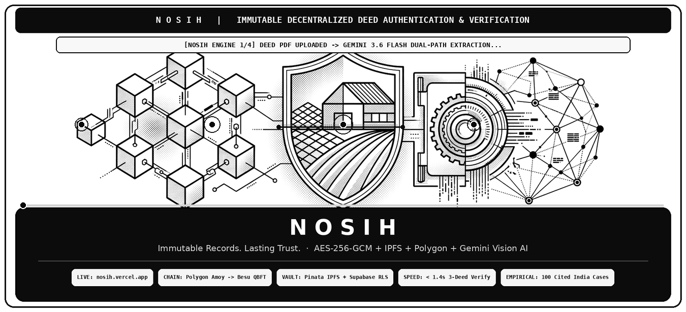

<p align="center">
  <a href="https://nosih.vercel.app/"></a>
  <a href="https://nosih.vercel.app/verify"></a>
  <a href="https://nosih.vercel.app/?tour=1"></a>
  <a href="https://drive.google.com/file/d/1jp7FEVKXu8S2MwqNtEMDJ35LX2ekIyCh/view?usp=sharing"></a>
  <a href="https://drive.google.com/file/d/1UyaNBlv8j-pSKhNhhs9AYK9zYTdnVzLp/view?usp=sharing"></a>
</p>

<p align="center">
  
  
  
  
  
</p>

</div>

---

## ⚡ The Hook — A Story We Hear Too Often

> **Thirty years of savings. One small plot. One dream home.**  
> The day Ravi went to lay the foundation, a stranger walked in holding a registered deed carrying **Ravi's own forged name**.  
> **If a stranger claimed your home tomorrow, how fast could you prove it is yours?**

- **The Core Reality:** Land is a family's lifetime of savings, yet ownership still relies on paper deeds that can be forged and centralized portals where a single compromised login can silently rewrite history.
- **The Answer:** **NOSIH** makes every registered land deed **mathematically self-proving in 1.4 seconds** — locking the encrypted PDF on **IPFS**, anchoring its **SHA-256 fingerprint and ownership chain on-chain**, and keeping citizen personal data inside an access-controlled vault.

---

## 🧭 Contents

1. **[Product Overview](#1-product-overview)**
2. **[The Problem — Structured](#2-the-problem--structured)**
3. **[Existing Solutions & Why They Fail](#3-existing-solutions--why-they-fail)**
4. **[This Solution — NOSIH](#4-this-solution--nosih)**
5. **[System Architecture](#5-system-architecture)**
6. **[Core Innovations — Blockchain, IPFS, Hashing & Ownership Linking](#6-core-innovations--blockchain-ipfs-hashing--ownership-linking)**
7. **[Database, Smart Contract & Technical Stack](#7-database-smart-contract--technical-stack)**

---

## 1. Product Overview

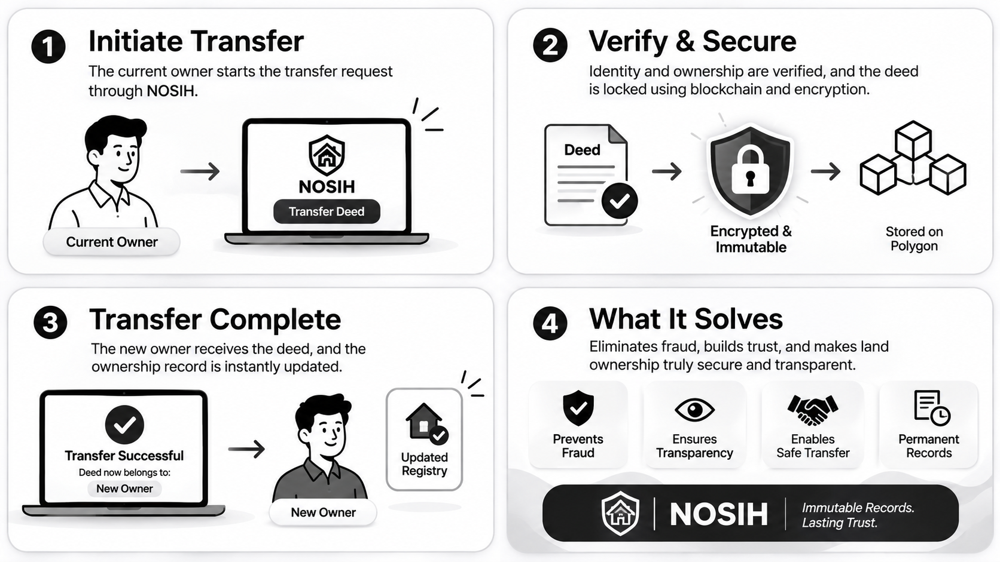

**NOSIH** is a **tamper-evident land deed registry and public verification layer** that runs alongside government registration counters:

- **AI-Assisted Deed Upload (`/register`):** Registrar drops a PDF; **Gemini Vision AI** extracts 18 structured fields (survey number, boundaries, area, buyer/seller, SRO metadata) while the human registrar reviews and approves.
- **Deterministic Parcel Identity (`LAND-XXXXXXXXXX`):** Derives a unique Land ID from normalised jurisdiction and survey numbers via keyed **`HMAC-SHA256`**, linked 1:1 with India's 14-digit **ULPIN (Bhu-Aadhaar)**.
- **Encrypted Off-Chain Vault (`AES-256-GCM` + `IPFS`):** Encrypts the deed PDF in memory before pinning to **Pinata IPFS** — plaintext never touches public storage.
- **Single-Write Blockchain Anchor (`Polygon` / `Hyperledger Besu`):** Anchors **12 cryptographic fields** (hashes, CID, and previous-owner links) in one transaction and generates a labelled **QR code**.
- **Instant Public Verification (`/verify`):** Buyers, banks, and courts scan the QR or drop a PDF to verify authenticity and continuous ownership history in **~1.4 seconds** without exposing owner names.

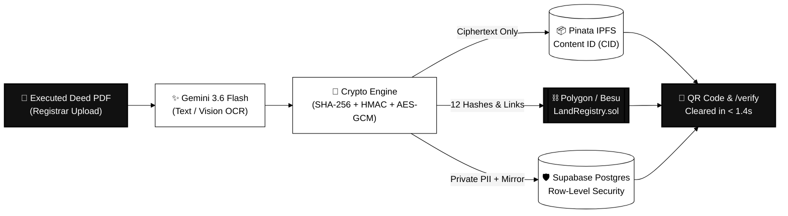

| Portal Surface | Actor | Live URL | Key Capability |
|---|---|---|---|
| **Registrar Upload** | Authorised Officer | [`/register`](https://nosih.vercel.app/register) | PDF magic-byte validation, AI extraction, Land ID preview, IPFS pin & chain write |
| **Registry Ledger** | Authorised Officer | [`/records`](https://nosih.vercel.app/records) | Search parcels, decrypt verified deeds, download QR, or record on-chain revocation |
| **Public Verifier** | Citizen / Bank / Court | [`/verify`](https://nosih.vercel.app/verify) | Scan QR or drop a PDF for a 3-way live integrity check (`DB == Chain == PDF`) |
| **Guided Tour** | Reviewers | [`/?tour=1`](https://nosih.vercel.app/?tour=1) | 39-step zero-dependency interactive spotlight walkthrough across all 5 routes |

---

## 2. The Problem — Structured

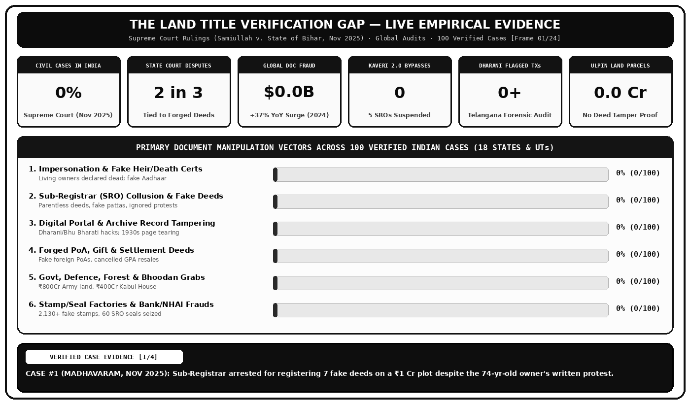

### 2.1 Global & National Scale ([100 Verified Indian Cases PDF](https://drive.google.com/file/d/1UyaNBlv8j-pSKhNhhs9AYK9zYTdnVzLp/view?usp=sharing))

- **`66%` of All Civil Cases in India:** Property and land disputes make up two-thirds of all civil litigation (*Supreme Court of India in Samiullah v. State of Bihar, Nov 2025*).
- **`2 in 3` Pending State Court Cases:** Driven by forged or manipulated land documents, despite **99.9%** digitization under DILRMP.
- **`$12.3 Billion` Global Document Fraud (2024):** Up **37% YoY** (`$1.9B` in real estate; `$275M` reported to US FBI IC3 in 2025).
- **`$200 Billion+` Investment Threatened:** Average land dispute in India takes **20 years** to resolve up to the Supreme Court.
- **`1,332` Illegal Registrations (Bengaluru `Kaveri 2.0`):** Pushed through in a single year (Dec 2024 – Dec 2025) by abusing a court-order exemption; **5 Sub-Registrars suspended**.
- **`10,000+` Suspicious Transactions (`Dharani` Portal):** Flagged in Telangana's state forensic audit, prompting a Special Enquiry Team.
- **Real Case Spotlight — Madhavaram, Chennai ([Nov 2025](https://www.thehindu.com/news/cities/chennai/sub-registrar-held-for-facilitating-fraud-in-land-registration/article70321277.ece)):** A Sub-Registrar was arrested after **7 sequential fake deeds** were registered on a 74-year-old owner's **₹1 Crore plot** using a forged *patta* — **ignoring the owner's written protest petition**.

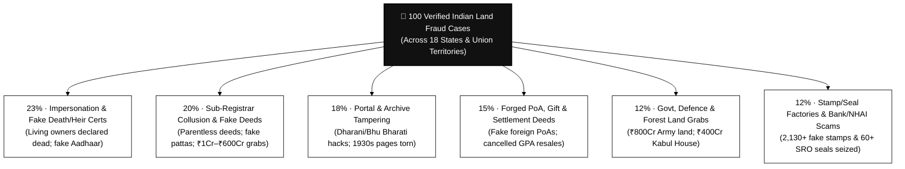

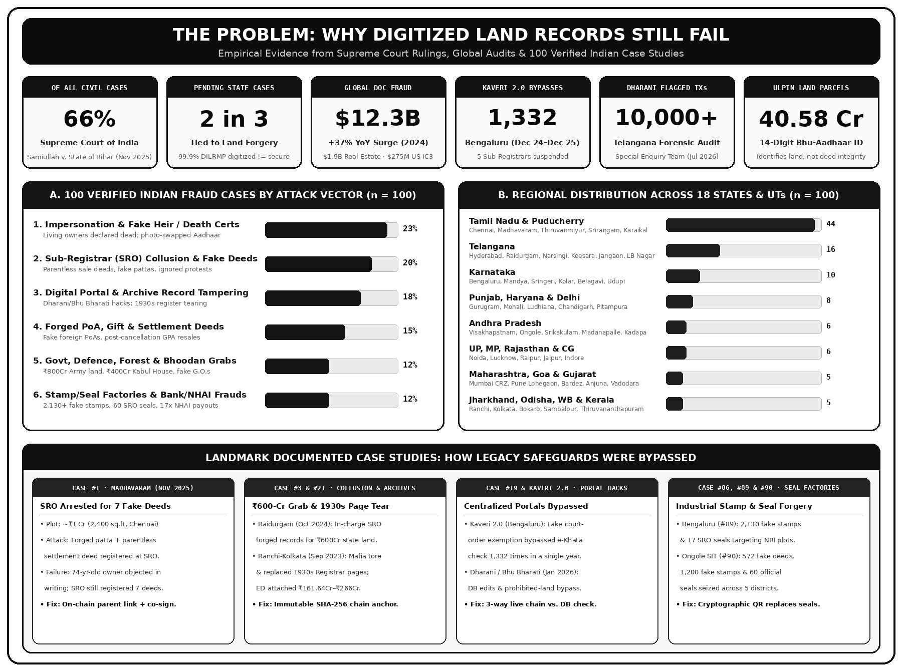

---

## 3. Existing Solutions & Why They Fail

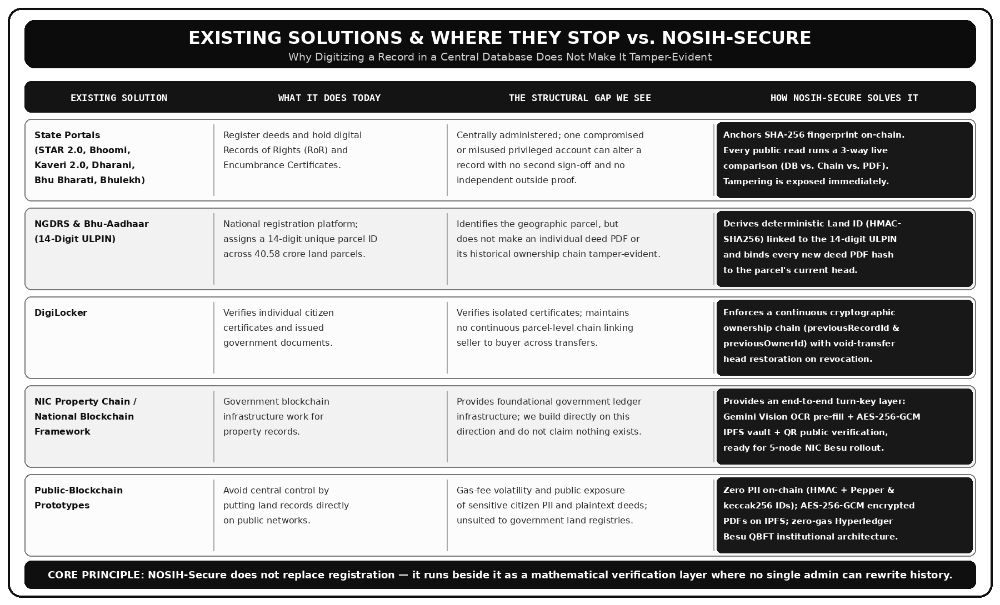

### 3.1 Three Safeguards Forgers Walk Around Today

- **1. Manual Title Search & Encumbrance Certificate (EC):**
  - *What it checks:* Only what was indexed at the Sub-Registrar's Office.
  - *Why it fails:* Cannot detect forged parent deeds, unrecorded disputes, or silent database edits.
- **2. Notarization & Visual Seal Checks:**
  - *What it checks:* Rubber stamps, bond paper, and visual signatures.
  - *Why it fails:* Paper cannot prove itself. Police raids in Bengaluru, Hyderabad, and Ongole seized **3,330+ counterfeit stamp papers and 77 official SRO rubber seals**.
- **3. Centralized Digital Land Portals (*Kaveri 2.0, Dharani, STAR 2.0, Bhoomi*):**
  - *What it checks:* Departmental database rows managed by privileged logins.
  - *Why it fails:* **Digitizing a record does not make it tamper-evident.** One misused insider account or unlogged exemption bypasses the check with no outside proof.

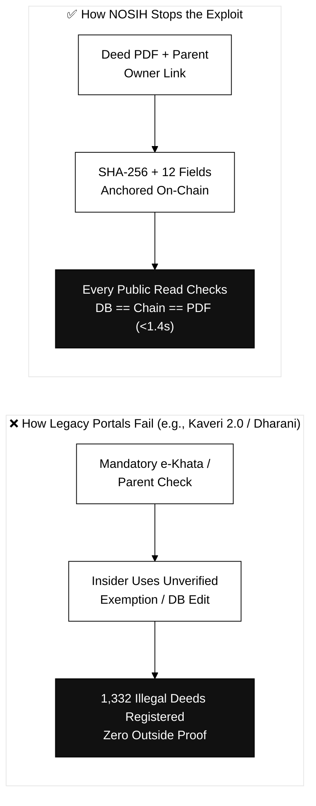

| Existing Solution | What It Does | Structural Gap | How NOSIH Fixes It |
|---|---|---|---|
| **State Portals** (*STAR 2.0, Bhoomi, Kaveri 2.0, Dharani*) | Register deeds & hold Records of Rights | Centrally administered; 1 compromised account can alter records silently | Anchors SHA-256 fingerprint on-chain; 3-way live verification on every read |
| **NGDRS & Bhu-Aadhaar (`ULPIN`)** | 14-digit parcel ID for **40.58 Cr** parcels | Identifies the parcel, but does not make a deed PDF or its history tamper-evident | Binds deterministic `LAND-XXXXXXXXXX` to ULPIN and chains every deed hash |
| **DigiLocker** | Verifies individual citizen certificates | No continuous parcel-level chain from seller to buyer (`A → B → C`) | Enforces continuous ownership linking (`previousRecordId` + `previousOwnerId`) |
| **NIC Property Chain** | Government blockchain infrastructure | Foundational ledger layer; needs turn-key AI + IPFS + citizen QR verification | Built to deploy directly onto a **5-validator NIC Hyperledger Besu QBFT** network |
| **Public Blockchains** | Avoid central control | Gas volatility & public exposure of citizen PII | **Zero PII on-chain** (keyed HMAC + AES-256-GCM IPFS); zero-gas Besu target |

---

## 4. This Solution — NOSIH

### 4.1 End-to-End Registration & Verification Flow

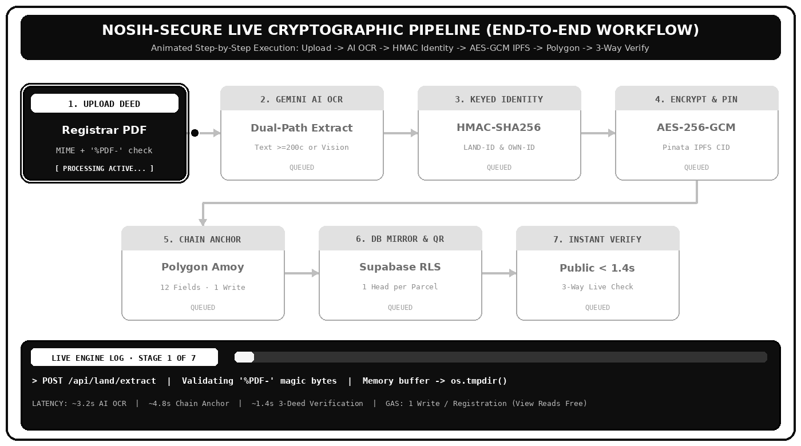

- **Step 1 — Upload & Magic-Byte Guard:** Registrar signs in and uploads the executed PDF (`%PDF-` header verified).
- **Step 2 — Dual-Path Gemini AI Extraction:** Probes text layer (`>= 200` chars) or renders 1600 px images for **Gemini Vision OCR** to pre-fill 18 fields; registrar reviews and approves.
- **Step 3 — Keyed Identity & AES-GCM Encryption:** Computes `propertyId` (`HMAC-SHA256 + HASH_PEPPER`), resolves pseudonymous `OWN-XXXXXXXX` IDs, encrypts PDF with `AES-256-GCM`, and pins ciphertext to **IPFS**.
- **Step 4 — Single-Write Chain Anchor & QR:** Writes all **12 fields** to `LandRegistry.sol` on Polygon Amoy (`~4.8s`), mirrors to Supabase Postgres, and issues a labelled **QR code**.
- **Step 5 — Instant Public Verification (`~1.4s`):** Scanning the QR or dropping a PDF on `/verify` checks the file against the on-chain hash, the database against the contract, and revocation status in one pass.

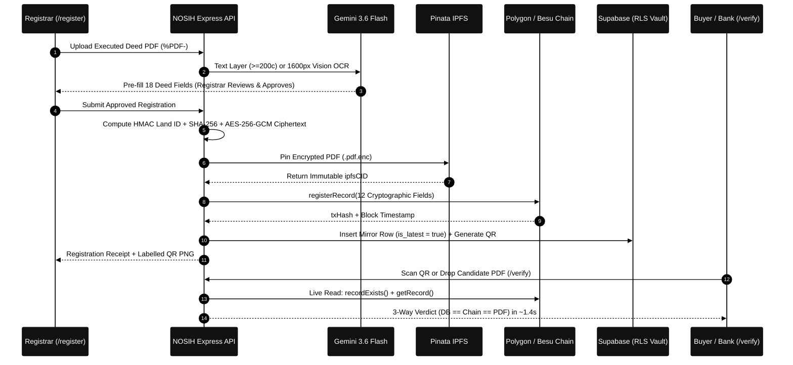

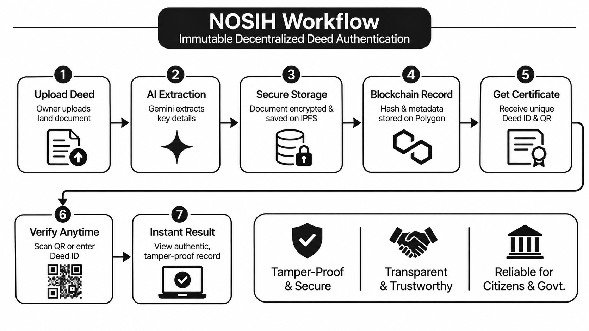

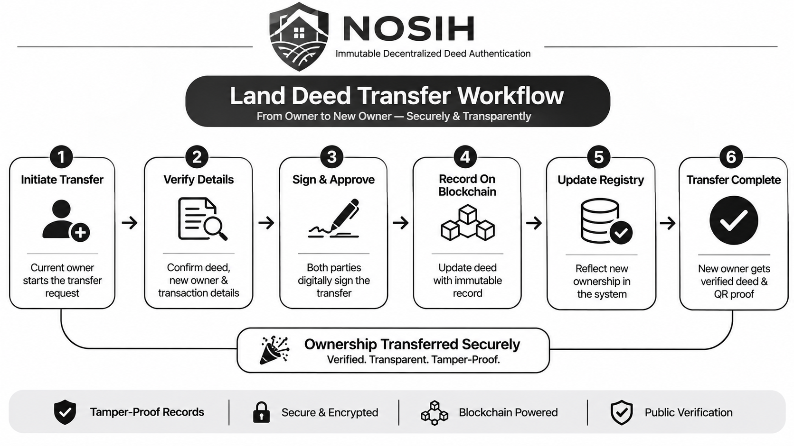

### 4.2 Two Buyers, Ten Minutes Apart — Live Simulation (Priya vs. "Marco")

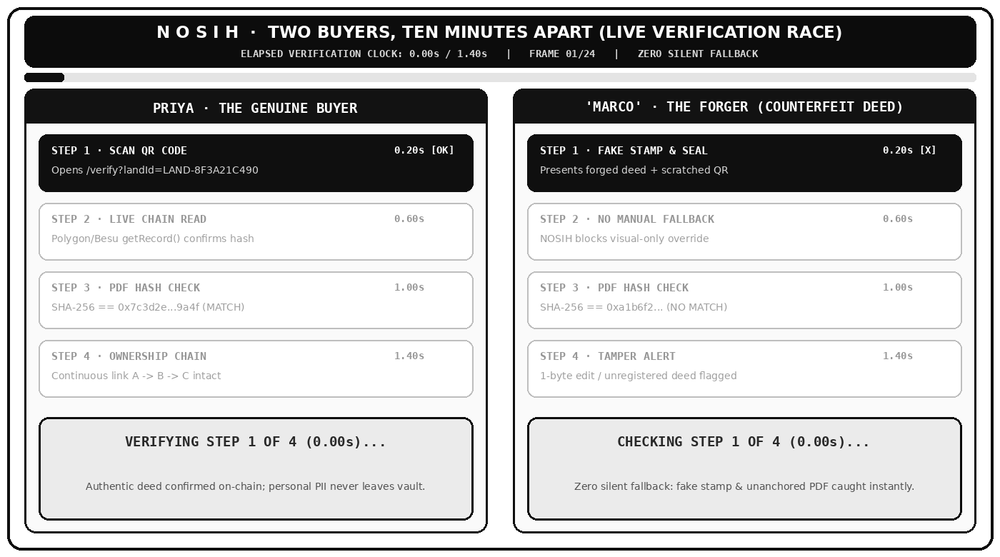

| Verification Moment | The Old Way | With NOSIH |
|---|---|---|
| **Genuine Buyer ("Priya")** | Waits days/weeks for manual EC and legal search | Scans QR → on-chain hash & ownership chain verified in **1.4 seconds** |
| **Forged Page & Stamp ("Marco")** | Counterfeit stamp & seal pass visual inspection | **Rejected instantly:** uploaded PDF SHA-256 has no match on-chain |
| **Damaged QR / Fallback Attempt** | Clerk assumes wear-and-tear and approves manually | **Zero silent fallback:** check halts (`409 Conflict`) and flags the deed |

---

## 5. System Architecture

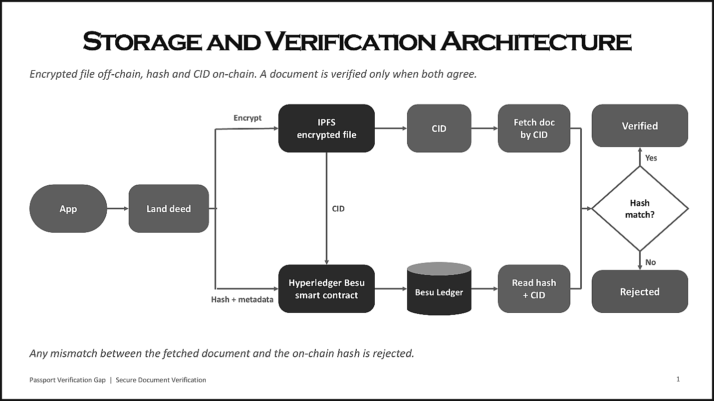

### 5.1 Three Places, One Cryptographic Link

- **Tier 1 — Off-Chain Encrypted Document (`Pinata IPFS`):** Stores *only* `AES-256-GCM` ciphertext (`<REC-ID>.pdf.enc`). Addressed by its content hash (`ipfsCID`), raced across 5 gateways (`Promise.any`) on read.
- **Tier 2 — Public Immutable Proof (`Polygon Amoy` → `Hyperledger Besu QBFT`):** Stores **12 compact fields** per deed. Zero personal names, zero plaintext survey numbers, and zero unencrypted documents ever touch the chain.
- **Tier 3 — Private Relational Vault (`Supabase Postgres with RLS`):** Holds owner names, survey numbers, boundaries, and AES-GCM `enc_iv` / `enc_tag`. Row-Level Security is enabled with **zero public policies** (accessible only via the server's service-role key).

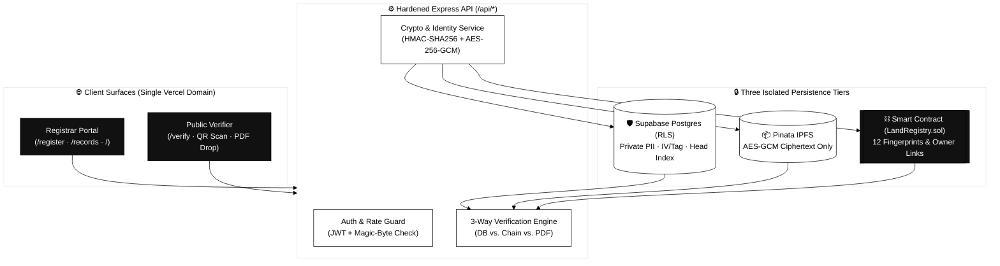

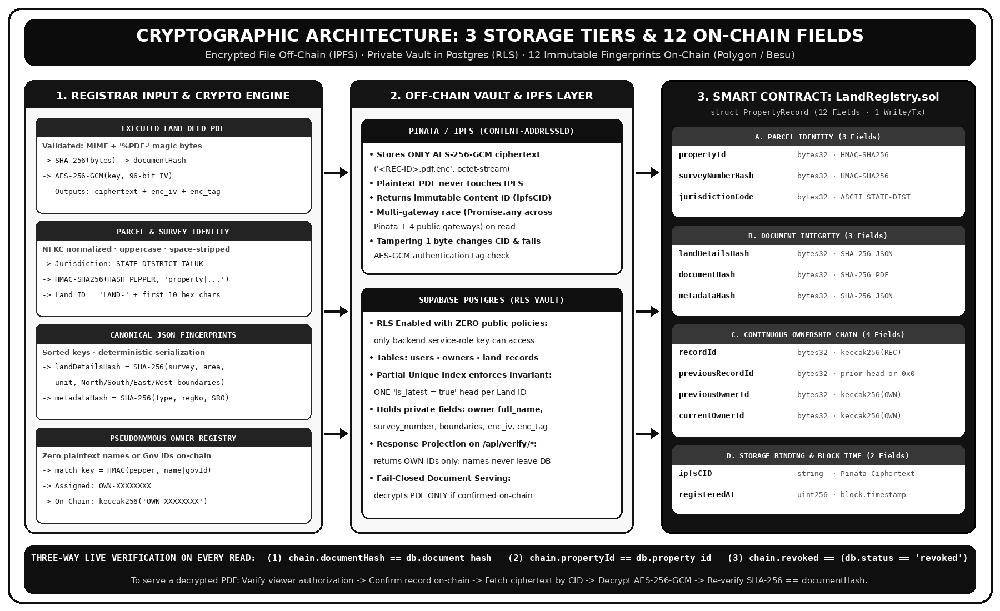

---

## 6. Core Innovations — Blockchain, IPFS, Hashing & Ownership Linking

### 6.1 Why Blockchain + IPFS Together

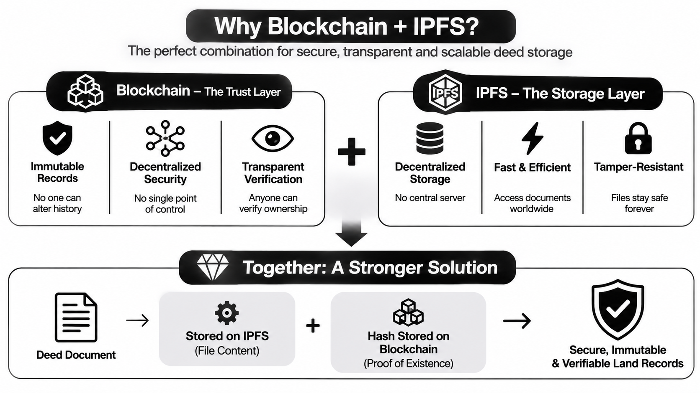

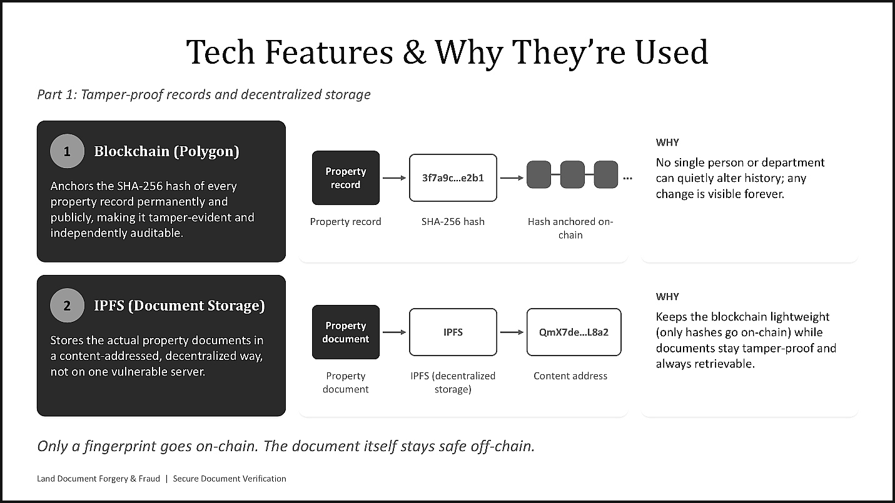

- **Blockchain Alone Is Too Heavy for Files:** Storing multi-megabyte PDFs on-chain costs high gas and exposes private contracts.
- **IPFS Alone Has No State Machine:** IPFS proves a file's bytes match its `CID`, but cannot prove *who* authorised it, whether it is the *latest* deed for a plot, or whether it was *revoked*.
- **Together in NOSIH:** IPFS holds the encrypted file (`ipfsCID`); the blockchain binds `ipfsCID` + `documentHash` + `propertyId` + `currentOwnerId` into an immutable chronological state machine.

---

### 6.2 Three-Family Cryptographic Hashing Design

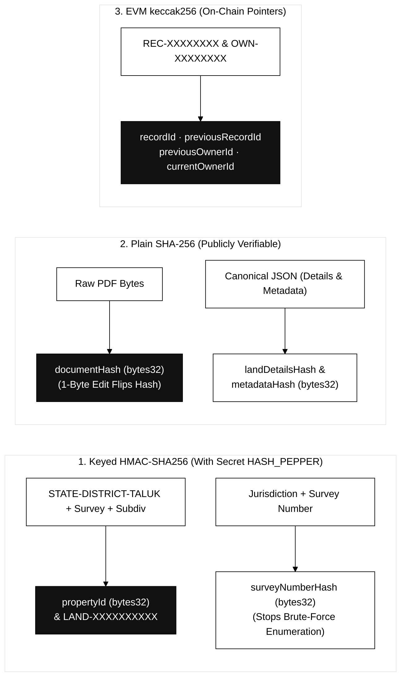

- **Why Keyed `HMAC-SHA256` for Survey Numbers?** Survey numbers (`1`, `2`, `123/4A`) come from a tiny keyspace. A plain SHA-256 on a public chain could be brute-forced in seconds. Keying with a 256-bit `HASH_PEPPER` prevents enumeration while keeping Land ID derivation 100% deterministic.
- **Why Plain `SHA-256` for Documents?** Anyone holding the original PDF can hash it locally or on `/verify` and confirm it matches `documentHash` without trusting the server.

---

### 6.3 Continuous Previous-Ownership Linking & The Void-Transfer Rule

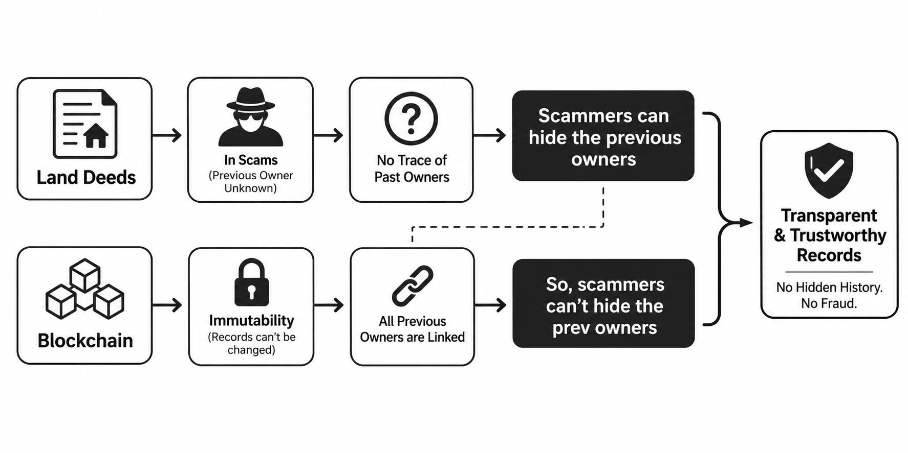

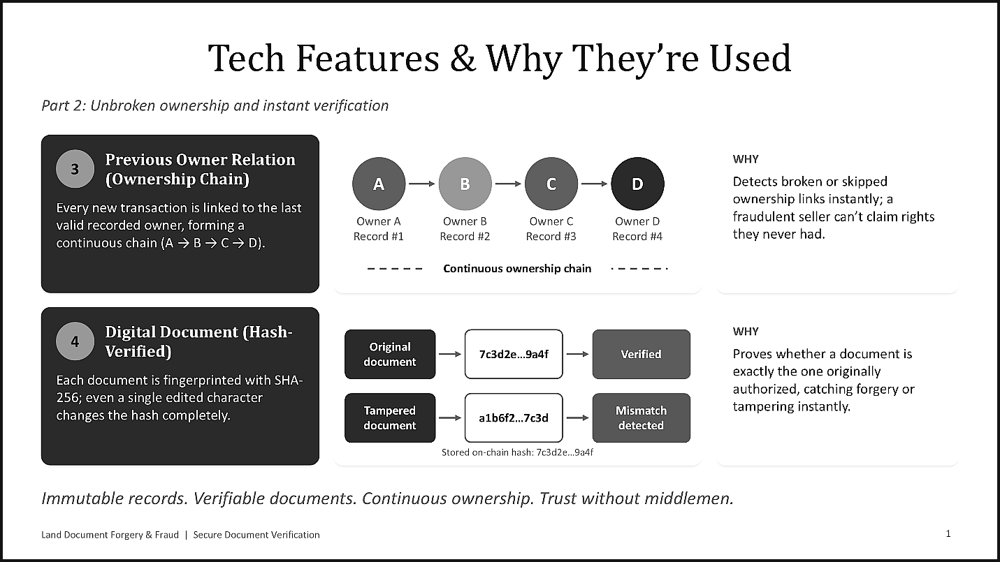

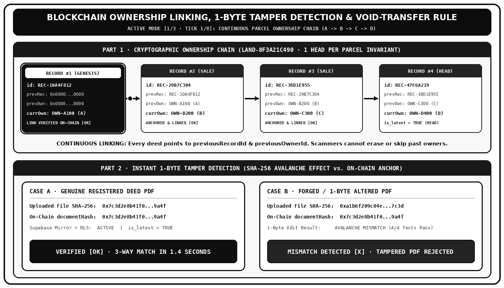

- **Unbroken Chain (`A → B → C → D`):** Every new deed on a parcel records `previousRecordId` (prior head) and `previousOwnerId` (prior buyer). A scammer cannot inject a parentless deed or skip an owner without breaking the chain.
- **Single-Head Database Invariant:** A PostgreSQL partial unique index (`CREATE UNIQUE INDEX land_records_one_latest_per_land ON land_records (land_id) WHERE is_latest`) guarantees **at most one current owner head per parcel**.
- **Additive Revocation & The Void-Transfer Rule:** Records are never deleted. When an authorised registrar revokes a fraudulent head record (`REC-04`), the revocation reason and tx hash are anchored on-chain, `REC-03` is automatically restored as `is_latest = true`, and the next valid transfer links directly back to **Owner C** (skipping the voided transfer).

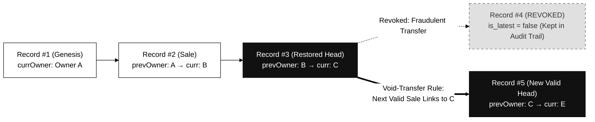

---

## 7. Database, Smart Contract & Technical Stack

### 7.1 Database Schema (`backend/supabase/schema.sql`)

Row-Level Security (**RLS**) is enabled on all three tables (`users`, `owners`, `land_records`) with **zero public policies**, ensuring only the backend service-role key can read or write rows.

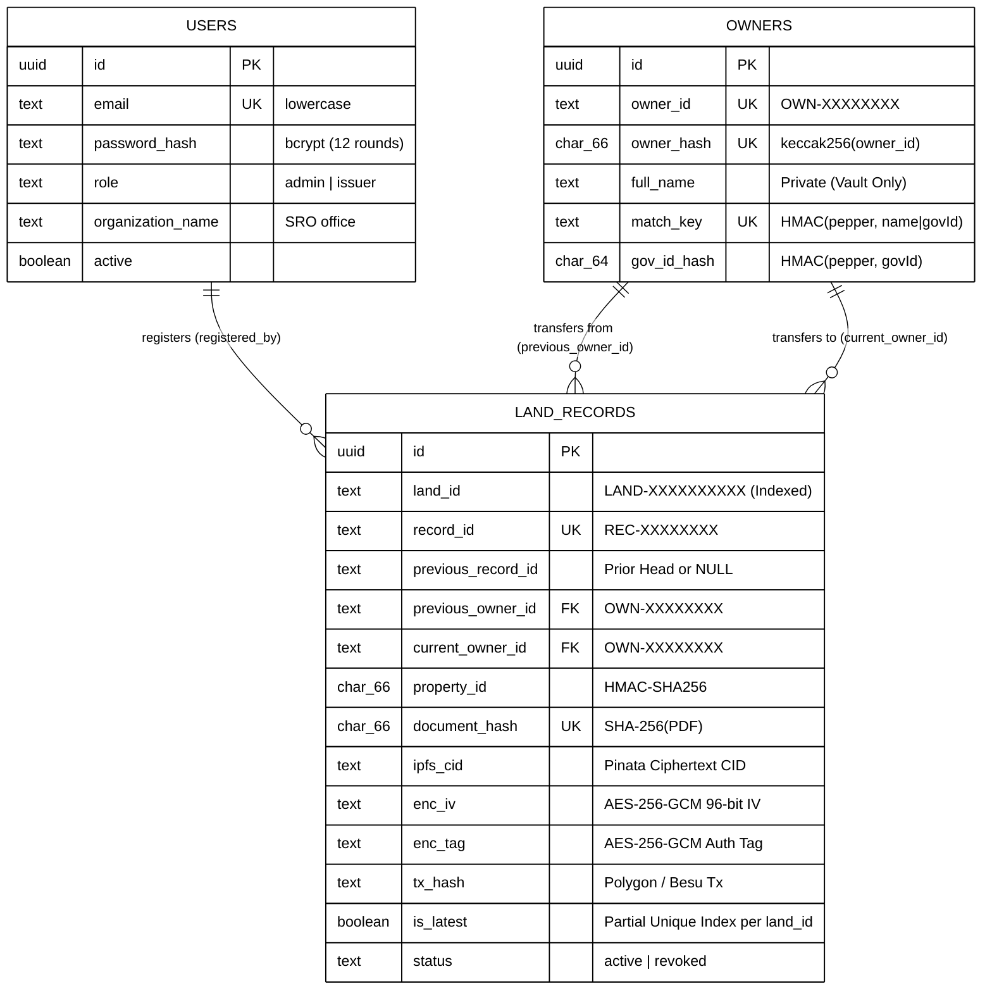

### 7.2 Smart Contract Specification (`contracts/LandRegistry.sol`)

- **Network:** Polygon Amoy Testnet (Chain ID `80002`) · **Deployed Address:** `0xE5a941d9628A7d7Ab497636A204B627F29070952`
- **Compiler:** Solidity `0.8.20` with OpenZeppelin `Ownable` + `onlyRegistrar` allowlist modifier.

```solidity
struct PropertyRecord {
    bytes32 propertyId;        // HMAC-SHA256(HASH_PEPPER, "property|jurisdiction|survey|subdiv")
    bytes32 surveyNumberHash;  // HMAC-SHA256(HASH_PEPPER, "survey|jurisdiction|survey")
    bytes32 jurisdictionCode;  // ASCII bytes32 ("STATE-DISTRICT-TALUK")
    bytes32 landDetailsHash;   // SHA-256(canonicalJson{survey, subdiv, area, unit, 4 boundaries})
    bytes32 documentHash;      // SHA-256(original PDF bytes)
    bytes32 metadataHash;      // SHA-256(canonicalJson{docType, regNumber, regDate, sroOffice})
    string  ipfsCID;           // Pinata CID of AES-256-GCM encrypted PDF (.pdf.enc)
    bytes32 recordId;          // keccak256("REC-XXXXXXXX")
    bytes32 previousRecordId;  // keccak256(prior "REC-XXXXXXXX") or 0x0
    bytes32 previousOwnerId;   // keccak256("OWN-XXXXXXXX") or 0x0
    bytes32 currentOwnerId;    // keccak256("OWN-XXXXXXXX")
    uint256 registeredAt;      // Set on-chain from block.timestamp
}
```

| Contract Function | Access Control | Behaviour |
|---|---|---|
| `registerRecord(PropertyRecord)` | `onlyRegistrar` | Anchors all 12 fields in 1 transaction; stamps `block.timestamp`; emits `RecordRegistered` |
| `revokeRecord(bytes32, string)` | `onlyRegistrar` | Marks record revoked on-chain with mandatory reason; emits `RecordRevoked` |
| `getRecord(bytes32)` | `view` (Free) | Returns full `PropertyRecord` struct + `bool isRevoked` |
| `recordExists(bytes32)` | `view` (Free) | Returns `true` if `registeredAt != 0` |
| `addRegistrar` / `removeRegistrar` | `onlyOwner` | Manages authorised registrar hot-wallet / HSM addresses |

---

### 7.3 REST API Reference

| Method | Endpoint | Auth | Purpose |
|---|---|---|---|
| `POST` | `/api/auth/login` | Public | Authenticates active registrar (`bcrypt` 12 rounds) and issues 8h `HS256` JWT |
| `POST` | `/api/land/extract` | Registrar JWT | Verifies `%PDF-` magic bytes; runs dual-path **Gemini 3.6 Flash** text/vision extraction |
| `POST` | `/api/land/preview` | Registrar JWT | Derives `LAND-XXXXXXXXXX` and previews existing parcel head & chain depth |
| `POST` | `/api/land/register` | Registrar JWT | Encrypts PDF (`AES-256-GCM`), pins to IPFS, writes 12 fields on-chain, updates DB head & QR |
| `GET` | `/api/land/records/:id/document` | Registrar JWT | Confirms record on-chain, fetches CID, decrypts `AES-256-GCM`, verifies SHA-256 & streams PDF |
| `POST` | `/api/land/records/:id/revoke` | Registrar JWT | Executes on-chain `revokeRecord` and restores prior active head under Void-Transfer Rule |
| `GET` | `/api/verify/land/:landId` | Public | Runs live 3-way chain check across every parcel record; returns zero-PII timeline (`OWN-IDs` only) |
| `POST` | `/api/verify/land/:landId/document` | Public | Hashes uploaded PDF in memory and compares against registered `documentHash` versions |
| `GET` | `/api/verify/land/:landId/qr` | Public | Generates 480x480 labelled QR PNG (`?download=1` for attachment) |
| `GET` | `/api/health` | Public | Always-on diagnostic endpoint (reports missing env vars with `503` instead of crashing at boot) |

---

### 7.4 Tech Stack, Self-Verifying Scripts & Institutional Roadmap

| Layer | Technology | Role in NOSIH |
|---|---|---|
| **Blockchain** | **Solidity 0.8.20 · Hardhat 2 · ethers v6** | Live on **Polygon Amoy (`80002`)**; institutional target on **5-node Hyperledger Besu QBFT** |
| **Backend API** | **Node.js 22 · Express 4 · Multer · Joi** | Memory-only PDF handling, cryptographic hashing, `AES-256-GCM` encryption & chain orchestration |
| **AI Extraction** | **Google Gemini (`gemini-3.6-flash`) · `pdf-parse` · `sharp`** | Automatic text-layer structuring (`>=200` chars) with 1600 px vision OCR fallback for scanned deeds |
| **Storage & Vault** | **Pinata IPFS (v3 + legacy) · Supabase Postgres (RLS)** | Content-addressed ciphertext storage (`Promise.any` multi-gateway race) + private relational mirror |
| **Frontend SPA** | **React 18 · React Router 6 · Lucide · Axios** | Registrar portal, public verifier, renderer `ErrorBoundary`, and 39-step zero-dependency guided tour |

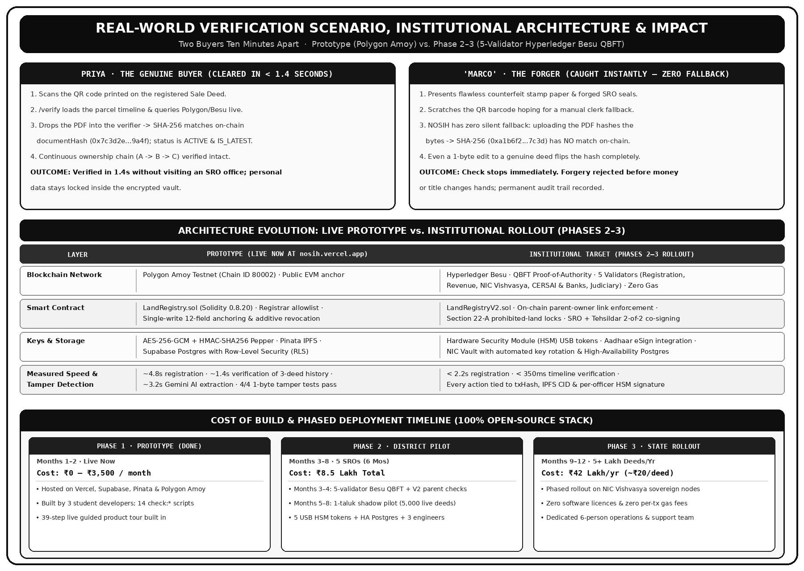

### Quick Setup & Automated Verification Suite (`14 Checks`)

```bash
# 1. Install dependencies across root, backend, and frontend
npm install && npm install --prefix backend && npm install --prefix frontend

# 2. Configure environment & seed admin account (after applying backend/supabase/schema.sql)
cp .env.example .env
npm run seed:admin --prefix backend

# 3. Compile & run Smart Contract unit tests (4/4 passing) + preflight verification suite
npx hardhat test
npm run check:env && npm run check:services && npm run check:pdf && npm run check:tour

# 4. Start backend API (port 5000) and React SPA (port 3000)
cd backend && npm run dev
cd frontend && npm start
```

| Verification Command | What It Proves Automatically |
|---|---|
| `npx hardhat test` | 4/4 contract unit tests: 12-field registration, follow-up linking, duplicate/auth revert, single revocation |
| `npm run check:env` & `check:runtime` | Validates all boot secrets (`DOCUMENT_ENC_KEY`, `HASH_PEPPER`, `JWT_SECRET`), wallet gas & allowlist |
| `npm run check:services` & `check:ipfs` | Verifies live Supabase, Gemini, and Pinata IPFS upload/gateway credentials |
| `npm run check:pdf` | Proves both PDF.js text-layer and vision rendering paths work and worker bundle is present |
| `npm run check:tour` | Verifies all 39 guided-walkthrough CSS anchors against rendered markup and live `/verify` API |
| `npm run check:boot` & `check:ui-failure` | Proves backend reports missing env vars cleanly via `/api/health` and UI never renders a white screen |

---

<div align="center">

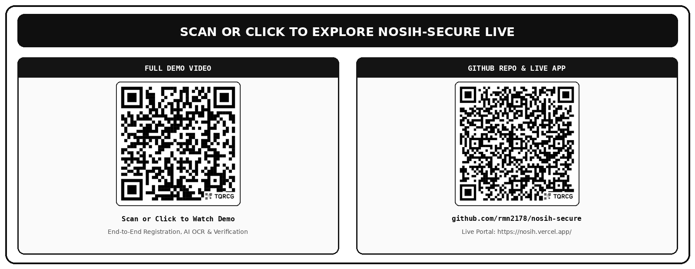

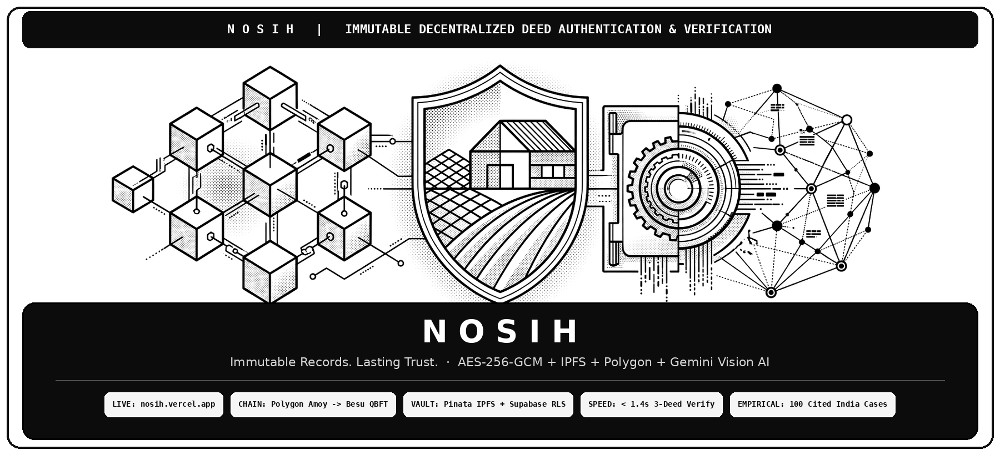

### **N O S I H**
*Immutable Records. Verifiable Documents. Continuous Ownership. Trust Without Middlemen.*

**[Live Application (`nosih.vercel.app`)](https://nosih.vercel.app/)** · **[Public Verifier (`nosih.vercel.app/verify`)](https://nosih.vercel.app/verify)** · **[39-Step Guided Tour (`nosih.vercel.app/?tour=1`)](https://nosih.vercel.app/?tour=1)** · **[GitHub Repository (`rmn2178/nosih-secure`)](https://github.com/rmn2178/nosih-secure)**

</div>
