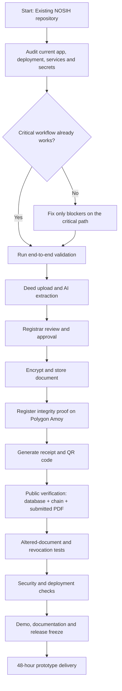
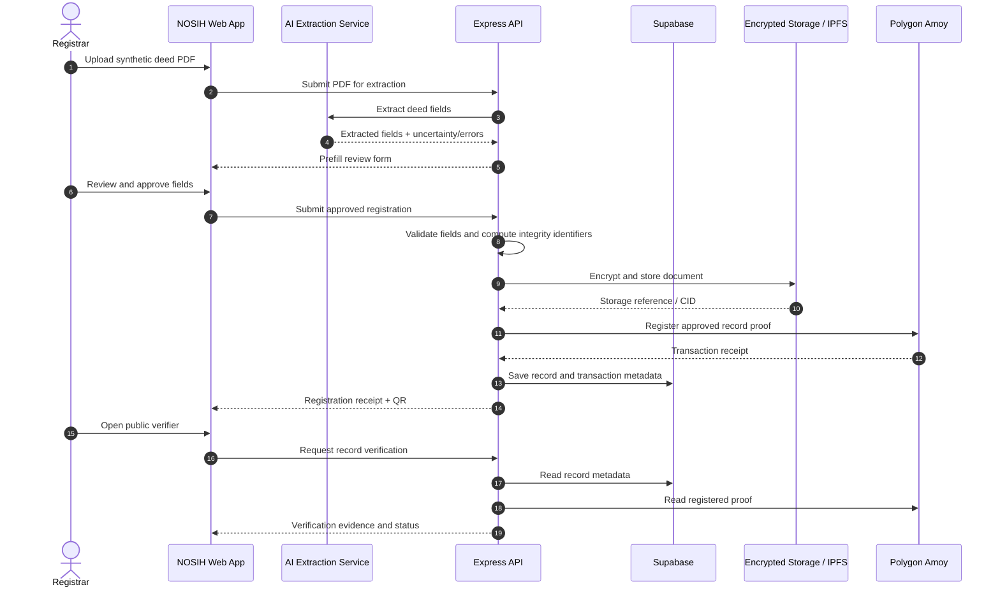
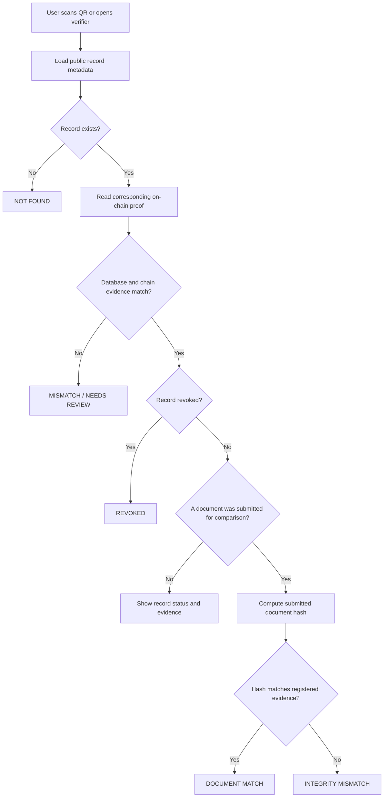
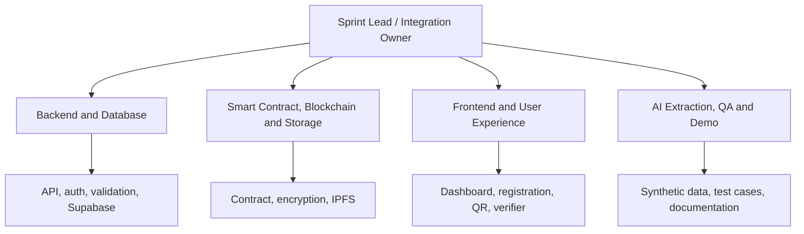
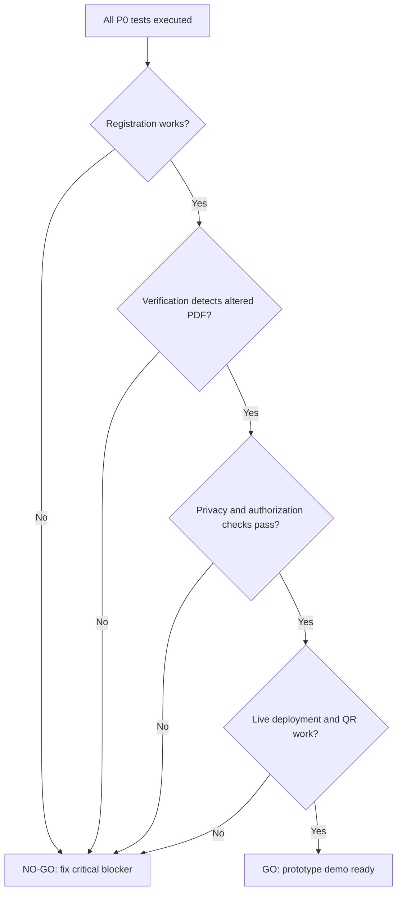
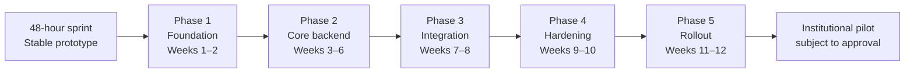

# NOSIH Secure — 48-Hour Execution Plan

> **Objective:** Turn the existing NOSIH Secure implementation into a stable, demonstrable prototype in 48 hours.
>
> **Delivery principle:** Stabilize the complete deed-registration-to-verification journey before adding new features.

**Timebox:** 48 hours  
**Delivery type:** Working prototype and demonstration  
**Existing long-term strategy:** 12-week / 5-phase implementation roadmap  
**48-hour focus:** Critical-path validation, integration, security checks, deployment, and demo readiness

---

## 1. Executive objective

NOSIH Secure aims to make land-document evidence easier to preserve and independently verify.

In this 48-hour sprint, the team should demonstrate one complete workflow:

1. A registrar uploads a synthetic land deed PDF.
2. AI extracts the available deed information.
3. The registrar reviews and corrects the extracted fields.
4. The document is encrypted before private storage.
5. A document-integrity proof and relevant record identifiers are registered on Polygon Amoy.
6. A QR code opens a public verification page.
7. The verifier checks the record against the available database and blockchain evidence.
8. An altered document produces an integrity mismatch.
9. A registrar can revoke a record and the application displays the updated status.

**Important scope boundary:** A blockchain hash can help establish whether a file matches previously registered evidence. It does not prove that the deed is legally valid, that the recorded claims are true, or that the person presenting it is the rightful owner. NOSIH should be presented as tamper-evident evidence and verification infrastructure, not as a replacement for government land registration or legal adjudication.

---

## 2. The 48-hour delivery map

### Delivery priorities

| Priority | Workstream | Required outcome |
|---|---|---|
| P0 | Existing-system audit | Know what works, what fails, and what must not be rebuilt |
| P0 | Registration flow | A deed can be uploaded, reviewed, and registered |
| P0 | Verification flow | Original and altered documents produce the correct integrity result |
| P0 | Deployment | The live application and public verifier work reliably |
| P1 | Revocation | A registrar can revoke a record and the status is visible |
| P1 | Security checks | No secrets or private deed details are exposed publicly or on-chain |
| P1 | Demo assets | Synthetic deed, QR, screenshots, and short demo video |
| P2 | Visual polish | Improve clarity and consistency after the critical flow is stable |

---

## 3. 48-hour schedule

## Day 1 — Audit, integrate and stabilize

```mermaid
gantt
    title NOSIH Secure — Day 1
    dateFormat HH:mm
    axisFormat %H:%M

    section Audit
    Repository and deployment audit     :a1, 00:00, 2h
    Environment and service checks      :a2, after a1, 2h

    section Core workflow
    Deed upload and AI extraction       :b1, 04:00, 3h
    Registrar review and validation     :b2, after b1, 2h
    Encryption and private storage      :b3, after b2, 2h
    Polygon Amoy registration           :b4, after b3, 3h

    section Verification
    QR and public verification          :c1, 14:00, 3h
    Altered document and revoke tests   :c2, after c1, 3h

    section Stabilization
    UI fixes and error states           :d1, 20:00, 2h
    Full workflow smoke test            :d2, after d1, 2h
```

| Time | Task | Actions | Exit condition |
|---|---|---|---|
| 00–04 h | Audit | Inspect repository, Vercel deployment, environment variables, Supabase, Pinata, Gemini, and Polygon Amoy | A written blocker list exists; no unnecessary rewrite is planned |
| 04–07 h | Upload and extraction | Test PDF upload, extraction response, field mapping, and failure handling | A sample deed can be uploaded and parsed |
| 07–09 h | Registrar review | Confirm editable fields, required-field validation, and human approval | Registrar can correct extracted values before registration |
| 09–11 h | Encryption and storage | Verify AES-256-GCM encryption and private storage path | Stored document is ciphertext; retrieval path works |
| 11–14 h | Blockchain registration | Verify signer, contract address, network, gas, transaction receipt, and stored proof | One registration produces a confirmed Amoy transaction |
| 14–17 h | Verification | Test QR, public page, record lookup, and comparison logic | Original document returns the expected integrity result |
| 17–20 h | Negative tests | Alter a PDF, test unknown ID, invalid file, and revoked record | Invalid or altered evidence is never shown as verified |
| 20–24 h | Stabilize | Fix critical UI errors, loading states, API failures, and run a complete smoke test | One clean end-to-end demo can be performed |

## Day 2 — Validate, secure and present

```mermaid
gantt
    title NOSIH Secure — Day 2
    dateFormat HH:mm
    axisFormat %H:%M

    section Reliability
    Security and privacy review           :a1, 00:00, 3h
    Failure and recovery tests            :a2, after a1, 3h

    section Demonstration
    Synthetic deed and demo data          :b1, 06:00, 2h
    Rehearse registration and verification:b2, after b1, 3h

    section Delivery assets
    Architecture and workflow diagrams   :c1, 11:00, 2h
    README and presentation               :c2, after c1, 2h
    Demo recording and screenshots        :c3, after c2, 2h

    section Release
    Cross-device and deployment checks   :d1, 17:00, 3h
    Critical bug fixes                    :d2, after d1, 2h
    Release freeze and final handoff       :d3, after d2, 1h
```

| Time | Task | Actions | Exit condition |
|---|---|---|---|
| 24–27 h | Security review | Inspect API authorization, RLS, public responses, frontend bundles, and secrets | No known critical exposure remains |
| 27–30 h | Failure tests | Test AI outage, storage outage, RPC failure, malformed input, and database/chain mismatch | Failures are visible and do not create false success |
| 30–32 h | Demo data | Prepare fictional/synthetic deed and test records | Demo uses no real personal or land-owner data |
| 32–35 h | Rehearsal | Run registration, QR verification, altered-document test, and revocation | Demo can be repeated reliably |
| 35–39 h | Documentation | Update architecture, workflow, limitations, setup notes, and presentation | README and presentation explain what is actually implemented |
| 39–41 h | Recording | Capture a short demo, screenshots, and backup evidence | Demo assets are available if live services fail |
| 41–44 h | Final deployment checks | Test live routes, QR links, mobile layout, and a second browser/device | Critical user journey works in the deployed environment |
| 44–47 h | Bug fixing | Fix only release-blocking defects; avoid feature expansion | No open release-blocking bug |
| 47–48 h | Freeze and handoff | Freeze features, record known limitations, confirm backup demo | Stable prototype is ready to present |

> The schedule is a timebox, not a guarantee that every task will take exactly the listed duration. If a blocker threatens the registration-to-verification path, defer lower-priority polish and resolve the blocker first.

---

## 4. End-to-end system workflow

### Verification decision flow

**Implementation note:** Match the decision flow to the actual contract and backend semantics. Do not label a record “verified” merely because a database row exists or a blockchain transaction succeeded. Define precisely which checks are performed and show the result of each check.

---

## 5. Team allocation

For a four-person team, assign clear ownership. If the team is smaller, combine roles but keep one person accountable for each workstream.

| Role | Ownership | Must hand off |
|---|---|---|
| Backend owner | Express API, authentication, Supabase, validation, record lifecycle | Working endpoints and API test results |
| Blockchain/storage owner | Contract, Amoy deployment, signer, encryption, IPFS | Transaction evidence and storage test results |
| Frontend owner | Login, dashboard, registration, records, public verifier, QR UX | Complete user journey in the browser |
| AI/QA/demo owner | Extraction tests, synthetic deeds, failure tests, documentation, demo | Repeatable test evidence and demo assets |
| Sprint lead | Scope, blockers, integration decisions, release freeze | Final acceptance checklist and handoff |

---

## 6. What is in scope — and what is deferred

### Must work within 48 hours

- [ ] Existing application boots and deployed app is reachable.
- [ ] Registrar authentication works.
- [ ] PDF upload works for the supported file size and type.
- [ ] AI extraction returns structured fields or a clear failure.
- [ ] Registrar can review and correct extracted information.
- [ ] Registration validates required fields.
- [ ] Document encryption and private storage work.
- [ ] Polygon Amoy transaction succeeds for a test registration.
- [ ] Registration receipt includes a usable record identifier.
- [ ] QR code opens the correct public verification page.
- [ ] Public verification compares the intended database and chain evidence.
- [ ] Original and modified document tests produce distinct, correct outcomes.
- [ ] Revocation is reflected in the public status.
- [ ] Public responses do not disclose private deed contents or owner PII.
- [ ] A backup demo recording exists.

### Defer unless already complete and stable

| Feature | 48-hour decision | Reason |
|---|---|---|
| Full 39-step guided tour | Defer | Not required to prove the core value |
| All 14 CI verification scripts | Keep essential checks; defer the rest | Prioritize release-blocking checks |
| 100-concurrent-user load test | Defer | Not a prototype acceptance requirement |
| Five-gateway IPFS racing | Keep only if already implemented and stable | Avoid introducing new failure modes |
| HSM key management | Future production phase | Requires institutional key-management design |
| NIC Besu migration | Future phase | Separate infrastructure and governance work |
| Multi-state federation | Future phase | Beyond prototype validation |
| 50-deed SRO pilot | Future phase | Requires an actual institutional pilot |
| Production legal certification | Outside this sprint | Requires qualified legal and institutional review |

---

## 7. Acceptance tests

Use synthetic data only. Record the result, evidence, and issue link for each test.

| ID | Test | Expected result | Status |
|---|---|---|---|
| T01 | Registrar login | Authorized registrar reaches protected app | [ ] |
| T02 | Upload valid PDF | File accepted within configured limits | [ ] |
| T03 | Upload invalid file | Clear validation error; no registration | [ ] |
| T04 | AI extraction | Fields returned or explicit extraction failure | [ ] |
| T05 | Manual correction | Registrar edits fields before approval | [ ] |
| T06 | Registration | Database record and chain transaction are linked | [ ] |
| T07 | Encrypted storage | Stored object is ciphertext, not plaintext deed | [ ] |
| T08 | QR verification | QR opens the matching public record | [ ] |
| T09 | Original document | Matching file produces a match result | [ ] |
| T10 | Modified document | Altered file produces an integrity mismatch | [ ] |
| T11 | Unknown record | Verifier returns not found / invalid status | [ ] |
| T12 | Revocation | Revoked status is visible and not shown as valid | [ ] |
| T13 | Unauthorized API access | Protected operations reject unauthenticated users | [ ] |
| T14 | Public privacy | No private deed contents, secrets, or owner PII leak | [ ] |
| T15 | Service failure | AI, IPFS, RPC, or DB failure is surfaced safely | [ ] |
| T16 | Live deployment | Core flow works on deployed app and another browser | [ ] |

### Release gate

A test is not “passed” until the team has observed the result in the running application and recorded evidence.

---

## 8. Security and privacy checklist

- [ ] `ISSUER_PRIVATE_KEY` is server-side only.
- [ ] `SUPABASE_SERVICE_ROLE_KEY` is server-side only.
- [ ] `DOCUMENT_ENC_KEY` and `HASH_PEPPER` are never exposed to the frontend.
- [ ] No private deed PDF or plaintext owner information is placed on-chain.
- [ ] Public verification responses expose only the minimum information required.
- [ ] Registrar-only routes enforce authentication and authorization.
- [ ] Supabase RLS policies are checked against the intended access model.
- [ ] Uploaded PDFs are validated by type, size, and processing limits.
- [ ] Errors do not leak secrets, stack traces, or private document data.
- [ ] A database/chain mismatch never silently falls back to “verified.”
- [ ] Revocation is auditable and its meaning is explained to the user.
- [ ] Test data is fictional and contains no real personal information.

**Key management warning:** Losing the document-encryption key can make encrypted deed files unrecoverable. Do not rotate `DOCUMENT_ENC_KEY` or `HASH_PEPPER` casually; understand the migration and recovery implications before changing them.

---

## 9. Risks and response plan

| Risk | Immediate response |
|---|---|
| Gemini quota or outage | Show extraction failure; allow registrar-assisted manual entry if supported |
| Polygon RPC or transaction failure | Show pending/failed state; do not issue a successful registration receipt prematurely |
| IPFS outage | Use an already-tested private storage fallback if configured; clearly record storage source |
| Supabase outage | Stop registration safely; do not claim the record is complete |
| AI extraction mistakes | Require registrar review; AI output is not authoritative |
| Hash mismatch | Return mismatch / review-required result; never silently accept |
| Lost encryption key | Stop key changes; follow documented recovery procedure |
| Vercel environment misconfiguration | Check environment scope and redeploy after correcting variables |
| Demo internet failure | Use the recorded demo and captured transaction/test evidence; label it as recorded evidence |

---

## 10. Demo storyline — 3 minutes

The demo should tell one coherent story rather than tour every screen.

```mermaid
flowchart LR
    A["1. Upload a synthetic deed"] --> B["2. AI extracts fields"]
    B --> C["3. Registrar reviews"]
    C --> D["4. Register and receive QR"]
    D --> E["5. Verify original document"]
    E --> F["6. Alter one field in a copy"]
    F --> G["7. Verify altered copy"]
    G --> H["8. Show integrity mismatch"]
```

| Time | What to show | What to say |
|---|---|---|
| 0:00–0:25 | Problem and deed upload | “Land-document copies can be difficult to independently compare and verify.” |
| 0:25–0:55 | AI extraction and review | “AI assists with data entry, but a registrar reviews the extracted information.” |
| 0:55–1:25 | Registration receipt and QR | “The system stores the document securely and records an integrity proof.” |
| 1:25–1:55 | Verify original | “The submitted file matches the registered evidence.” |
| 1:55–2:30 | Verify modified copy | “A changed document produces an integrity mismatch.” |
| 2:30–3:00 | Architecture and limitations | “This supports tamper-evident verification; it does not replace legal title adjudication or government records.” |

### Demo preparation checklist

- [ ] Prepare a fictional deed PDF.
- [ ] Prepare a modified copy with one field changed.
- [ ] Confirm the original PDF is the exact registered file.
- [ ] Confirm the QR points to the deployed verifier.
- [ ] Keep the transaction hash and record ID ready.
- [ ] Clear browser state and prepare a fresh demo login.
- [ ] Record a backup walkthrough.
- [ ] Never use real citizen deeds or personal information in a public demo.

---

## 11. Prototype success metrics

These are sprint acceptance targets, not claims of production performance.

| Metric | 48-hour target |
|---|---|
| Complete registration-to-verification journey | At least 1 repeatable successful run |
| Synthetic deed extraction | Test 3–5 sample documents |
| Blockchain registration | At least 1 confirmed Amoy transaction |
| Integrity comparison | Original matches; modified copy mismatches |
| QR verification | Opens the correct record |
| Revocation | At least 1 successful test |
| Critical privacy checks | All checklist items reviewed |
| Release-blocking defects | Zero known open blockers |
| Demo | One rehearsed 3-minute walkthrough and backup recording |

Do not claim latency, uptime, extraction accuracy, or scale targets unless they have been measured and documented.

---

## 12. Existing 12-week roadmap: what happens next

The uploaded long-term strategy remains the broader implementation plan. The 48-hour sprint is a prototype stabilization and demonstration checkpoint; it does not replace the institutional rollout phases.

| Long-term phase | Original focus | Relationship to 48-hour sprint |
|---|---|---|
| Phase 1 — Foundation | Repository, schema, contract, tests, Amoy deployment | Audit existing foundation; repair blockers only |
| Phase 2 — Core backend | Express, auth, identity, IPFS, blockchain, AI, QR | Validate critical services already used by the prototype |
| Phase 3 — Integration | Land endpoints, verification, storage, registration, revocation | Main focus of the 48-hour sprint |
| Phase 4 — Hardening | React portal, guided tour, checks, Vercel deployment | Validate core UX and deployment; defer noncritical polish |
| Phase 5 — Rollout | E2E/load tests, security audit, SRO pilot, production cutover | Prepare evidence and identify the work required before a real pilot |

The original roadmap's pilot, uptime, throughput, and institutional targets remain future acceptance criteria. They must not be represented as completed by this sprint.

---

## 13. Final handoff checklist

- [ ] Live application URL confirmed.
- [ ] Public verifier URL confirmed.
- [ ] Git branch and commit recorded.
- [ ] Environment variables checked for preview and production scopes.
- [ ] Contract address and network confirmed.
- [ ] Test transaction hash recorded.
- [ ] Synthetic deed and altered copy stored in the demo folder.
- [ ] Test results and known limitations documented.
- [ ] Screenshots and backup video saved.
- [ ] No secrets committed to Git.
- [ ] Release owner confirms the final build.

## Final message

> **NOSIH Secure makes document integrity independently checkable.**
>
> It combines AI-assisted data extraction, encrypted document storage, blockchain-backed integrity evidence, and QR-based verification into one registrar-oriented workflow.
>
> **48 hours. One complete workflow. Evidence you can demonstrate.**

---

## Project links

- [Live application](https://nosih.vercel.app/)
- [Public verifier](https://nosih.vercel.app/verify)
- [GitHub repository](https://github.com/rmn2178/nosih-secure)

> Confirm these links and the deployed routes before presenting. This README is an execution plan; it does not certify that the listed features or deployment are currently working.
