

# NOSIH — Implementation Strategy

### Phased Execution Plan · 12 Weeks · 5 Phases · 14 Verification Gates

---

## 1. Execution Plan at a Glance

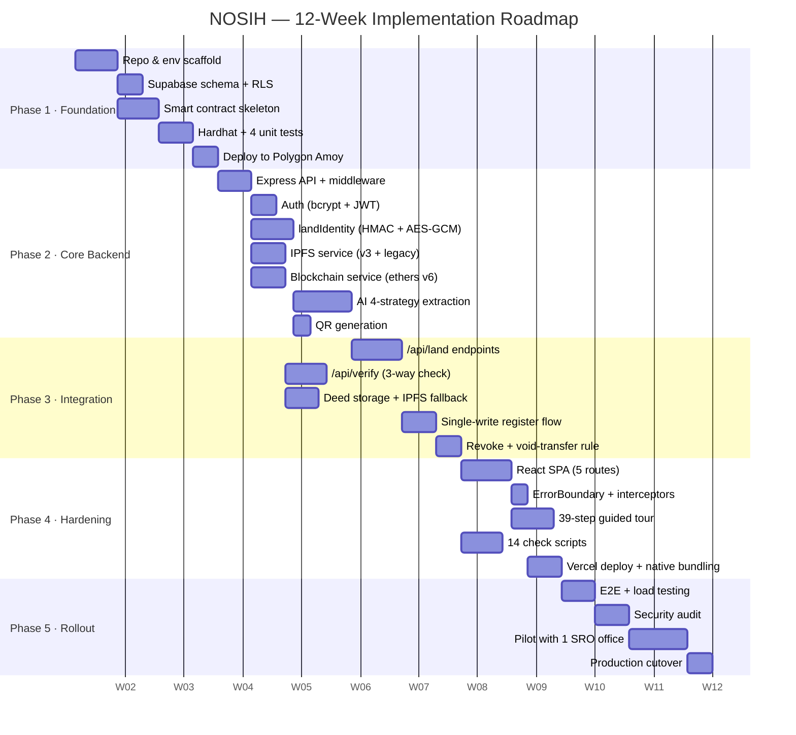

---

## 2. Phase Breakdown

### Phase 1 — Foundation (Weeks 1-2)

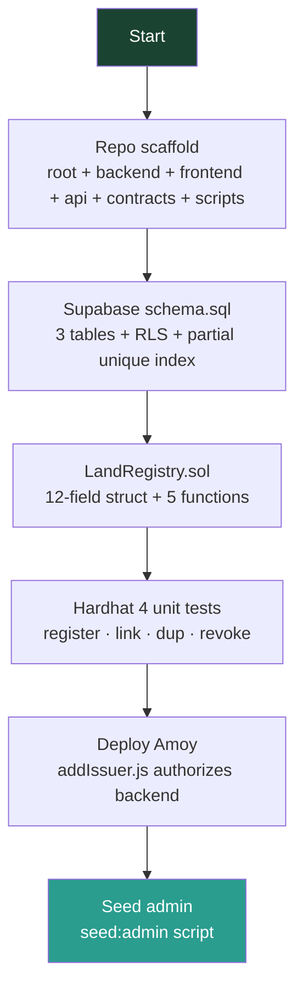

| Task | Deliverable | Gate |
|---|---|---|
| Repo + env scaffold | Monorepo with `backend/`, `frontend/`, `api/`, `contracts/`, `scripts/`, `.env.example` | `npm install` works in all 3 packages |
| Supabase schema | `backend/supabase/schema.sql` applied; 3 tables + RLS + partial unique index | `SELECT count(*) FROM users` returns 0, not error |
| Contract skeleton | `contracts/LandRegistry.sol` with 12-field `PropertyRecord` struct + 5 functions | `npx hardhat compile` clean |
| Unit tests | `test/LandRegistry.test.js` — 4 tests covering all paths | `npx hardhat test` → 4/4 passing |
| Deploy Amoy | `scripts/deploy.js` + `scripts/addIssuer.js` run on Amoy (chain 80002) | `CONTRACT_ADDRESS` set in `.env`; `authorizedRegistrars(issuer)` returns true |
| Seed admin | `npm run seed:admin` inserts first admin row | Login works with seeded credentials |

### Phase 2 — Core Backend (Weeks 3-6)

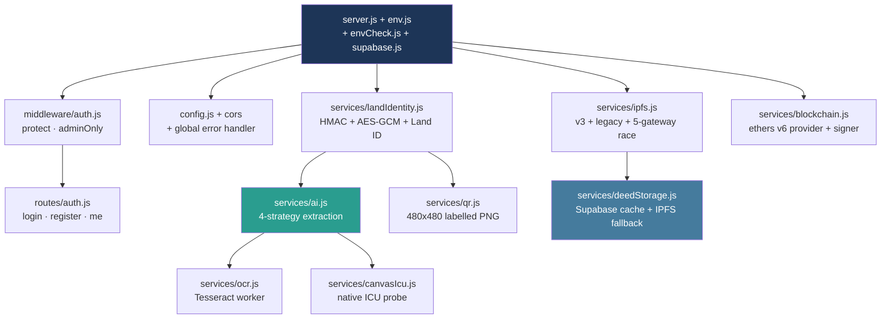

| Task | Deliverable | Gate |
|---|---|---|
| Express bootstrap | `server.js`, `env.js`, `envCheck.js`, `supabase.js`, `config.js` | `node server.js` boots; `/api/health` returns `200 ok` |
| Auth middleware | `middleware/auth.js` (`protect`, `adminOnly`) + `routes/auth.js` | `POST /api/auth/login` returns JWT; `GET /api/auth/me` returns user |
| Land identity | `services/landIdentity.js` — HMAC, AES-256-GCM encrypt/decrypt, Land ID derivation, owner pseudonym resolution | `assertLandSecrets()` passes at boot |
| IPFS service | `services/ipfs.js` — v3 upload, legacy fallback, 5-gateway race | `npm run check:ipfs` → CID pinned, gateways race, fetch returns ciphertext |
| Blockchain service | `services/blockchain.js` — ethers v6 provider + signer + contract read/write | `npm run check:gas` reports successful read |
| AI extraction | `services/ai.js` — 4-strategy chain, `EXTRACTION_BUDGET_MS`, retries, parallel mode | `npm run check:extract` returns 18 fields from sample PDF |
| OCR + canvas ICU | `services/ocr.js`, `services/canvasIcu.js` | `npm run check:pdf` validates both paths |
| QR + deed storage | `services/qr.js`, `services/deedStorage.js` | Sample QR generated at 480×480 with label |

### Phase 3 — Integration (Weeks 7-8)

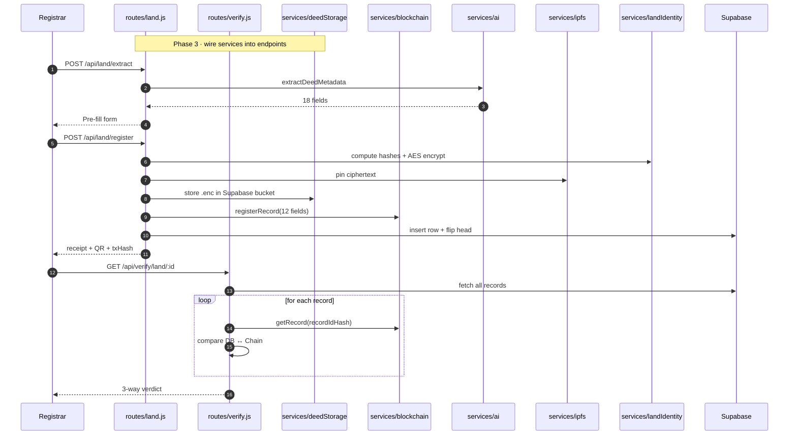

| Task | Deliverable | Gate |
|---|---|---|
| `/api/land` endpoints | `routes/land.js` — `extract`, `preview`, `register`, list, `stats`, `get`, `document`, `revoke` | Postman suite passes for all 8 endpoints |
| `/api/verify` endpoints | `routes/verify.js` — 3-way integrity check, public document upload, QR | Public read returns zero-PII timeline; PDF upload verdict matches |
| Deed storage integration | `services/deedStorage.js` orchestrates Supabase → IPFS fallback + backfill | `X-IPFS-Source` header reveals winning source |
| Single-write register flow | 8-step orchestration with failure recovery | Manual revoke + restore prior head works; old head `is_latest=true` again |
| Void-transfer rule | Revoke auto-restores prior head; next transfer links to the pre-revoke owner | DB invariant: exactly one `is_latest=true` per `land_id` |

### Phase 4 — Hardening (Weeks 9-10)

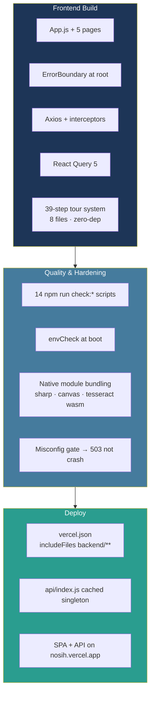

| Task | Deliverable | Gate |
|---|---|---|
| React SPA | `App.js` + 5 pages (Login, Dashboard, Register, Records, Verify) + Layout | All 5 routes render; `PrivateRoute` redirects unsigned users |
| ErrorBoundary + interceptors | Recovery card on throw; 401 → token clear + `/login` redirect | Deliberately malformed API response doesn't crash the UI |
| 39-step tour | 8-file tour system with auth gating, cross-route nav, read-only demo mode | `npm run check:tour` validates all 39 anchors against rendered markup |
| 14 check scripts | `check:env`, `check:runtime`, `check:services`, `check:ipfs`, `check:pdf`, `check:tour`, `check:boot`, `check:ui-failure`, `check:extract`, `check:extract:resilience`, `check:gas`, `check:login`, `check:vercel`, `check:deploy` | All 14 pass in CI on every PR |
| Vercel deploy | `vercel.json`, `api/index.js`, native bundling via `includeFiles` | `nosih.vercel.app` responds `200` on `/api/health` and serves SPA |

### Phase 5 — Rollout (Weeks 11-12)

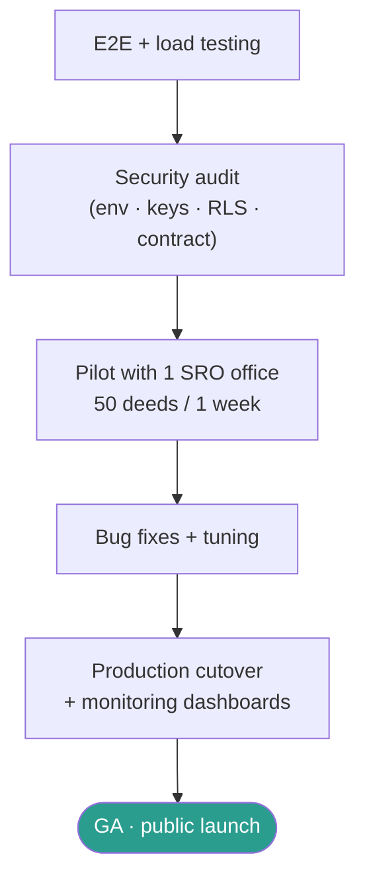

| Task | Deliverable | Gate |
|---|---|---|
| E2E + load testing | Playwright suite covering register → verify → revoke; 100 concurrent verify requests | p95 verification latency < 2 s |
| Security audit | External review of env vars, key rotation policy, RLS policies, contract bytecode | No critical findings open |
| Pilot deployment | 1 SRO office registers 50 deeds over 1 week | Zero data-loss events; 100% chain-DB consistency |
| Production cutover | Monitoring dashboards (Vercel + Supabase + Pinata + Polygon); runbook for revoke/restore | 99.9% uptime over 7-day observation |

---

## 3. Milestones & Deliverables

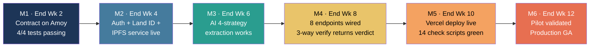

| Milestone | Week | Deliverable | Acceptance Criteria |
|---|---|---|---|
| **M1** | 2 | Smart contract on Polygon Amoy | `npx hardhat test` → 4/4 · `CONTRACT_ADDRESS` set · `addIssuer.js` run |
| **M2** | 4 | Backend foundation (auth + crypto + IPFS) | `npm run check:env`, `check:services`, `check:ipfs` all green |
| **M3** | 6 | AI extraction pipeline | `npm run check:extract` returns 18 fields from a sample scanned deed |
| **M4** | 8 | Full API surface | Manual Postman suite covers all 15 endpoints; 3-way verify returns verdict in <2 s |
| **M5** | 10 | Vercel production deploy | All 14 `check:*` scripts pass in CI; `nosih.vercel.app` live with `/verify` public |
| **M6** | 12 | Pilot validated → GA | 1 SRO office · 50 deeds · zero data loss · 99.9% uptime observed |

---

## 4. Testing Strategy

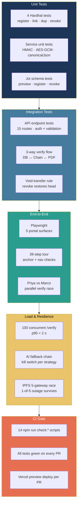

| Layer | Tool | Coverage Target |
|---|---|---|
| Smart contract | Hardhat + Chai | 4/4 paths (registration, linking, auth/duplicate revert, single revocation) |
| Service units | Node `assert` + manual | HMAC determinism, AES round-trip, canonical JSON stability |
| API integration | Postman + supertest | All 15 endpoints × happy + error paths |
| E2E | Playwright | 5 portal surfaces; full register → verify → revoke cycle |
| Tour | `check-tour-steps.mjs` | All 39 anchors resolve against rendered markup |
| Load | k6 or autocannon | 100 concurrent verifies, p95 < 2 s |
| Resilience | Chaos test | Kill 1 IPFS gateway, kill Gemini API → verify must still complete |
| CI gate | `npm run check:*` × 14 | All green on every PR; Vercel preview auto-deployed |

---

## 5. CI/CD Pipeline

| Stage | Command | Failure Action |
|---|---|---|
| Lint | `eslint .` + `prettier --check` | Block PR |
| Contract test | `npx hardhat test` (4/4) | Block PR |
| Env audit | `npm run check:env` + `check:runtime` | Block PR |
| Service check | `npm run check:services` + `check:ipfs` | Block PR |
| PDF / tour check | `npm run check:pdf` + `check:tour` | Block PR |
| Boot / UI check | `npm run check:boot` + `check:ui-failure` | Block PR |
| Frontend build | `npm run build --prefix frontend` | Block PR |
| Preview deploy | Vercel auto-deploy per PR | Manual review |
| Smoke test | `node scripts/smoke-api.js` against preview | Block merge |
| Prod deploy | Auto on merge to `main` | Rollback via Vercel CLI |

---

## 6. Deployment Strategy

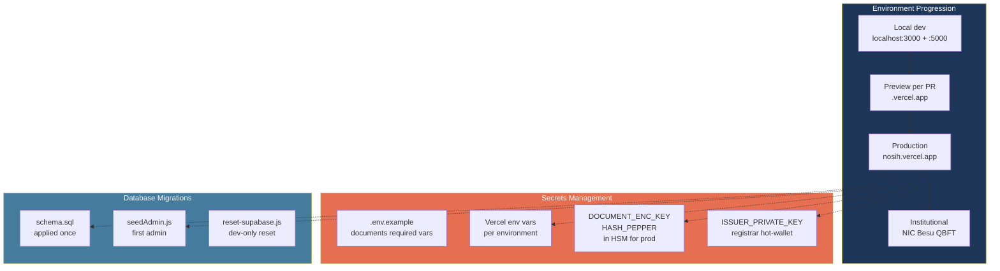

| Environment | URL | DB | Chain | Secrets |
|---|---|---|---|---|
| Local | `localhost:3000` + `:5000` | Supabase project (dev) | Polygon Amoy | `.env` file |
| Preview | `<pr-hash>.vercel.app` | Supabase project (dev) | Polygon Amoy | Vercel env (preview) |
| Production | `nosih.vercel.app` | Supabase project (prod) | Polygon Amoy → Besu | Vercel env (prod) + HSM for keys |
| Institutional | custom domain | NIC-hosted Postgres | NIC Besu QBFT (5 validators) | HSM-bound keys · on-prem |

**Rollback strategy:** Vercel instant rollback to previous deployment via CLI or dashboard. Database writes are append-only (records never deleted) — no rollback needed for chain or DB. Vercel env var change requires redeploy.

---

## 7. Risk Management

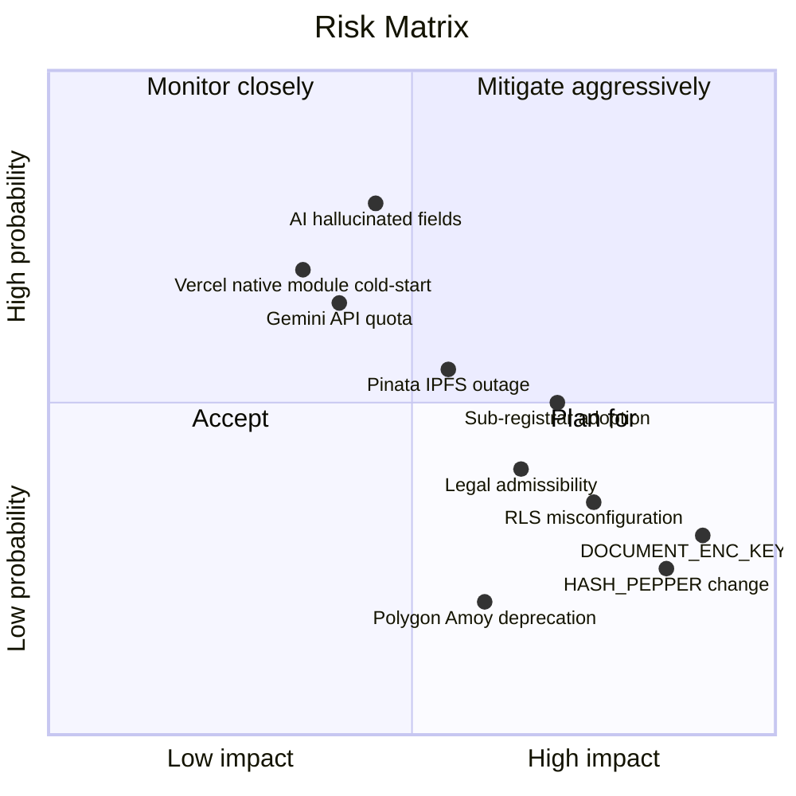

| Risk | Probability | Impact | Mitigation |
|---|---|---|---|
| **DOCUMENT_ENC_KEY loss** | Low | Catastrophic | HSM-backed key vault in prod; documented in `.env.example` as "losing it loses every deed". Backup key in offline safe. |
| **HASH_PEPPER rotation** | Low | Catastrophic | Pepper migration script + planned backfill window. Documented as "changes every Land ID so new deeds stop linking to old ones". |
| **Pinata IPFS outage** | Medium | High | 5-gateway `Promise.any` race + Supabase Storage ciphertext cache as primary read path. |
| **Gemini API quota / outage** | Medium | Medium | 4-strategy fallback chain ends in local Tesseract OCR; worst case the registrar types fields manually. |
| **Polygon Amoy deprecation** | Low | High | Contract is EVM-equivalent; redeployment to Besu QBFT is a `hardhat.config.js` change. |
| **Vercel native cold-start issue** | High | Low | `includeFiles: backend/**` + `keepCoreInTheBundle` / `keepIcuDataInTheBundle` literal `require()` specifiers; lazy-load native modules. |
| **RLS misconfiguration** | Low | Catastrophic | `envCheck.js` validates `SUPABASE_SERVICE_ROLE_KEY` shape; boot audit `SELECT id LIMIT 1` on every cold start. |
| **AI hallucinated fields** | High | Medium | Registrar approves every extraction; `Joi` validates output; `FIELD_DESCRIPTIONS` map drives both prompt and schema (no drift). |
| **Sub-registrar adoption resistance** | Medium | High | 39-step guided tour; in-person training; pilot office with 50-deed trial; minimal registrar UI surface. |
| **Legal admissibility** | Medium | High | NOSIH produces **evidence**, not verdicts — `disclaimer` field returned on every verify response. |

---

## 8. Key Material Management

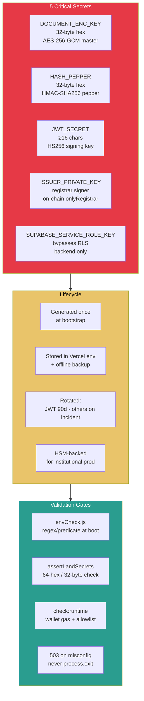

| Secret | Validation | Rotation Policy | Loss Impact |
|---|---|---|---|
| `DOCUMENT_ENC_KEY` | 64 hex chars (32 bytes) | Only on incident; backfill required | Every deed becomes unreadable |
| `HASH_PEPPER` | 64 hex chars (32 bytes) | Only on incident; backfill required | Every Land ID changes — breaks chain linking |
| `JWT_SECRET` | ≥ 16 chars | Every 90 days | All sessions invalidated |
| `ISSUER_PRIVATE_KEY` | `0x` + 64 hex | Quarterly via `addRegistrar` + `removeRegistrar` | Unauthorized writes possible until revoked |
| `SUPABASE_SERVICE_ROLE_KEY` | `sb_secret_` prefix or ≥ 32 chars | Quarterly via Supabase dashboard | Anon RLS still blocks; only service-role bypass lost |

---

## 9. Operational Readiness

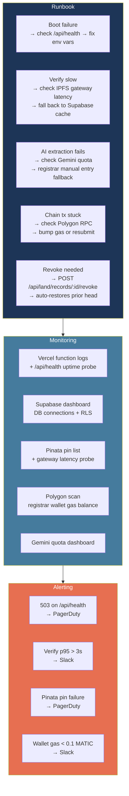

| Runbook Scenario | Trigger | Action |
|---|---|---|
| Boot failure | `/api/health` returns `503` | Read `problems[]` from response → fix env var in Vercel → redeploy |
| Verify latency spike | p95 > 3 s | Check IPFS gateway latency; Supabase cache should mask IPFS outage |
| AI extraction failure | `extractDeedMetadata` returns `{success: false}` | Check Gemini quota; registrar types fields manually |
| Chain tx stuck | `tx.wait()` not mining in 60 s | Check Polygon RPC; bump gas or resubmit via `registerRecordOnChain` |
| Fraudulent record needs revocation | Registrar reports forged deed | `POST /api/land/records/:id/revoke` with reason → void-transfer rule restores prior head |
| Wallet gas low | Gas balance < 0.1 MATIC | Top up via faucet (testnet) or treasury (mainnet); alert Slack |

---

## 10. Institutional Rollout Path

| Phase | Scope | Chain | Key Change |
|---|---|---|---|
| **Pilot** | 1 SRO office, 50 deeds | Polygon Amoy (testnet) | Validate UX, latency, registrar workflow |
| **District** | 5 SROs, 500 deeds | Polygon Amoy | Validate multi-registrar concurrency, search/verify load |
| **State** | 50 SROs, 5000+ deeds | Polygon mainnet OR Besu staging | Real gas costs, public-verifier load |
| **Besu migration** | State-wide | NIC Hyperledger Besu QBFT (5 validators) | Zero gas, permissioned validator set, on-prem DB |
| **National** | Multi-state federation | Federated Besu network | Cross-state verify; Bhu-Aadhaar ULPIN binding at scale |

---

## 11. Success Metrics

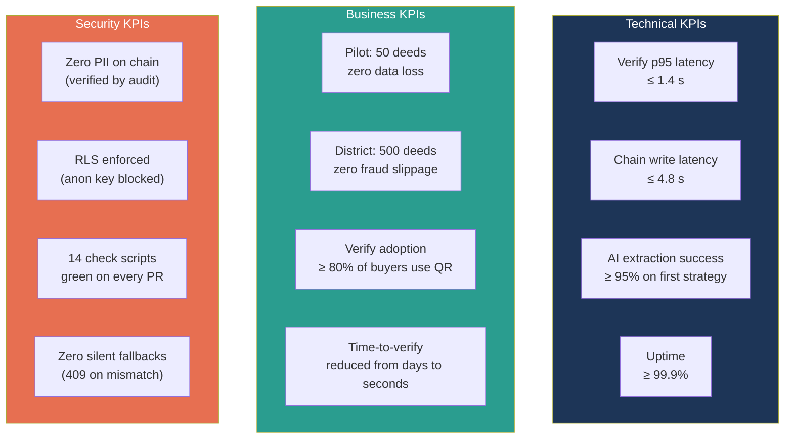

| KPI Category | Metric | Target |
|---|---|---|
| **Latency** | Public verify p95 | ≤ 1.4 s |
| **Latency** | Chain write p95 | ≤ 4.8 s |
| **Latency** | AI extraction success rate (first strategy) | ≥ 95% |
| **Availability** | Uptime | ≥ 99.9% |
| **Adoption** | Pilot deeds registered | ≥ 50 in week 1 |
| **Adoption** | Verify usage | ≥ 80% of buyers use QR |
| **Integrity** | DB ↔ Chain mismatches | 0 |
| **Security** | PII fields on-chain | 0 |
| **Resilience** | Silent fallbacks | 0 (every mismatch → 409) |
| **CI** | `check:*` scripts green | 14 / 14 on every PR |

---

**[Live App](https://nosih.vercel.app/)** · **[Public Verifier](https://nosih.vercel.app/verify)** · **[GitHub](https://github.com/rmn2178/nosih-secure)**

*12 weeks. 5 phases. 14 verification gates. One immutable registry.*

