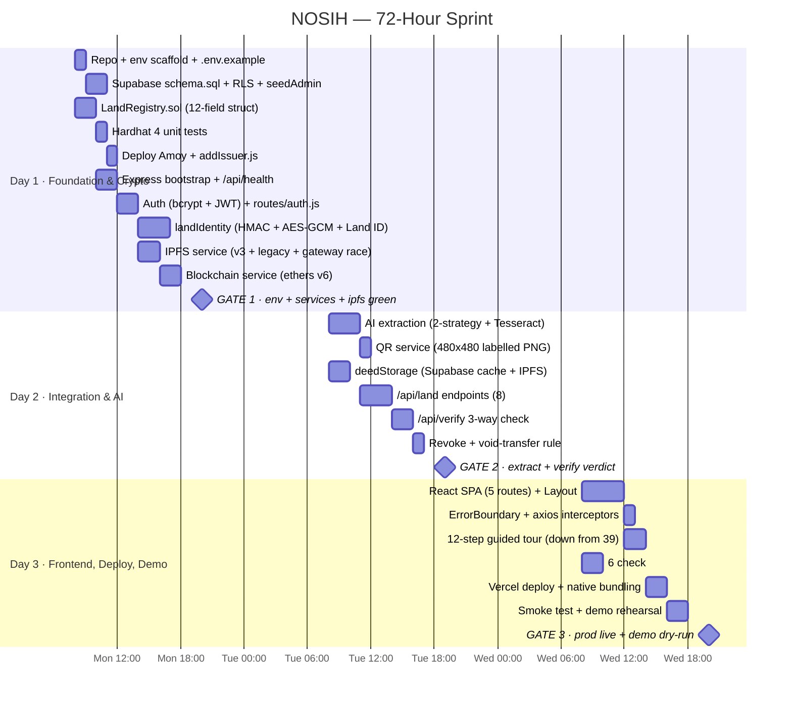
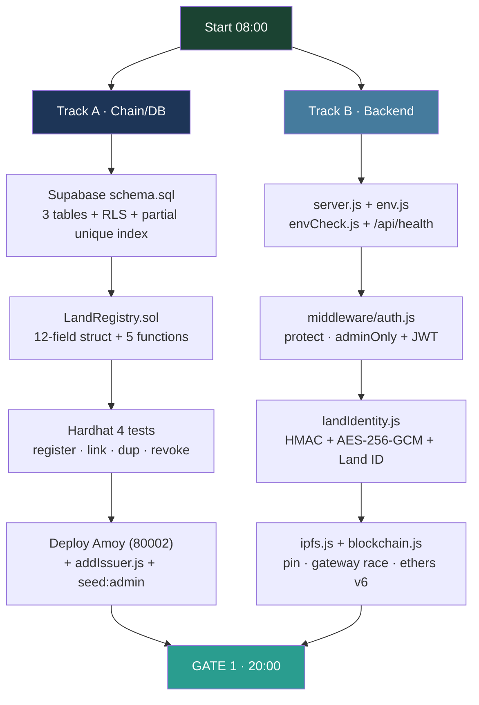
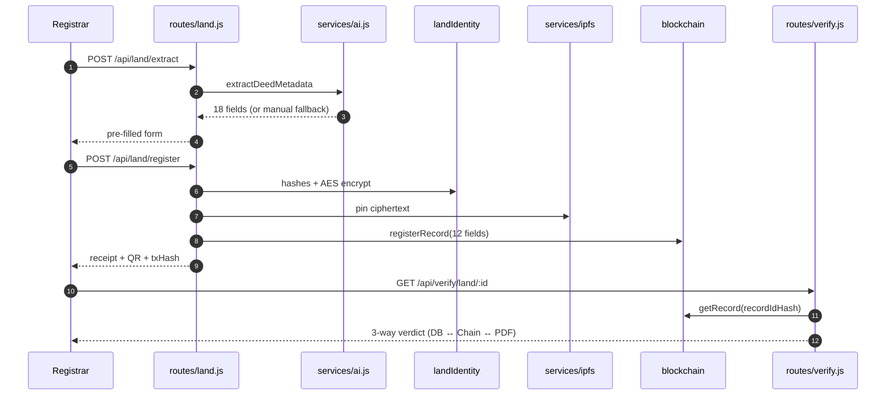
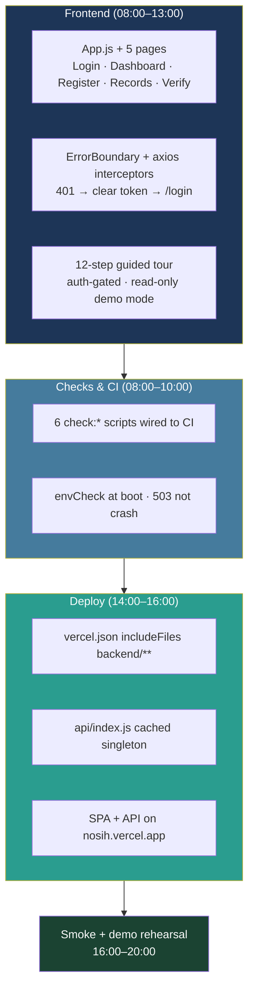
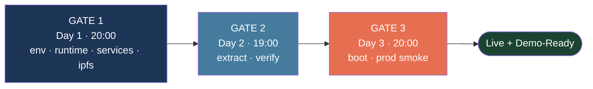
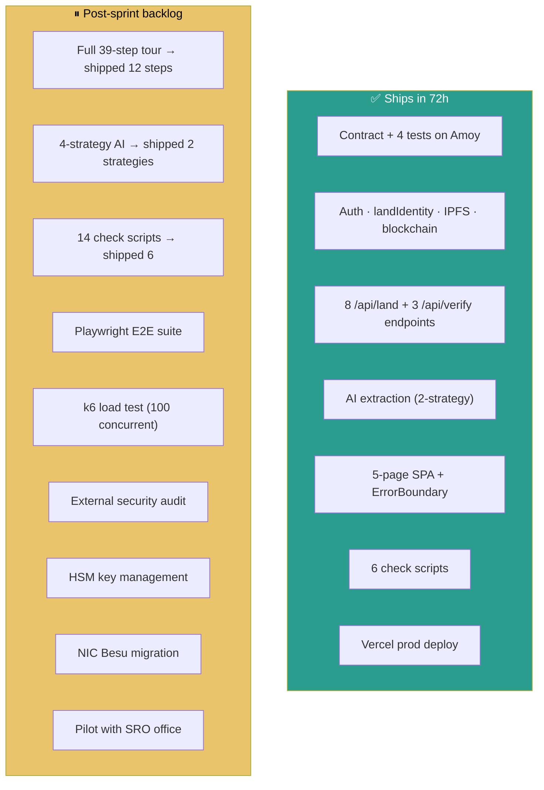
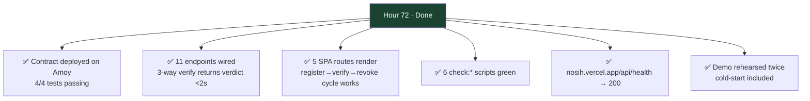

# NOSIH — 72-Hour Implementation Strategy

### 3 Days · 3 Phases · 6 Verification Gates · 2 Parallel Tracks

> **Compression note:** the 12-week plan is re-cut into a 72-hour sprint by running **2 engineers in parallel** (Track A = chain/DB, Track B = backend/AI) and by **deferring non-blocking polish** to a post-sprint backlog (see §4 Scope Triage). Every deferred item is listed explicitly — nothing is silently dropped.

---

## 1. Execution Plan at a Glance

---

## 2. Phase Breakdown

### Day 1 — Foundation & Crypto (08:00 → 20:00)

| Hr | Task | Deliverable | Gate |
|---|---|---|---|
| 08–09 | Repo + env scaffold | Monorepo `backend/ frontend/ api/ contracts/ scripts/` + `.env.example` | `npm install` works ×3 |
| 08–10 | Contract skeleton | `LandRegistry.sol` — 12-field `PropertyRecord` + 5 functions | `npx hardhat compile` clean |
| 09–11 | Supabase schema | `schema.sql` applied — 3 tables, RLS, partial unique index | `SELECT count(*) FROM users` → `0`, not error |
| 10–12 | Express bootstrap | `server.js`, `env.js`, `envCheck.js`, `supabase.js` | `/api/health` → `200 ok` |
| 10–11 | Hardhat tests | `test/LandRegistry.test.js` — 4 paths | `npx hardhat test` → 4/4 |
| 11–12 | Deploy Amoy | `deploy.js` + `addIssuer.js` + `seed:admin` | `authorizedRegistrars(issuer) === true` |
| 12–14 | Auth | `middleware/auth.js` + `routes/auth.js` | `POST /api/auth/login` returns JWT; `/me` returns user |
| 14–17 | Land identity | `landIdentity.js` — HMAC, AES-GCM, Land ID, pseudonym | `assertLandSecrets()` passes at boot |
| 14–16 | IPFS service | `ipfs.js` — v3 + legacy + 5-gateway `Promise.any` | `npm run check:ipfs` → CID pinned, fetch returns ciphertext |
| 16–18 | Blockchain service | `blockchain.js` — provider + signer + read/write | `npm run check:gas` → successful read |
| 18–20 | **GATE 1** | `check:env` · `check:runtime` · `check:services` · `check:ipfs` | 4/4 green |

---

### Day 2 — Integration & AI (08:00 → 19:00)

| Hr | Task | Deliverable | Gate |
|---|---|---|---|
| 08–11 | AI extraction | `ai.js` — **2-strategy chain** (Gemini → Tesseract), `EXTRACTION_BUDGET_MS`, retries | `check:extract` returns ≥18 fields from sample PDF |
| 08–10 | Deed storage | `deedStorage.js` — Supabase cache → IPFS fallback + backfill | `X-IPFS-Source` header reveals winning source |
| 11–12 | QR | `qr.js` — 480×480 labelled PNG | Sample QR renders with label |
| 11–14 | `/api/land` | `extract`, `preview`, `register`, list, `stats`, `get`, `document`, `revoke` | Postman suite passes all 8 |
| 14–16 | `/api/verify` | 3-way integrity check + public document upload + QR | Public read returns zero-PII timeline; verdict matches |
| 16–17 | Revoke + void-transfer | Revoke auto-restores prior head; next transfer links to pre-revoke owner | DB invariant: exactly one `is_latest=true` per `land_id` |
| 17–19 | **GATE 2** | `check:extract` · `check:verify` + manual register→verify→revoke cycle | 2/2 green + end-to-end walkthrough succeeds |

---

### Day 3 — Ship (08:00 → 20:00)

| Hr | Task | Deliverable | Gate |
|---|---|---|---|
| 08–12 | React SPA | `App.js` + 5 pages + `Layout` + `PrivateRoute` | All 5 routes render; unsigned user redirected |
| 12–13 | Resilience | `ErrorBoundary` recovery card; 401 → token clear + `/login` | Malformed API response doesn't crash UI |
| 12–14 | Guided tour | **12 steps** (was 39) — auth gating, cross-route nav, read-only demo | Every anchor resolves against rendered markup |
| 08–10 | Check scripts | `check:env`, `check:runtime`, `check:services`, `check:ipfs`, `check:extract`, `check:verify` | 6/6 pass in CI |
| 14–16 | Vercel deploy | `vercel.json`, `api/index.js`, native bundling via `includeFiles` (`sharp`, `canvas`, `tesseract.wasm`) | `nosih.vercel.app/api/health` → `200`; SPA served |
| 16–18 | Smoke | `scripts/smoke-api.js` against prod: register → verify → revoke | Full cycle completes; `txHash` on Amoy explorer |
| 18–20 | **GATE 3** | Live demo rehearsal ×2, cold-start rehearsal | Demo passes twice consecutively |

---

## 3. Verification Gates (6 total)

| Gate | Script(s) | Pass Criteria | If It Fails |
|---|---|---|---|
| **G1** | `check:env` `check:runtime` `check:services` `check:ipfs` | 4/4 green · wallet has gas · CID fetchable | Stop, fix env — do not start Day 2 |
| **G2** | `check:extract` `check:verify` | 18 fields extracted · 3-way verdict returns in <2 s | Ship with manual-entry fallback + Tesseract only |
| **G3** | `check:boot` + prod smoke | `/api/health` → 200 on Vercel · full cycle in prod | Roll back via Vercel CLI; demo from `localhost` |

---

## 4. Scope Triage — What Ships vs. What Waits

| Item | 12-Week Plan | 72-Hour Plan | Rationale |
|---|---|---|---|
| Guided tour | 39 steps | **12 steps** (register → verify happy path) | Demo-critical path only; anchors rest in backlog |
| AI extraction | 4-strategy chain | **2-strategy** (Gemini → Tesseract) + manual override | Registrar approves every extraction anyway |
| Check scripts | 14 | **6** (the boot/security-critical ones) | Remaining 8 are polish, not correctness |
| AI retries | Parallel mode + retries | Sequential + 1 retry | Latency budget absorbed by manual fallback |
| E2E | Playwright 5 surfaces | **Manual + smoke script** | Not enough time to stabilize Playwright selectors |
| Load test | 100 concurrent, p95 <2 s | **Deferred** | Single-office pilot doesn't need it yet |
| Security audit | External, 4 days | **Deferred** to Week 2 | Nothing in a 3-day sprint is production-critical |
| Pilot | 1 SRO, 50 deeds | **Demo to stakeholders** | Pilot needs audit sign-off first |

---

## 5. Testing Strategy (Compressed)

| Layer | Tool | In Sprint? | Coverage |
|---|---|---|---|
| Smart contract | Hardhat + Chai | ✅ | 4/4 — register, link, dup/auth revert, revoke |
| Crypto units | Node `assert` | ✅ | HMAC determinism, AES round-trip, canonical JSON stability |
| API smoke | Postman + supertest | ✅ | 11 endpoints × happy path + 401/409 errors |
| AI extraction | `check:extract` | ✅ | 18 fields from one sample scanned deed |
| 3-way verify | `check:verify` | ✅ | DB ↔ Chain ↔ PDF verdict on 3 seeded records |
| E2E (Playwright) | Playwright | ⏸ Deferred | — |
| Load (k6) | k6 | ⏸ Deferred | — |
| Tour anchors | `check:tour` | ⚠️ Partial | 12 shipped steps only |

---

## 6. CI/CD (Minimal Viable)

```mermaid
flowchart LR
    PUSH["push to branch"] --> LINT["eslint + prettier"]
    LINT --> HT["hardhat test (4/4)"]
    HT --> CHK["6 check:* scripts"]
    CHK --> BUILD["frontend build"]
    BUILD --> PREV["Vercel preview"]
    PREV --> MERGE["merge → main"]
    MERGE --> PROD["Vercel prod"]
    PROD --> SMOKE["smoke-api.js"]

    style CHK fill:#e9c46a,color:#000
    style PROD fill:#e76f51,color:#fff
```

| Stage | Command | Blocking? |
|---|---|---|
| Lint | `eslint .` | Yes |
| Contract | `npx hardhat test` | Yes |
| Checks | `npm run check:env check:runtime check:services check:ipfs check:extract check:verify` | Yes |
| Build | `npm run build --prefix frontend` | Yes |
| Preview | Vercel per-PR | No |
| Prod | auto on merge to `main` | — |
| Smoke | `node scripts/smoke-api.js` | Yes (post-deploy) |

---

## 7. Risk Register (Sprint-Scoped)

| Risk | Likelihood | Impact | Mitigation in 72h |
|---|---|---|---|
| Amoy faucet dry / no gas | High | Blocks Deploy | Fund wallet **before 08:00 Day 1**; 2 backup wallets ready |
| Native module bundling breaks on Vercel (`sharp`/`canvas`/`tesseract`) | High | Blocks deploy | Test `includeFiles` on a **stub deploy at 10:00 Day 1**, not Day 3 |
| AI extraction fails on sample deed | Medium | Demo shows blank form | Manual-entry fallback is always reachable; pre-extract 3 sample deeds as fixtures |
| `DOCUMENT_ENC_KEY` / `HASH_PEPPER` mismatch between local and Vercel | Medium | Deeds unreadable in prod | `check:env` validates shape at boot; paste from single source of truth |
| IPFS (Pinata) outage mid-demo | Low | Verify stalls | Supabase ciphertext cache is the primary read path |
| Postgres RLS misconfigured | Low | Catastrophic | `envCheck` boot audit `SELECT id LIMIT 1` on every cold start |
| Scope creep from 12-week doc | High | Nothing ships | **§4 triage is binding** — anything not in the ✅ column is a stretch goal |

---

## 8. Secrets (Unchanged — Still 5 Critical)

| Secret | Validation | 72h Handling |
|---|---|---|
| `DOCUMENT_ENC_KEY` | 64 hex (32 bytes) | Generated Day 1 08:00, pasted into Vercel + offline note |
| `HASH_PEPPER` | 64 hex (32 bytes) | Same |
| `JWT_SECRET` | ≥16 chars | Same |
| `ISSUER_PRIVATE_KEY` | `0x` + 64 hex | Faucet-funded Day 0 |
| `SUPABASE_SERVICE_ROLE_KEY` | `sb_secret_` prefix | Day 1 09:00 |

> **Loss impact unchanged:** losing `DOCUMENT_ENC_KEY` loses every deed; changing `HASH_PEPPER` breaks every Land ID and all chain linking. Neither is rotated during the sprint.

---

## 9. Definition of Done — Hour 72

| # | Done When | Verified By |
|---|---|---|
| 1 | `npx hardhat test` → 4/4; `CONTRACT_ADDRESS` set | Gate 1 |
| 2 | Full register → verify → revoke cycle on prod returns a verdict | Gate 2 + Gate 3 smoke |
| 3 | `/verify` public page shows zero-PII timeline | Manual |
| 4 | Revoke restores prior head; exactly one `is_latest=true` per `land_id` | SQL invariant check |
| 5 | All 6 `check:*` scripts pass in CI | Gate 3 |
| 6 | `nosih.vercel.app` serves SPA + API; native modules load on cold start | Gate 3 |
| 7 | Demo runs twice consecutively without a manual fix | Rehearsal |

---

## 10. Post-Sprint Backlog (Week 2+)

| Priority | Item | Unblocks |
|---|---|---|
| P0 | External security audit (env, keys, RLS, bytecode) | Any real pilot |
| P0 | Restore 39-step tour + remaining 8 check scripts | Registrar adoption |
| P1 | Playwright E2E + k6 load (100 concurrent, p95 <2 s) | District rollout |
| P1 | 4-strategy AI chain with parallel mode | 95% first-strategy extraction |
| P2 | HSM-backed key management | Institutional prod |
| P2 | NIC Besu QBFT migration (5 validators) | State rollout |
| P3 | Pilot with 1 SRO office — 50 deeds / 1 week | GA |

---

**[Live App](https://nosih.vercel.app/)** · **[Public Verifier](https://nosih.vercel.app/verify)** · **[GitHub](https://github.com/rmn2178/nosih-secure)**

*72 hours. 3 phases. 6 gates. One immutable registry.*

