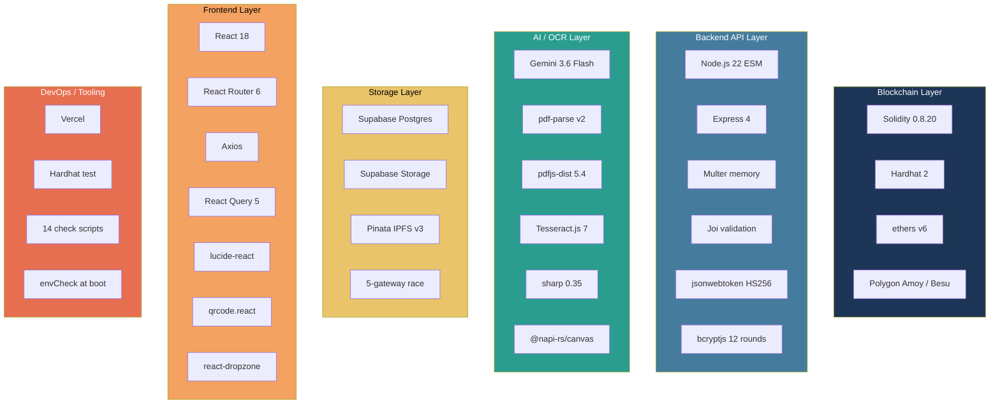
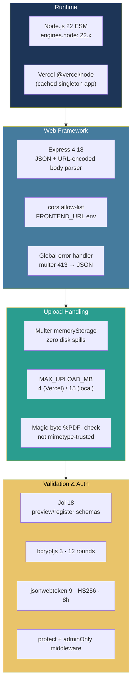
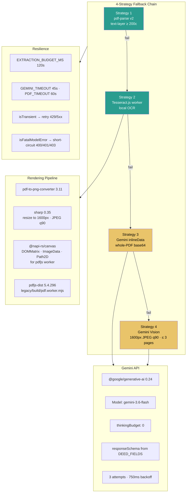
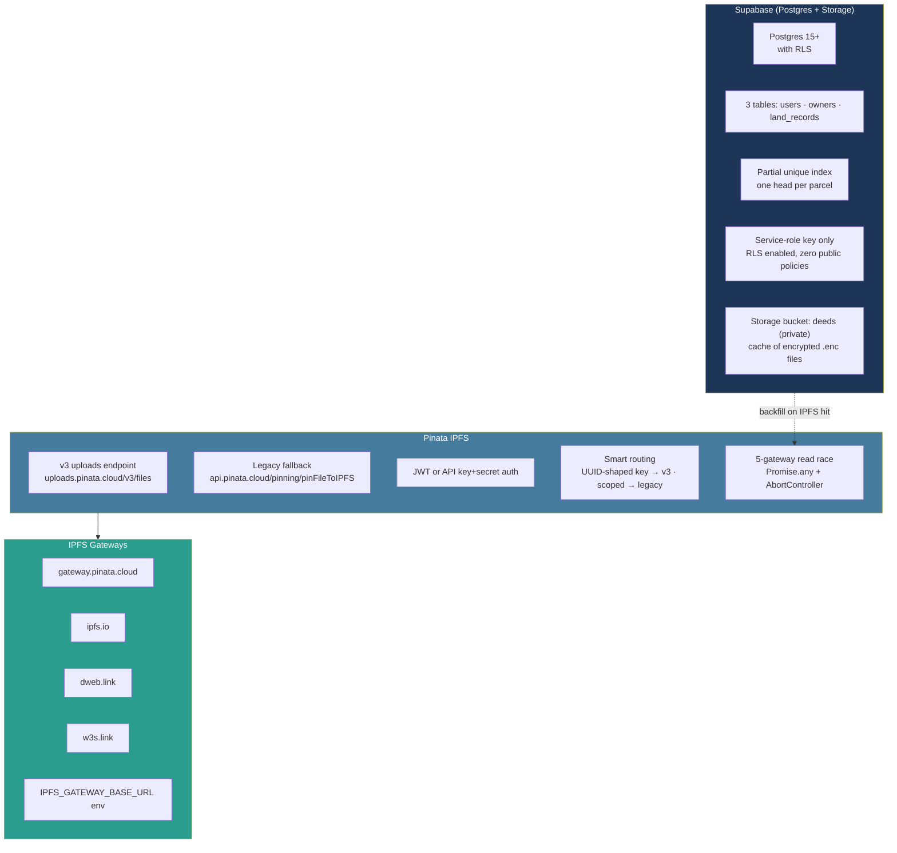
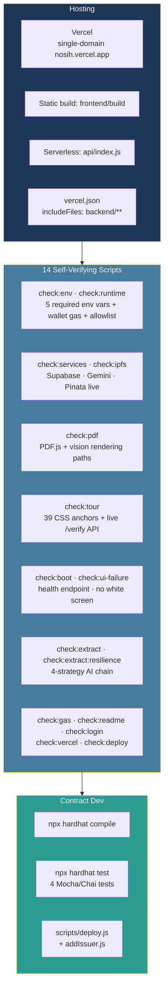
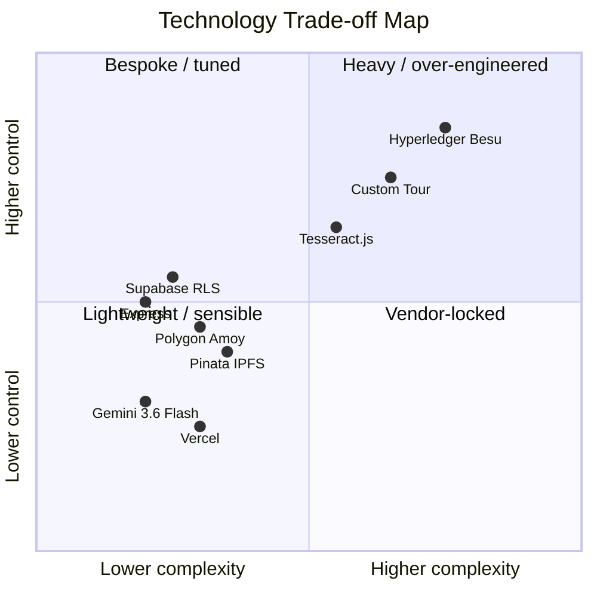
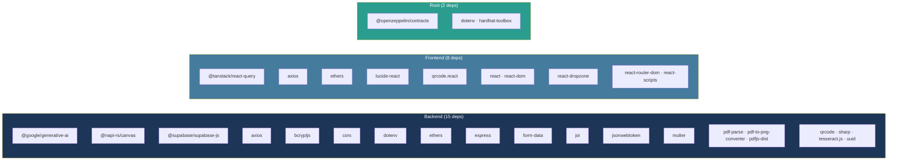
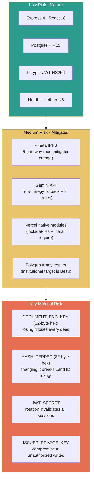

# NOSIH — Proposed Technologies

### A Minimal, Battle-Tested Stack for Tamper-Evident Land Registry

---

## 1. Tech Stack at a Glance

| Layer | Technology | Version | Role in NOSIH |
|---|---|---|---|
| **Blockchain** | Solidity · Hardhat · ethers · Polygon Amoy | `0.8.20` · `2.19` · `6.8` · chain `80002` | 12-field single-write anchor + free public reads |
| **Backend API** | Node.js · Express · Multer · Joi · jsonwebtoken · bcryptjs | `22.x` · `4.18` · `1.4.5-lts` · `18` · `9` · `3.0` | Memory-only PDF · crypto orchestration · JWT 8h |
| **AI Extraction** | Google Gemini · pdf-parse · pdfjs-dist · Tesseract.js · sharp · @napi-rs/canvas | `gemini-3.6-flash` · `2.4` · `5.4.296` · `7` · `0.35` · `1.1` | 4-strategy extraction · 18 fields · local-OCR fallback |
| **Storage** | Supabase Postgres · Supabase Storage · Pinata IPFS | latest · latest · v3 + legacy | RLS vault · ciphertext bucket · content-addressed |
| **Frontend** | React · React Router · Axios · React Query · Lucide · qrcode.react · react-dropzone | `18.2` · `6.20` · `1.6` · `5.8` · `1.60` · `3.1` · `14.2` | SPA · ErrorBoundary · 39-step tour |
| **DevOps** | Vercel · 14 check scripts · envCheck | n/a | Single-domain deploy · boot audit · self-verifying CI |

---

## 2. Blockchain Layer

```mermaid
graph LR
    subgraph CONTRACT["Smart Contract"]
        SC1["LandRegistry.sol<br/>Solidity 0.8.20"]
        SC2["OpenZeppelin Ownable"]
        SC3["onlyRegistrar modifier"]
        SC4["12-field PropertyRecord struct"]
    end

    subgraph TOOLING["Dev Tooling"]
        T1["Hardhat 2.19<br/>+ hardhat-toolbox"]
        T2["ethers v6.8<br/>JsonRpcProvider · Wallet"]
        T3["4 Mocha/Chai tests<br/>(register · link · dup · revoke)"]
    end

    subgraph DEPLOY["Deployment Targets"]
        D1["Polygon Amoy<br/>Chain ID 80002<br/>(current · public testnet)"]
        D2["Polygon Mainnet 137<br/>(optional next)"]
        D3["Hyperledger Besu QBFT<br/>5-node NIC<br/>(institutional target)"]
    end

    CONTRACT --> TOOLING --> DEPLOY

    style CONTRACT fill:#1d3557,color:#fff
    style TOOLING fill:#457b9d,color:#fff
    style DEPLOY fill:#2a9d8f,color:#fff
```

| Choice | Rationale |
|---|---|
| **Solidity `0.8.20`** | Mature, overflow-checked, broad toolchain support. |
| **OpenZeppelin `Ownable`** | Audited ownership primitive; `addRegistrar` / `removeRegistrar` reuse the pattern. |
| **Single-write anchor** | One `registerRecord` call writes all 12 fields in one tx → ~4.8 s on Amoy. No history walks on-chain; the backend resolves linking pointers off-chain. |
| **Polygon Amoy (testnet)** | Low-cost, EVM-equivalent, public RPC. Deployed at `0xE5a941d9628A7d7Ab497636A204B627F29070952`. |
| **Hyperledger Besu QBFT (target)** | Permissioned 5-validator NIC network for institutional rollout — zero gas, private validator set. |
| **ethers v6** | Modern typed API, smaller bundle, `JsonRpcProvider` + `Wallet` + `Contract` ergonomics. |
| **Hardhat** | De-facto Solidity dev environment; 4 unit tests cover the contract surface. |

---

## 3. Backend API Layer

| Choice | Rationale |
|---|---|
| **Node.js 22 ESM** | Modern ES modules, top-level await, native `fetch`. `engines.node: "22.x"` enforced. |
| **Express 4** | Minimal, middleware-rich, battle-tested. Mounted under `/api/*` via Vercel rewrites. |
| **Multer memory storage** | PDF bytes never touch disk → plaintext window minimised to one request lifetime. |
| **Magic-byte check (`%PDF-`)** | Client-supplied mimetype is untrusted; only the first 5 bytes count. |
| **Joi schemas** | Compile-time-typed request validation per endpoint (preview, register, revoke). |
| **bcryptjs 12 rounds** | Industry-standard password hashing; ~250 ms per hash on Node 22. |
| **JWT HS256 · 8h** | Symmetric, no key-pair management; sliding window via fresh login. |
| **Vercel @vercel/node serverless** | Single-file `api/index.js` exports the Express app — Vercel calls it as a handler per `/api/*` request. |

---

## 4. AI / OCR Layer

| Choice | Rationale |
|---|---|
| **Gemini 3.6 Flash** | Fast, structured-JSON output via `responseSchema` derived from `DEED_FIELDS` — no drift between prompt and API contract. `gemini-3.8-flash` documented as hanging; flash chosen deliberately. |
| **pdf-parse v2** | Lightweight text-layer extractor; ≥200 chars heuristic filters out image-only PDFs cheaply. |
| **pdfjs-dist 5.4** | Mozilla's PDF engine; `legacy/build/pdf.worker.mjs` runs in a worker thread to avoid blocking the event loop. |
| **Tesseract.js 7** | Pure-JS OCR — pixels never leave the server. WASM core (6 simd/lstm variants) bundled literally so Vercel's tracer follows them. |
| **sharp 0.35** | Native image resize; converts PDF pages to 1600px JPEG q90 — Gemini Vision's preferred input size. |
| **@napi-rs/canvas** | Required by pdfjs for `DOMMatrix` / `ImageData` / `Path2D` globals. `canvasIcu.js` probes 8 ICU data variants; `keepIcuDataInTheBundle()` literally `require()`s each so the Vercel tracer follows. |
| **4-strategy fallback** | Privacy-preserving by design: text-layer → local-OCR (never leaves server) → whole-PDF → rendered-vision. Only the last resort sends pixels to Gemini. |
| **Per-call budget** | `EXTRACTION_BUDGET_MS=120000` caps concurrent requests so one slow extraction can't starve others. |

---

## 5. Storage Layer

| Choice | Rationale |
|---|---|
| **Supabase Postgres** | Managed Postgres with Row-Level Security; `gen_random_uuid()` defaults, triggers for `updated_at`, partial unique index for the single-head invariant. |
| **RLS with zero public policies** | Defence-in-depth — even if the anon key leaks, the tables are unreadable. Backend uses service-role key (bypasses RLS). |
| **Partial unique index** (`WHERE is_latest`) | Enforces "at most one current head per parcel" at the database level, not just application logic. |
| **Supabase Storage `deeds` bucket (private)** | Fast in-network read for the encrypted `.enc` cache; falls back to IPFS gateways on miss, then backfills. |
| **Pinata IPFS (v3 + legacy)** | Content-addressed ciphertext storage. The CID is the proof — bytes cannot be silently swapped. |
| **5-gateway read race (`Promise.any`)** | First gateway to respond wins; `AbortController` cancels the rest. Survives any single gateway outage. |
| **Dual storage (Supabase + IPFS)** | Speed (Supabase cache) + permanence (IPFS, content-addressed, decentralized). |

---

## 6. Frontend Layer

```mermaid
graph TB
    subgraph CORE["Core"]
        C1["React 18.2<br/>createRoot + StrictMode"]
        C2["React Router 6.20<br/>BrowserRouter · PrivateRoute"]
        C3["React Scripts 5.0.1<br/>CRA build"]
    end

    subgraph DATA["Data & Networking"]
        D1["Axios 1.6<br/>+ interceptors (401 redirect)"]
        D2["@tanstack/react-query 5.8"]
        D3["sessionStorage token<br/>cleared on tab close"]
        D4["Per-endpoint timeouts<br/>extract 90s · register 180s"]
    end

    subgraph UI["UI Components"]
        U1["lucide-react 1.60<br/>tree-shakeable icons"]
        U2["qrcode.react 3.1<br/>client QR rendering"]
        U3["react-dropzone 14.2<br/>PDF drag-and-drop"]
    end

    subgraph TOUR["Tour System (zero-dep)"]
        T1["TourProvider · Context API"]
        T2["Spotlight · box-shadow cut-out"]
        T3["TourTooltip · auto-flip positioning"]
        T4["39 steps in tourSteps.json"]
        T5["5 groups: login · dashboard · register · records · verify"]
    end

    subgraph SAFE["Safety"]
        SF1["ErrorBoundary at root<br/>prevents React 18 unmount-on-throw"]
        SF2["Array.isArray defensive checks"]
        SF3["apiErrorMessage() safe renderer"]
    end

    CORE --> DATA --> UI --> TOUR --> SAFE

    style CORE fill:#1d3557,color:#fff
    style DATA fill:#457b9d,color:#fff
    style UI fill:#2a9d8f,color:#fff
    style TOUR fill:#e9c46a,color:#000
    style SAFE fill:#e76f51,color:#fff
```

| Choice | Rationale |
|---|---|
| **React 18** | Concurrent features, `createRoot`, strict-mode double-invoke for catching side effects. |
| **React Router 6** | Declarative data-loading patterns; `PrivateRoute` validates via `/auth/me` on mount. |
| **sessionStorage (not localStorage)** | Token cleared on tab close → smaller exfil window. |
| **Axios interceptors** | Global 401 handler (except `/auth/login`) clears storage and redirects to `/login` — prevents stale-token cascades. |
| **React Query 5** | Cache + retry + invalidation for `getLandStats`, `listLandRecords`. |
| **lucide-react** | Tree-shakeable icon set; only used icons make it into the bundle. |
| **react-dropzone** | Accessible drag-and-drop with keyboard fallback. |
| **Zero-dependency tour** | 8 hand-written files (no react-joyride or shepherd.js) — 39 steps loaded from `tourSteps.json`, hooks attached via `HOOKS` map in `tourSteps.js`. |
| **ErrorBoundary at root** | React 18 unmounts the entire tree on an uncaught throw → blank screen. The boundary renders a recovery card instead. |

---

## 7. DevOps & Tooling

| Choice | Rationale |
|---|---|
| **Vercel** | Single-domain deploy (frontend + serverless API on `nosih.vercel.app`); zero-config `@vercel/node` runtime. |
| **`vercel.json includeFiles`** | Bundles the entire `backend/` folder with the serverless function — critical for native modules (`sharp`, `@napi-rs/canvas`, Tesseract WASM). |
| **14 self-verifying scripts** | `npm run check:*` covers env, services, PDF rendering, tour anchors, boot health, UI failure, extraction, gas, login, deploy. Every script is idempotent and runnable in CI. |
| **Boot-time env audit** | `envCheck.js` validates 5 required vars against regex/predicate; misconfig returns `503` on every route + reports via `/api/health` instead of `process.exit(1)`. |
| **Hardhat 4 unit tests** | Cover the 4 contract paths: registration + timestamp, follow-up linking, duplicate/auth revert, single revocation. |

---

## 8. Technology Decisions & Trade-offs

| Decision | Alternative Considered | Why NOSIH Chose |
|---|---|---|
| **Polygon Amoy** over Ethereum mainnet | Ethereum L1 | L1 gas is prohibitive for a 12-field write; Amoy is EVM-equivalent and free for the testnet phase. |
| **Hyperledger Besu QBFT** for institutional target | Polygon mainnet, private PoA | Permissioned 5-validator NIC network = zero gas, no public PII exposure, government-controlled validator set. |
| **Supabase RLS** over self-hosted Postgres | AWS RDS + custom auth | Managed, RLS built-in, service-role key bypass + Storage in one platform. |
| **Pinata IPFS** over self-hosted IPFS node | go-ipfs on EC2 | Pinata handles replication + pinning; v3 + legacy fallback covers both key types. |
| **Gemini 3.6 Flash** over GPT-4 Vision | OpenAI GPT-4V | Native `responseSchema` JSON output, faster TTFT, lower cost per token for structured extraction. |
| **Tesseract.js** over Google Vision OCR | Google Cloud Vision OCR | Pixels never leave the server — preserves privacy for deeds containing owner PII. |
| **Custom tour** over react-joyride / driver.js | Off-the-shelf tour libs | 39-step flow with cross-route navigation, auth gating, and CustomEvent hooks for read-only demo mode — libs couldn't express the "register without submitting" requirement. |
| **Express** over Fastify / Hono | Fastify, Hono | Mature middleware ecosystem (multer, cors, joi), drop-in Vercel serverless handler. |
| **CRA (react-scripts 5)** over Vite | Vite | Production-stable, zero-config, `vercel-build` script supported out of the box. |
| **AES-256-GCM** over AES-CBC | AES-CBC | GCM provides authenticated encryption — IV + tag in DB, ciphertext in IPFS; tampering of either is detected on decrypt. |
| **HMAC-SHA256 + pepper** over plain SHA-256 for survey #s | Plain SHA-256 | Survey numbers (`1`, `2`, `123/4A`) come from a tiny keyspace — public chain storage of plain SHA-256 enables brute-force enumeration in seconds. |
| **sessionStorage** over localStorage for JWT | localStorage | Token cleared on tab close reduces exfil window. |
| **Memory-only Multer** over disk storage | diskStorage | Plaintext PDF never touches disk; window is one request lifetime. |

---

## 9. Dependency Inventory

**No runtime bloat:** every dependency is justified by direct use in a service or route. Native modules (`sharp`, `@napi-rs/canvas`, Tesseract WASM) are lazy-loaded on first use so a platform binary mismatch never kills the function at import time.

---

## 10. Technology Risk Posture

| Risk | Mitigation |
|---|---|
| **Document encryption key loss** | Document in `.env.example` as "losing it loses every deed". Recommend HSM-backed key vault for institutional rollout. |
| **Hash pepper change** | Documented as "changes every Land ID so new deeds stop linking to old ones". Pepper migration requires a one-time backfill. |
| **Pinata outage** | 5-gateway `Promise.any` race + Supabase Storage ciphertext cache as primary read path. |
| **Gemini API outage** | 4-strategy fallback chain ends in local OCR (Tesseract); worst case the registrar types the fields manually. |
| **Vercel cold start with native modules** | `includeFiles: backend/**` + `keepCoreInTheBundle` / `keepIcuDataInTheBundle` literal `require()` specifiers. |
| **Polygon Amoy deprecation** | Contract is EVM-equivalent; redeployment to Besu QBFT is a config change in `hardhat.config.js`. |

---

**[Live App](https://nosih.vercel.app/)** · **[Public Verifier](https://nosih.vercel.app/verify)** · **[GitHub](https://github.com/rmn2178/nosih-secure)**

*Right tool for each layer. No NIH. No bloat.*

