

# NOSIH — Solution Design

### Immutable Decentralized Deed Authentication & Verification

*One Land. One Hash. One Chain. Verifiable in 1.4 seconds.*

---

## 1. Problem at a Glance

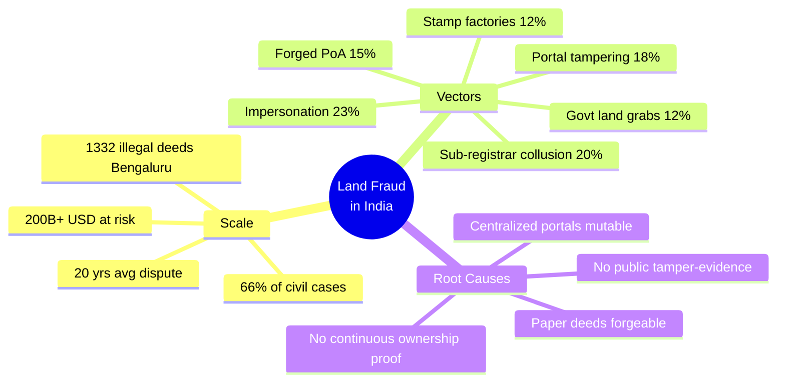

| Statistic | Source |
|---|---|
| `66%` of Indian civil cases are property disputes | *Sammiullah v. State of Bihar, Supreme Court, Nov 2025* |
| `1,332` illegal registrations in Bengaluru (Dec 2024–Dec 2025) | Kaveri 2.0 audit |
| `10,000+` suspicious transactions on Dharani | Telangana forensic audit |
| `$12.3B` global document fraud (2024), `+37% YoY` | Industry report |

---

## 2. Design Goals

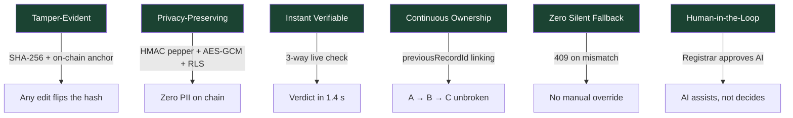

---

## 3. Solution Concept

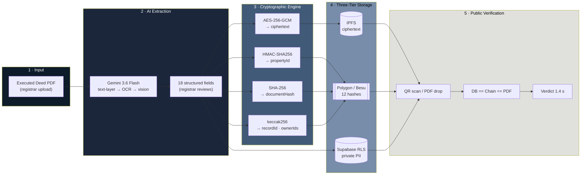

---

## 4. Actor Roles & Portal Surfaces

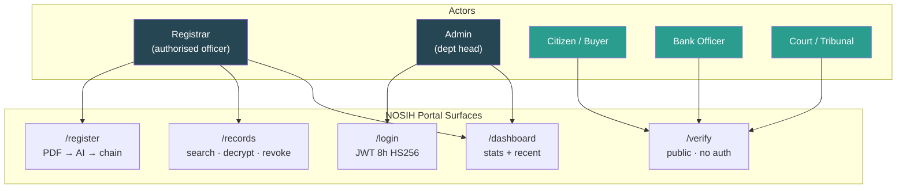

| Surface | Actor | Auth | Capability |
|---|---|---|---|
| `/register` | Registrar | JWT | Upload PDF · AI extract · preview Land ID · pin IPFS · write chain · issue QR |
| `/records` | Registrar | JWT | Search · decrypt verified deed · download QR · revoke fraudulent record |
| `/verify` | Public | None | Scan QR / drop PDF → 3-way live integrity check |
| `/dashboard` | Registrar | JWT | Real-time stats (parcels, records, transfers, revocations) |
| `/?tour=1` | Reviewer | None | 39-step interactive walkthrough |

---

## 5. End-to-End Registration Flow

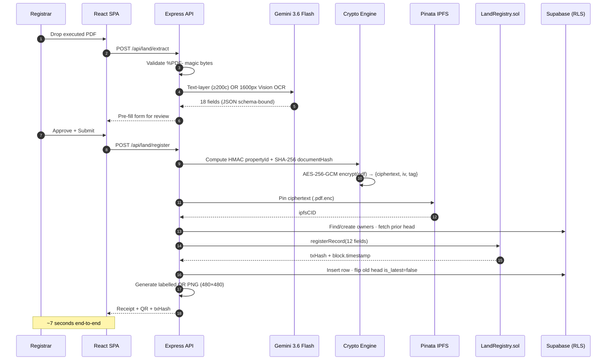

---

## 6. End-to-End Verification Flow

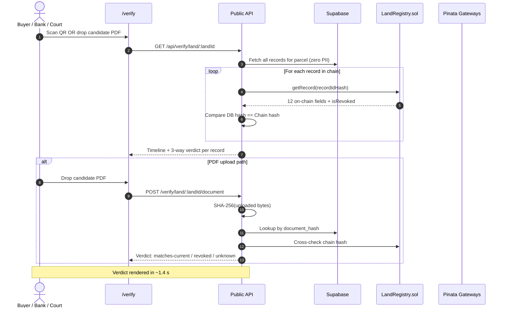

---

## 7. Three-Family Cryptographic Design

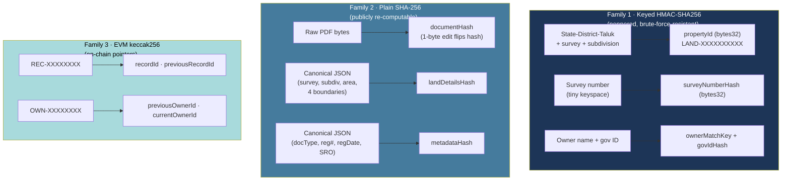

| Family | Algorithm | Used For | Why |
|---|---|---|---|
| **Keyed HMAC-SHA256** | `HMAC(HASH_PEPPER, label\|value)` | `propertyId`, `surveyNumberHash`, `ownerMatchKey` | Survey numbers (`1`, `2`, `123/4A`) come from a tiny keyspace — plain SHA-256 on a public chain could be brute-forced in seconds. The 256-bit pepper prevents enumeration. |
| **Plain SHA-256** | `SHA-256(canonicalJson)` | `documentHash`, `landDetailsHash`, `metadataHash` | Anyone holding the original PDF can hash it locally on `/verify` and confirm it matches `documentHash` without trusting the server. |
| **EVM keccak256** | `keccak256("REC-XXXXXXXX")` | On-chain record & owner pointers | Compact `bytes32` storage; deterministic pointers for chain traversal. |

---

## 8. Continuous Ownership Linking & Void-Transfer Rule

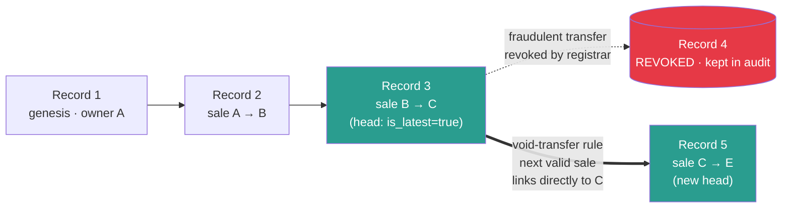

**Three invariants guarantee chain integrity:**

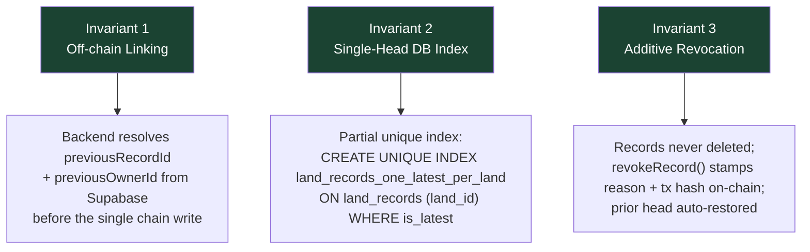

---

## 9. Three-Way Verification Engine

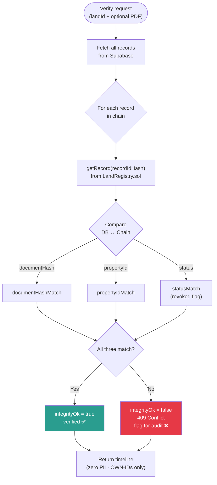

---

## 10. Design Principles

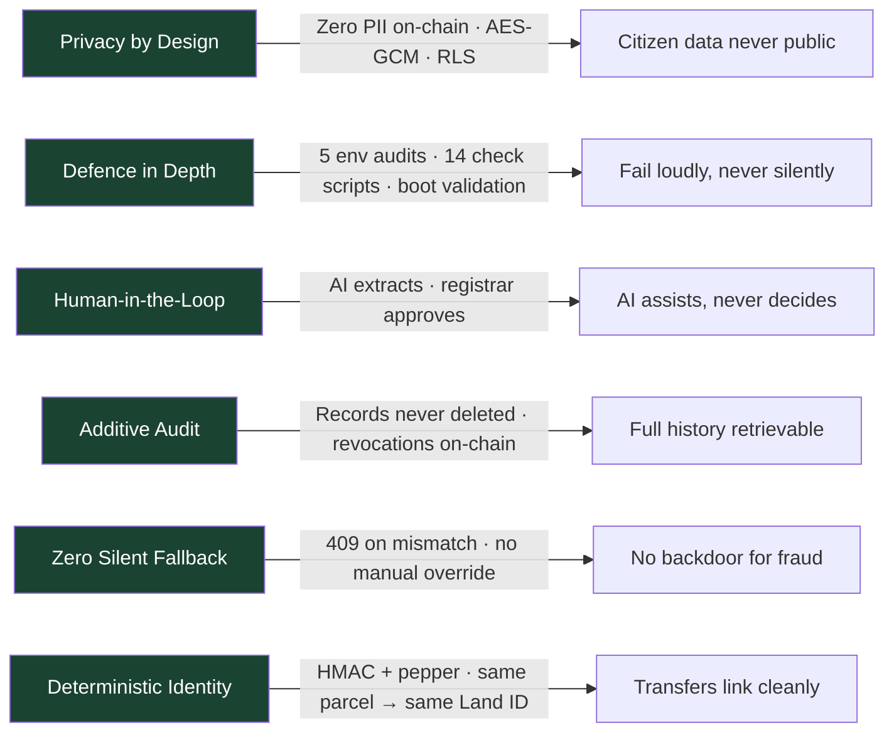

---

## 11. Priya vs Marco — Live Verification Race

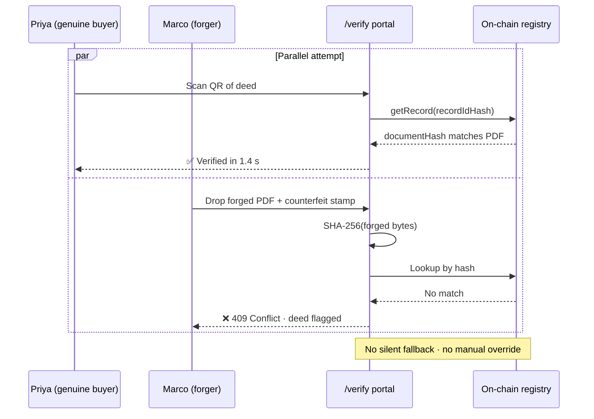

---

## 12. Solution Boundaries

| What NOSIH Does | What NOSIH Does NOT Do |
|---|---|
| Makes a registered deed **mathematically self-proving** in 1.4 s | Replace the legal registration process — registrars still approve |
| Anchor **SHA-256 + CID + ownership links** on-chain | Store plaintext PDFs, owner names, or survey numbers on-chain |
| Detect tampering via **3-way live integrity check** | Independently adjudicate civil disputes — it produces evidence, not verdicts |
| **Revoke** fraudulent records with audit trail | Delete history — every record (incl. revoked) remains queryable |
| Generate a **public QR** per parcel | Expose PII via the public API — `/verify` returns only `OWN-XXXXXXXX` IDs |
| Support **Polygon Amoy** today, **Hyperledger Besu QBFT** tomorrow | Mandate a single chain — the architecture is chain-agnostic by design |

---

**[Live App](https://nosih.vercel.app/)** · **[Public Verifier](https://nosih.vercel.app/verify)** · **[GitHub](https://github.com/rmn2178/nosih-secure)**

*Immutable Records. Verifiable Documents. Continuous Ownership.*

