

# NOSIH — Technical Architecture

### Three-Tier Cryptographic Storage · Single-Write Chain Anchor · 3-Way Live Verification

---

## 1. Architecture at a Glance (C4 Context)

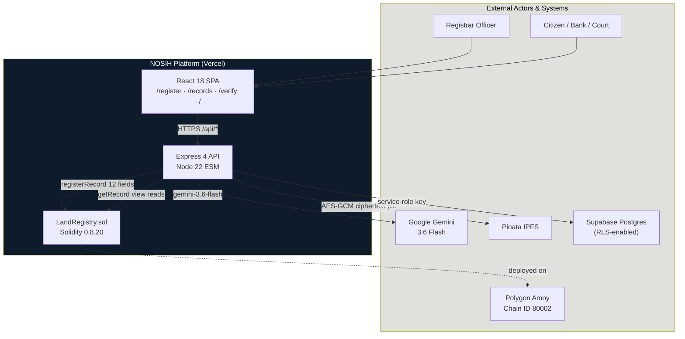

---

## 2. Three-Tier Storage Model

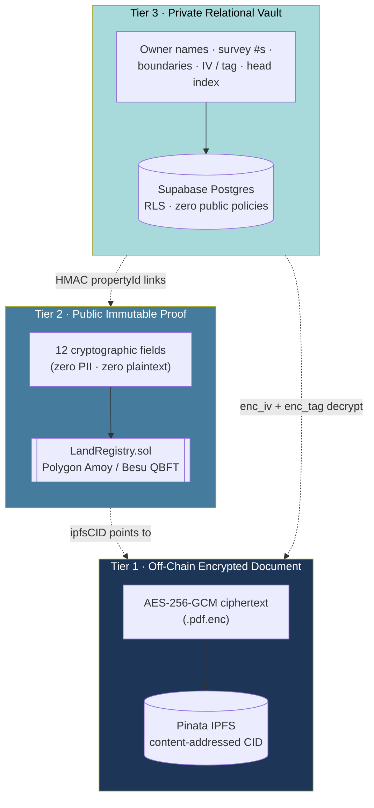

| Tier | Storage | Contents | Access |
|---|---|---|---|
| **T1 — Encrypted Document** | Pinata IPFS (5-gateway race on read) | `AES-256-GCM` ciphertext only | Public CID, but decryptable only via backend IV+tag |
| **T2 — Immutable Proof** | `LandRegistry.sol` on Polygon Amoy | 12 fields: 9× `bytes32` hashes + 1× `string` CID + 1× `uint256` timestamp | Free public reads via `getRecord()` |
| **T3 — Private Vault** | Supabase Postgres with RLS | Owner PII, survey #s, boundaries, IV, tag, head index | Service-role key only — anon key blocked |

---

## 3. Component Architecture

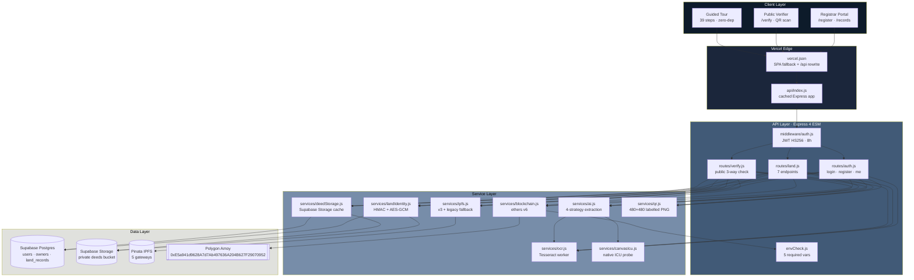

---

## 4. Module Dependency Graph (Backend)

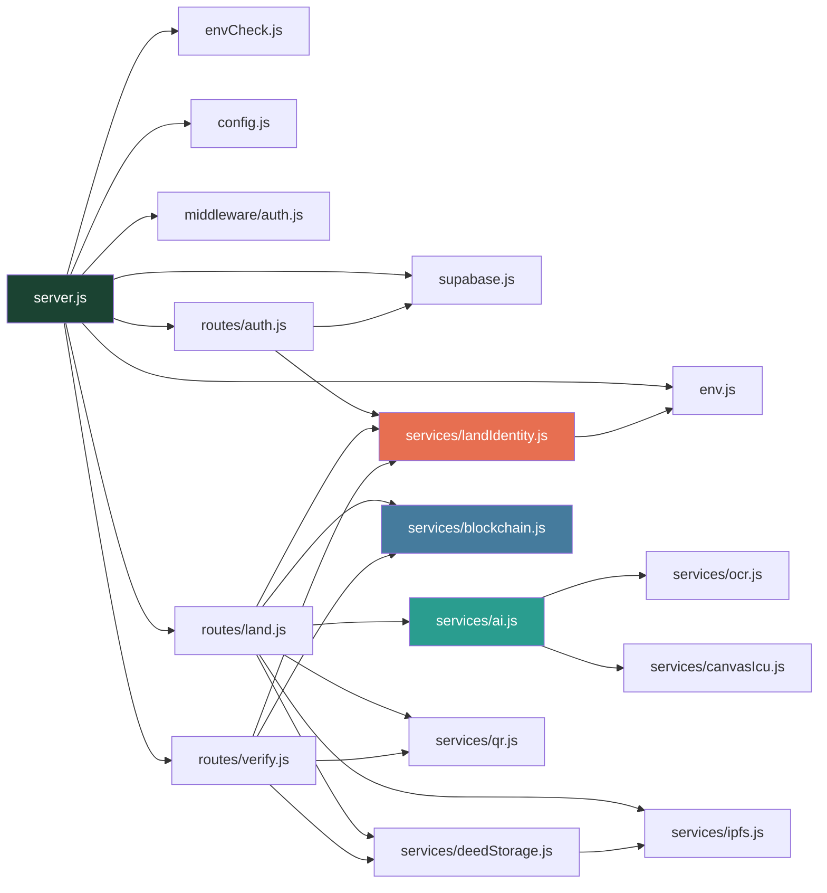

---

## 5. Database Schema (ERD)

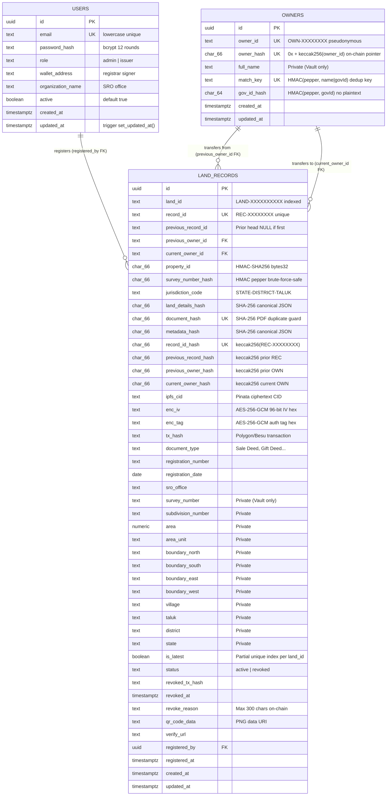

**Critical indexes:**
- `land_records_one_latest_per_land` — `UNIQUE(land_id) WHERE is_latest` → **one head per parcel invariant**
- `land_records_land_id_idx`, `survey_number_idx`, `current_owner_idx`, `created_at_idx`

**Row-Level Security:** enabled on all 3 tables with **zero public policies** → anon key reads nothing; backend service-role bypasses RLS.

---

## 6. Smart Contract Specification

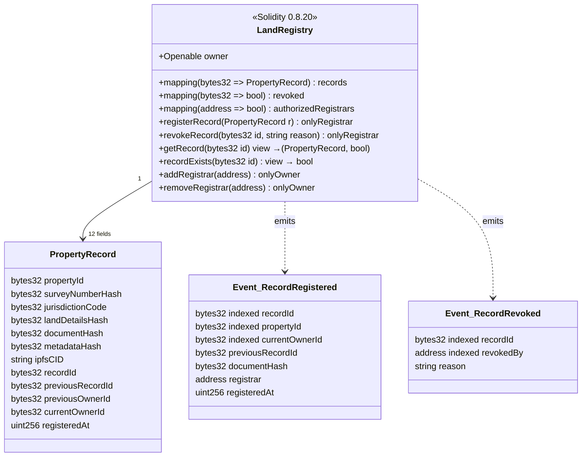

| Field | Type | Algorithm | PII? |
|---|---|---|---|
| `propertyId` | `bytes32` | HMAC-SHA256(pepper, jurisdiction\|survey\|subdiv) | No |
| `surveyNumberHash` | `bytes32` | HMAC-SHA256(pepper, jurisdiction\|survey) | No |
| `jurisdictionCode` | `bytes32` | `ethers.encodeBytes32String("STATE-DISTRICT-TALUK")` | No |
| `landDetailsHash` | `bytes32` | SHA-256(canonicalJSON) | No |
| `documentHash` | `bytes32` | SHA-256(raw PDF bytes) | No |
| `metadataHash` | `bytes32` | SHA-256(canonicalJSON) | No |
| `ipfsCID` | `string` | Pinata v3 CID of `AES-256-GCM` ciphertext | No (encrypted) |
| `recordId` | `bytes32` | keccak256("REC-XXXXXXXX") | No |
| `previousRecordId` | `bytes32` | keccak256(prior REC) or `0x0` | No |
| `previousOwnerId` | `bytes32` | keccak256(prior "OWN-XXXXXXXX") or `0x0` | No |
| `currentOwnerId` | `bytes32` | keccak256("OWN-XXXXXXXX") | No |
| `registeredAt` | `uint256` | `block.timestamp` (set by contract) | No |

**Deployment:** Polygon Amoy (Chain ID `80002`) · Address `0xE5a941d9628A7d7Ab497636A204B627F29070952` · Compiler Solidity `0.8.20` · OpenZeppelin `Ownable` + `onlyRegistrar` allowlist.

---

## 7. AI Extraction Pipeline (4-Strategy Chain)

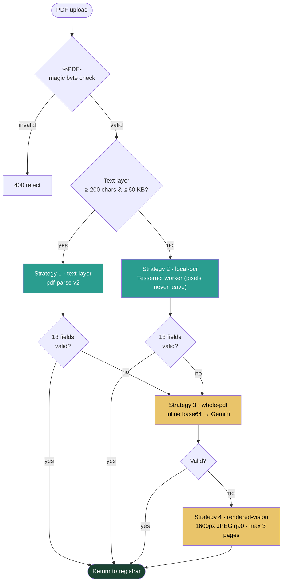

| Strategy | Tool | When Used | Privacy |
|---|---|---|---|
| **1 · text-layer** | `pdf-parse` v2 | Text layer exists (≥200 chars, ≤60 KB) | Bytes never leave server |
| **2 · local-ocr** | `Tesseract.js` worker | Scanned PDF, no text layer | Pixels never leave server |
| **3 · whole-pdf** | Gemini inlineData | Both above fail | Raw PDF sent to Gemini |
| **4 · rendered-vision** | `pdf-to-png-converter` + `sharp` + Gemini Vision | Strategy 3 fails | JPEG images sent to Gemini (max 3 pages) |

**Resilience:** `EXTRACTION_BUDGET_MS=120000` total deadline · `GEMINI_MAX_ATTEMPTS=3` exponential backoff (`750ms · 1.5s · 3s`) · transient (429/5xx/network) retries, fatal (400/401/403/404) short-circuits.

**18 extracted fields:** `sellerName, buyerName, surveyNumber, subdivisionNumber, area, areaUnit, boundaryNorth/South/East/West, village, taluk, district, state, documentType, registrationNumber, registrationDate, sroOffice`.

---

## 8. API Surface

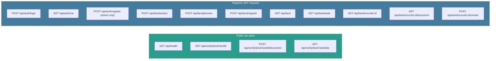

| Method | Endpoint | Auth | Purpose |
|---|---|---|---|
| `POST` | `/api/auth/login` | Public | bcrypt compare + JWT HS256 (8h) |
| `POST` | `/api/auth/register` | Admin JWT | bcrypt 12 rounds · create issuer/admin |
| `GET` | `/api/auth/me` | JWT | Current user profile |
| `POST` | `/api/land/extract` | JWT | Magic-byte check · 4-strategy AI extraction |
| `POST` | `/api/land/preview` | JWT | HMAC Land ID · preview head & chain depth |
| `POST` | `/api/land/register` | JWT | Encrypt · IPFS pin · chain write · DB mirror · QR |
| `GET` | `/api/land` | JWT | Paginated search (max 100) |
| `GET` | `/api/land/stats` | JWT | 5 counts (records · parcels · transfers · revoked · owners) |
| `GET` | `/api/land/records/:id` | JWT | Single record + parcel history (with owner joins) |
| `GET` | `/api/land/records/:id/document` | JWT | Decrypt + stream PDF + `X-Document-Hash-Match` header |
| `POST` | `/api/land/records/:id/revoke` | JWT | `revokeRecord` on-chain + restore prior head |
| `GET` | `/api/verify/land/:landId` | Public | 3-way integrity check · zero-PII timeline |
| `POST` | `/api/verify/land/:landId/document` | Public | SHA-256 uploaded PDF → lookup by hash |
| `GET` | `/api/verify/land/:landId/qr` | Public | 480×480 labelled QR PNG |
| `GET` | `/api/health` | Public | Boot audit · `200` ok or `503` degraded with problem list |

---

## 9. Frontend Architecture

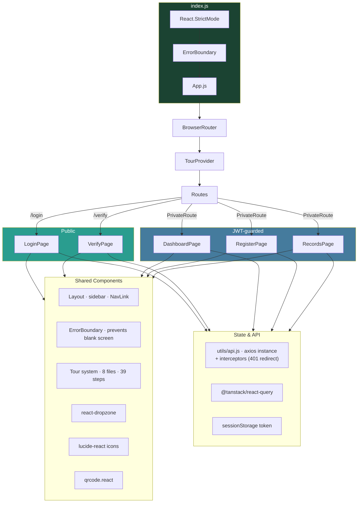

**Frontend design choices:**
- **Token in sessionStorage** (not localStorage) → cleared on tab close
- **Axios interceptor** → on 401 (except `/auth/login`) clears token + redirects to `/login`
- **ErrorBoundary at root** → prevents React 18 unmount-on-throw → no blank pages
- **Per-endpoint timeouts** — extract 90s · register 180s · revoke 120s · fetch 60s
- **`Array.isArray` + `typeof === "object"` defensive checks** → bad API shape never throws

---

## 10. Security Architecture

```mermaid
flowchart TB
    subgraph NET["Network Edge"]
        N1["Vercel WAF & DDoS"]
        N2["CORS allow-list<br/>FRONTEND_URL env"]
        N3["HTTPS only"]
    end

    subgraph APP_GUARD["Application Guard"]
        A1["Magic-byte PDF check<br/>not just mimetype"]
        A2["MAX_UPLOAD_MB<br/>4 MB on Vercel · 15 MB local"]
        A3["Joi schema validation<br/>per endpoint"]
        A4["Boot env audit<br/>5 required vars"]
    end

    subgraph AUTH["Auth & Identity"]
        AU1["bcrypt 12 rounds"]
        AU2["JWT HS256 8h"]
        AU3["protect + adminOnly middleware"]
        AU4["authorizedRegistrars allowlist<br/>on-chain onlyRegistrar"]
    end

    subgraph CRYPTO["Cryptographic Layer"]
        CR1["HMAC-SHA256 + HASH_PEPPER<br/>64-hex / 32-byte secret"]
        CR2["AES-256-GCM<br/>DOCUMENT_ENC_KEY 32-byte"]
        CR3["keccak256 for on-chain pointers"]
        CR4["SHA-256 for verifiable docs"]
    end

    subgraph DATA["Data Protection"]
        D1["Supabase RLS<br/>zero public policies"]
        D2["Service-role key only<br/>never exposed to browser"]
        D3["PII columns blacklisted<br/>from /verify response"]
        D4["Encrypted PDF in IPFS<br/>plaintext never pinned"]
    end

    NET --> APP_GUARD --> AUTH --> CRYPTO --> DATA

    style NET fill:#0d1b2a,color:#fff
    style APP_GUARD fill:#1b263b,color:#fff
    style AUTH fill:#415a77,color:#fff
    style CRYPTO fill:#778da9,color:#000
    style DATA fill:#e0e1dd,color:#000
```

---

## 11. Deployment Topology

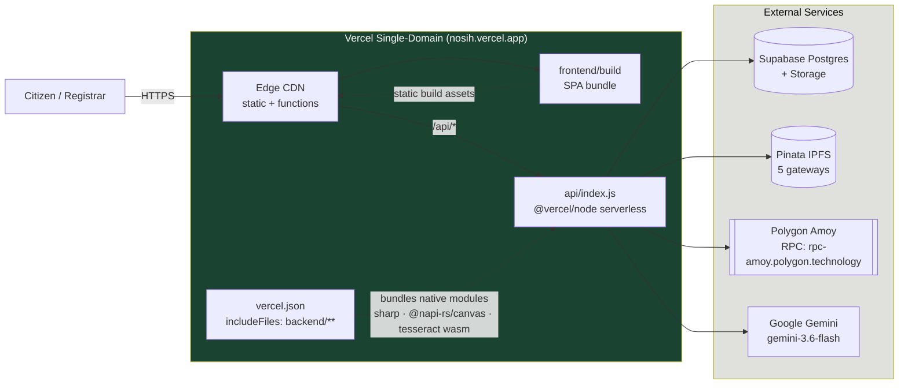

**Vercel-specific engineering:**
- `vercel.json` `includeFiles: "backend/**"` → bundles native modules (`sharp`, `@napi-rs/canvas`, Tesseract WASM) with the serverless function
- `api/index.js` caches the Express app promise → loaded once per warm instance
- No `process.exit()` at boot → misconfig reports via `/api/health` instead of opaque `FUNCTION_INVOCATION_FAILED`
- `keepIcuDataInTheBundle()` + `keepCoreInTheBundle()` → literal `require()` specifiers (not in loops) so Vercel's file tracer follows them
- SPA fallback rewrite `/(.*) → /index.html` + API rewrite `/api/(.*) → /api/index.js`

---

## 12. Data Flow — Registration (Single-Write Anchor)

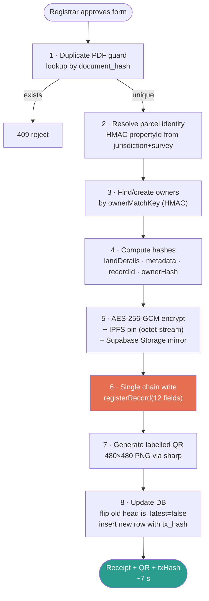

**Failure recovery:** if DB insert fails *after* chain write succeeds → old head is restored, response returns `500` with `{recordId, txHash}` so the registrar can manually reconcile.

---

## 13. Data Flow — Verification (3-Way Live Check)

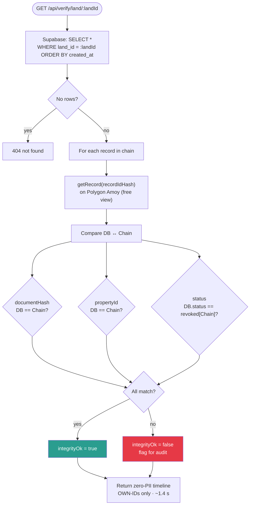

---

## 14. Resilience & Failure Modes

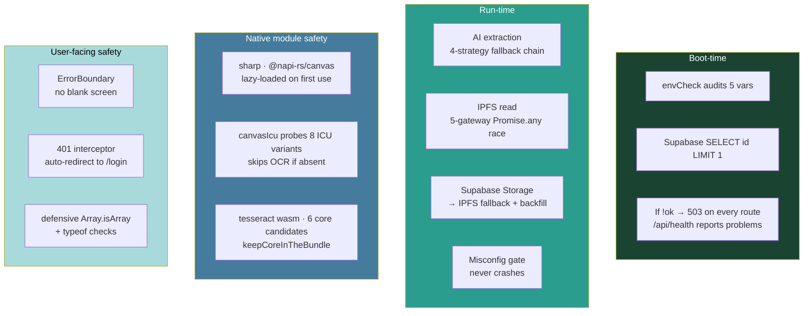

---

**[Live App](https://nosih.vercel.app/)** · **[Public Verifier](https://nosih.vercel.app/verify)** · **[GitHub](https://github.com/rmn2178/nosih-secure)**

*Three tiers. One hash. Verifiable forever.*

